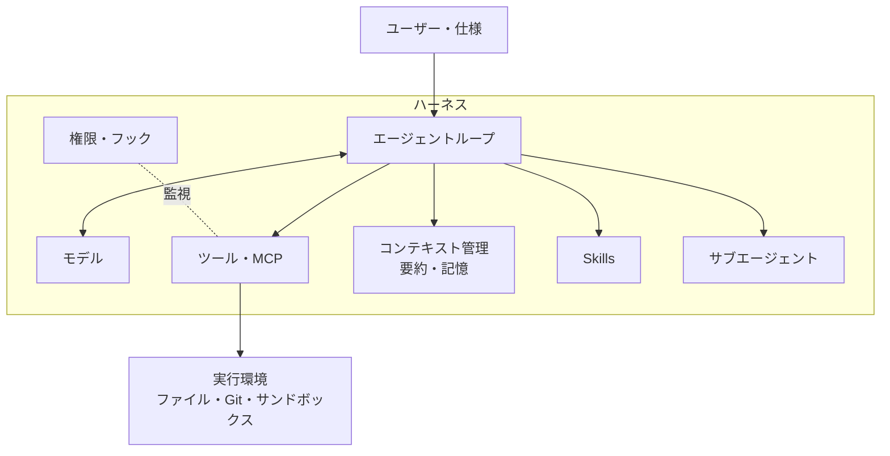

**ハーネス（harness）** は、モデルの周りで動くソフトウェアの仕組み全体を指します。
Anthropic の定義では「ループ・ツール・コンテキスト管理・ガードレール」から成る足場（scaffolding）です。
Addy Osmani 氏は **「エージェント = モデル + ハーネス」** と表現し、モデル以外のコード・設定・実行の仕組みはすべてハーネスだとしています。

同じモデルでも、ハーネスによって結果は大きく変わります。
Osmani 氏の記事では、ハーネスだけを変えてコーディングエージェントのベンチマーク順位を上位 30 位から上位 5 位に上げた例が紹介されています。

## ハーネスの構成要素

| 構成要素 | 中身 | Claude Code での例 |
| --- | --- | --- |
| 指示 | システムプロンプト、プロジェクト共通の決まり | `CLAUDE.md`・`AGENTS.md` |
| ツール | エージェントが実行できる操作と、その説明文 | bash・ファイル編集・MCP サーバ |
| 手順の部品 | 必要なときだけ読み込む手順書 | [Skills](/ai-tech-notes/agents/skills/) |
| 実行環境 | ファイルシステム・サンドボックス・ブラウザ | 作業ディレクトリ・Git worktree |
| オーケストレーション | 別のエージェントへの委任、モデルの使い分け | [サブエージェント](/ai-tech-notes/agents/subagents/) |
| フック | 特定のタイミングで必ず実行されるスクリプト | Stop・PreToolUse・PostToolUse フック |
| コンテキスト管理 | 要約（コンパクション）・古いツール結果の削除・記憶 | 自動コンパクト・メモリファイル |
| 権限・ガードレール | 許可する操作、確認を求める操作 | `permissions` の allow / deny、権限モード |
| 観測 | ログ・トレース・費用の計測 | セッションの記録・OpenTelemetry による計測 |

## Anthropic の 3 つのパターン

Anthropic は 2026 年 4 月の記事で、ハーネス設計の 3 つのパターンを示しています。
前提にあるのは、**ハーネスは「モデルが自分ではできないこと」の思い込みを埋め込んだもので、モデルが賢くなるとその思い込みは古くなる** という考え方です。

### 1. モデルが知っている道具に乗る

専用ツールを増やすより、モデルが使い慣れた **bash とテキストエディタ** を土台にします。
2024 年末には、Claude 3.5 Sonnet がこの 2 つのツールだけで SWE-bench Verified の 49% を解きました。
Skills やメモリ機能も、実体はこの 2 つの組み合わせ（ファイルを読む・書く・スクリプトを実行する）です。

### 2. ハーネスを削る

「人が作り込んでいた処理のうち、やめられるものは何か」を問います。

| 任せること | やり方 | 報告されている効果 |
| --- | --- | --- |
| 処理の組み立て | コードを実行させ、途中のツール結果ではなく **最終結果だけ** を文脈に戻す | Opus 4.6 が自分でツール出力を絞り込むと、BrowseComp が 45.3% → 61.6% |
| コンテキストの整理 | Skills を必要なときだけ読む（段階的な読み込み）。古いツール結果を消す。別作業はサブエージェントに分ける | サブエージェントの利用で BrowseComp が単体の最良値より +2.8 ポイント |
| 記憶の維持 | 要約（コンパクション）と、エージェントが読み書きするメモリフォルダ | Sonnet 4.5 にメモリフォルダを持たせると 60.4% → 67.2% |

同じ記事では、Sonnet 4.5 はコンテキストの上限に近づくと作業を早めに切り上げる傾向があり、そのためにリセット処理を足していたものの、
Opus 4.5 ではその傾向が消え、リセット処理は「無駄な重り」になったと書かれています。
**モデルが新しくなるたびに、ハーネスの各部品がまだ必要かを確かめ直す** ことが大切です。

### 3. 境界は慎重に引く

| 観点 | 設計の指針 |
| --- | --- |
| キャッシュ | 固定部分を先頭、変わる部分を末尾に置く。途中の更新はプロンプトを書き換えずメッセージとして追加する。セッション途中でモデルを変えない（安いモデルを使うならサブエージェントに分ける） |
| ツールの数 | すべてのツールを最初から並べず、ツール検索で必要なものだけ見せる |
| 専用ツール | 安全・使いやすさ・監査が必要な操作は、bash で済ませず専用ツールにする。引数が型で分かれていれば、ハーネスが確認・表示・記録・再実行できる |
| 取り返しのつかない操作 | 削除や外部への送信などは、ユーザーの確認を必須にする |

キャッシュされた入力トークンは通常の 10% の料金なので、並べ方の設計はそのままコストに効きます（→ [コンテキストとキャッシュ](/ai-tech-notes/rag/context-and-caching/)）。

## 長時間タスクのハーネス

1 つのコンテキストに収まらない大きな作業では、エージェントは「引き継ぎなしで交代するシフト勤務」のような状態になります。
Anthropic は 2025 年 11 月の記事で、要約（コンパクション）だけでは足りないとして、次の構成を示しました。

| 役割 | いつ動くか | やること |
| --- | --- | --- |
| 初期化エージェント | 最初の 1 回 | 起動スクリプト `init.sh`、進捗ログ `claude-progress.txt`、機能一覧を作り、最初のコミットをする |
| コーディングエージェント | 2 回目以降の毎回 | 進捗ログと Git の履歴を読み、未完了の機能を **1 つだけ** 実装・検証し、コミットして進捗を書き残す |

この構成で防いでいる失敗は次のとおりです。

| 失敗 | 対策 |
| --- | --- |
| 一度に全部作ろうとして、途中でコンテキストが尽きる | 1 回の作業は機能 1 つに限る |
| 前の回の進捗を見て「もう完成した」と判断する | 機能一覧に合否欄を持たせ、未完了の機能を明示する |
| テストせずに完了扱いにする | ブラウザ自動操作などで、利用者と同じ操作で確かめてから合格にする |
| 毎回、アプリの起動方法を調べ直す | 起動手順を `init.sh` にまとめる |

機能一覧は Markdown ではなく **JSON** で書かれています。
モデルが JSON を勝手に書き換えにくいためで、エージェントには合否欄（`passes`）以外の変更を禁じています。
これは [ループエンジニアリング](/ai-tech-notes/agents/loop-engineering/) の「進捗はファイルに残す」「作る側と確かめる側を分ける」と同じ考え方です。

## コンテキスト管理の手法

Anthropic の 2025 年 9 月の記事（コンテキストエンジニアリング）では、トークンが増えるほど想起の精度が落ちる **コンテキストの劣化（context rot）** を前提に、
「望む結果を得られる、最小で情報密度の高いトークンの集合」を目指すとしています。

| 手法 | 内容 | 向く作業 |
| --- | --- | --- |
| コンパクション | 上限が近づいたら会話を要約して始め直す。最も軽い形は古いツール結果の削除 | 長いやり取りが続く作業 |
| 構造化メモ | `NOTES.md` や TODO リストなど、コンテキストの外に記録を残す | 区切りのある反復的な開発 |
| サブエージェント | 別のコンテキストで調査させ、要約（多くは 1,000〜2,000 トークン）だけを受け取る | 並行して進められる調査 |
| 必要なときに読む | ファイルパスやリンクだけを持っておき、必要になったらツールで読む | 大きなコードベースや文書群 |

Claude Code では、`CLAUDE.md` は最初から文脈に入り、それ以外のファイルは glob や grep で必要なときに読み込まれます。
これは [RAG](/ai-tech-notes/rag/) のように事前に検索して渡すのではなく、エージェント自身が探す方式です。

## 失敗をハーネスに反映する

Osmani 氏は、エージェントが失敗したときは **モデルではなくハーネスを直す** ことを勧めています。

- **失敗 1 つにつき、仕組みを 1 つ足す。** `CLAUDE.md` に規則を足す、危険な操作を止めるフックを足す、型チェックを必須にする、など。
- **良い `CLAUDE.md` の各行は、実際に起きた失敗にたどれる。** 想像で規則を書き足すと長くなるだけです。短く保ちます。
- **モデルが進歩して不要になった仕組みは外す。** 足すだけのハーネスは重くなります。
- **成功は静かに、失敗は詳しく。** フックは成功時に何も出力せず、失敗時だけ理由を返すと、文脈を汚しません。

:::caution[ツールの説明文も指示になる]
MCP サーバなどのツールの説明文は、そのままモデルへの指示として文脈に入ります。
信頼できないサーバをつなぐことは、信頼できない指示を読ませることと同じです（→ [MCP サーバ設計](/ai-tech-notes/mcp/server-design/)）。
:::

## Claude Code での対応表

| やりたいこと | 使う仕組み |
| --- | --- |
| プロジェクトの決まりを毎回守らせる | `CLAUDE.md` |
| 長い手順書を必要なときだけ読ませる | [Skills](/ai-tech-notes/agents/skills/) |
| 調査やレビューを本体の文脈から切り離す | [サブエージェント](/ai-tech-notes/agents/subagents/) |
| 必ず実行したい検査（テスト・lint）や、禁止したい操作 | フック（PreToolUse・PostToolUse・Stop） |
| 検証が通るまで作業を続けさせる | `/goal`・Stop フック（→ [ループエンジニアリング](/ai-tech-notes/agents/loop-engineering/)） |
| 外部のデータやサービスにつなぐ | MCP サーバ（→ [MCP 活用](/ai-tech-notes/mcp/)） |
| 操作の範囲を絞る | `permissions` の allow / deny、権限モード |
| 自分のアプリにエージェントを組み込む | Claude Agent SDK / Claude Managed Agents |

## 設計チェックリスト

- [ ] `CLAUDE.md` は短く、各規則が実際の失敗に基づいているか
- [ ] 長い手順書は `CLAUDE.md` に直接書かず、Skill に分けているか
- [ ] 調査など出力の多い作業は、サブエージェントに分けているか
- [ ] 必ず守らせたい検査は、指示ではなく **フック** で強制しているか
- [ ] 進捗と状態が **ファイルと Git** に残り、新しいセッションで再開できるか
- [ ] 取り返しのつかない操作に、確認や禁止の設定があるか
- [ ] 文脈の先頭に固定部分を置き、キャッシュが効く並べ方になっているか
- [ ] モデルを更新したとき、不要になった仕組みを見直しているか

## 参考・出典

- [Agent Harness Design: 3 Patterns for Harnessing Claude's Intelligence](https://claude.com/resources/articles/harnessing-claudes-intelligence) — Anthropic（2026-04-02）
- [Effective harnesses for long-running agents](https://www.anthropic.com/engineering/effective-harnesses-for-long-running-agents) — Anthropic（2025-11-26）
- [Effective context engineering for AI agents](https://www.anthropic.com/engineering/effective-context-engineering-for-ai-agents) — Anthropic（2025-09-29）
- [Agent Harness Engineering](https://addyosmani.com/blog/agent-harness-engineering/) — Addy Osmani（2026-04-19）
- [Building effective agents](https://www.anthropic.com/engineering/building-effective-agents) — Anthropic
