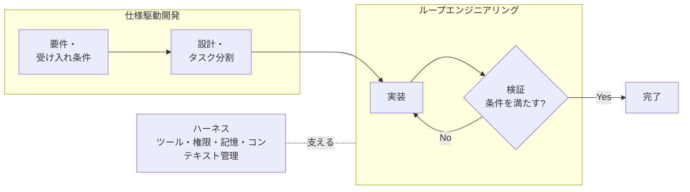

2026 年、AI を使った開発の中心は「1 回ずつ指示して、結果を見て、また指示する」対話から、
**仕様を渡し、検証できる条件を決め、エージェントに自走させる** 進め方に移りつつあります。
この章では、ナレッジ AI システムを作る・改善するときにも使える、その進め方を整理します。

## 3 つの考え方

| 考え方 | 一言でいうと | 決めること | 詳細 |
| --- | --- | --- | --- |
| 仕様駆動開発（SDD） | **何を作るか** を先に文書にする | 要件・受け入れ条件・設計・タスク | [仕様駆動開発](/ai-tech-notes/agents/spec-driven/) |
| ループエンジニアリング | **終わるまで回す** 仕組みを作る | ゴール・判定シグナル・停止条件 | [ループエンジニアリング](/ai-tech-notes/agents/loop-engineering/) |
| ハーネス設計 | エージェントの **周りの仕組み** を作る | ツール・コンテキスト管理・権限・記憶 | [ハーネス設計](/ai-tech-notes/agents/harness/) |

3 つは別々の流行語ではなく、1 つの流れの各部分です。
**仕様の受け入れ条件** が **ループの停止条件** になり、その両方を **ハーネス** が支えます。

ハーネスの部品のうち、特によく使う 2 つは別のページで詳しく扱います。

| 部品 | 一言でいうと | 詳細 |
| --- | --- | --- |
| Skills | 必要なときだけ読み込まれる **手順書** | [Skills](/ai-tech-notes/agents/skills/) |
| サブエージェント | 別の文脈で作業し、**結果だけを返す担当者** | [サブエージェント](/ai-tech-notes/agents/subagents/) |

## ハーネスとは

ハーネス（harness）は、モデルの周りで動くソフトウェアの仕組み全体を指します。
エージェントを動かす **ループ・ツール・コンテキスト管理・ガードレール** がこれに当たります。
Claude Code や Claude Managed Agents は、Anthropic が用意したハーネスの代表例です。

Anthropic は 2026 年 4 月の記事で、ハーネス設計の 3 つのパターンを示しています。

| パターン | 内容 | 例 |
| --- | --- | --- |
| モデルが知っている道具に乗る | 専用ツールを増やすより、モデルが使い慣れた道具を組み合わせる | bash・テキストエディタ。Skills やメモリもこれらの組み合わせ |
| ハーネスを削る | 「人が作り込んでいた処理のうち、やめられるものは何か」を問う | コード実行で結果だけを文脈に戻す。コンテキストの整理・要約・記憶をモデル自身に任せる |
| 境界は慎重に引く | キャッシュが効く文脈の並べ方や、権限・監視の境界を意図して設計する | 固定部分を先頭に置く、セッション途中でモデルを変えない |

同じ記事では、Sonnet 4.5 に **メモリフォルダを持たせただけで** 調査タスクの正答率が 60.4% → 67.2% に上がったと報告されています。
「プロンプトを工夫する」より「エージェントの置かれた環境を整える」ほうが効く、というのが 2026 年の共通認識です。
→ 詳細は [ハーネス設計](/ai-tech-notes/agents/harness/)、メモリは [エージェントメモリと RAG](/ai-tech-notes/rag/agent-memory/)

## ナレッジ AI 開発での使いどころ

この章の考え方は、コードを書く場面だけでなく、このサイトで扱うナレッジ AI システムの改善にもそのまま使えます。

| 作業 | 仕様（何を満たすか） | ループ（何で確かめるか） |
| --- | --- | --- |
| チャンク分割の改善 | 「評価セットの正答率 85% 以上、平均トークン数は現状以下」 | 評価スクリプトを実行し、結果を出力 |
| データソースの取り込み | 「全ページに必須メタデータが付く」「重複版が 0 件」 | 検証スクリプトでメタデータと重複を検査 |
| MCP サーバの実装 | ツールの入出力仕様、エラー時の振る舞い | 単体テスト・契約テストの通過 |
| 回答テンプレートの改善 | 「出典が必ず付く」「禁止表現を含まない」 | レビュー用エージェントや規則チェックで判定 |

:::tip[まず「検証できる条件」を書く]
どの作業でも、最初に決めるべきは **機械的に確かめられる完了条件** です。
条件が書ければ、仕様にもループの停止条件にもなります。逆に、条件が書けない作業は、まだエージェントに丸投げできる段階ではありません。
:::

## 参考・出典

- [Agent Harness Design: 3 Patterns for Harnessing Claude's Intelligence](https://claude.com/resources/articles/harnessing-claudes-intelligence) — Anthropic（2026-04-02）
- [Agent Harness Engineering](https://addyosmani.com/blog/agent-harness-engineering/) — Addy Osmani
- [Building effective agents](https://www.anthropic.com/engineering/building-effective-agents) — Anthropic
