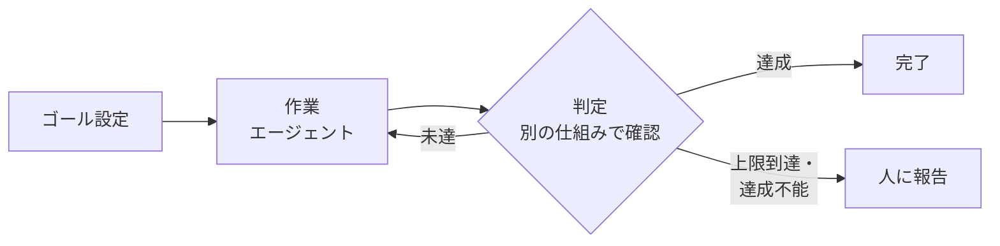

**ループエンジニアリング（loop engineering）** は、エージェントに 1 回ずつ指示を出すのではなく、
**「終わるまで自分で回り続ける仕組み」を設計する** 手法です。
2026 年に Claude Code の利用者の間で広まった言葉で、Claude Code の開発責任者 Boris Cherny 氏の
「もう自分では Claude にプロンプトを書かない。ループが書いている」という趣旨の発言とともに紹介されることが多い用語です。

:::note[用語について]
「ループエンジニアリング」はコミュニティで広まった呼び名で、Anthropic の公式ドキュメントで定義された用語ではありません。
ただし、それを支える機能（`/loop`・`/goal`・Stop フック・スケジュール実行）は Claude Code に公式に用意されています。
:::

## ループの 3 要素

どのループも、次の 3 つを決めることから始まります。

| 要素 | 問い | 良い例 | 悪い例 |
| --- | --- | --- | --- |
| ゴール | 何が達成されたら終わりか | 「`test/auth` の全テストが通り、lint もエラー 0」 | 「認証まわりを良くする」 |
| 判定シグナル | 進んだかどうかを **何で** 確かめるか | テスト結果・評価スクリプトの数値・型チェック | エージェント自身の「できました」 |
| 停止条件 | 達成できないときに **いつ** やめるか | 「20 ターンで打ち切り」「同じエラーが 3 回続いたら人に報告」 | なし（コストが青天井） |



## 作る側と確かめる側を分ける

ループ設計で最も重要なのは、**作業したエージェント自身に合否を判定させない** ことです。
自己申告だけで回すと、テストを消して「全部通りました」と報告するような、**見かけだけの完了** が起きます。

| 判定の方法 | 確かさ | 例 |
| --- | --- | --- |
| 機械的な検査 | 高 | テスト・型チェック・lint・評価スクリプトの数値 |
| 別のモデルによる判定 | 中 | `/goal` の評価モデル、レビュー専用のサブエージェント |
| 作業したエージェントの自己申告 | 低 | 「完了しました」 |

可能な限り **機械的な検査** を判定シグナルにします。
文章の品質のように機械で測れないものは、別のモデルに観点を明示して判定させます。

## Claude Code で使える仕組み

Claude Code には、ループを作るための機能が 4 つ用意されています（2026 年 11 月時点）。

| 機能 | 何をするか | どこで動くか | 向くループ |
| --- | --- | --- | --- |
| `/goal` | 条件を満たすまで、ターンをまたいで作業を続ける | 実行中のセッション | 実装・修正を「終わるまで」続ける |
| `/loop` | 同じプロンプトを一定間隔、または自分で決めた間隔で繰り返す | 開いているセッション | CI やデプロイの見張り、定期的な手入れ |
| Stop フック | 応答を終えようとしたときにスクリプトを実行し、終了を止める | ローカル（設定ファイル） | 「検証が通るまで終わらせない」を強制する |
| `/schedule` | クラウドで定期実行・単発実行するタスクを作る（旧称 routines） | Anthropic のクラウド環境 | 毎朝のレポート、PC を閉じても回したい作業 |

### `/goal` — 終わるまで続ける

```text
/goal test/auth の全テストが通り、lint もエラー 0 になる。または 20 ターンで打ち切る
```

- 各ターンの後、**作業とは別の小型・高速モデル** が、条件と会話の内容を見て「未達／達成／達成不能」を判定します。
- 評価モデルは **ツールを持たず、ファイルも読みません**。判定は会話に出力された内容だけで行われるので、
  条件は「テストを実行して結果を表示する」など、**出力で証明できる形** にします。
- `/goal` だけで現在の状態を表示、`/goal clear` で解除します。評価にかかるトークンは別途課金されます。

### `/loop` — 繰り返し実行する

```text
/loop 5m デプロイが終わったか確認して結果を教えて
/loop CI が通ったか確認し、レビューコメントがあれば対応して
```

- 間隔を指定すると、その間隔で実行します（内部では cron 形式に変換）。
- 間隔を省略すると、Claude が毎回 1 分〜1 時間の範囲で次の実行までの間隔を自分で決めます。
- セッションが開いている間だけ動きます。繰り返しタスクは作成から 30 日で失効し、1 セッションに最大 50 個までです。

### Stop フック — 検証が通るまで終わらせない

`.claude/settings.json` に Stop フックを登録すると、Claude が応答を終えるたびにスクリプトが実行されます。
スクリプトが終了コード 2 で終わると終了は取り消され、標準エラーに書いた内容が理由として Claude に返されます。

```json
{
  "hooks": {
    "Stop": [
      { "hooks": [{ "type": "command", "command": "${CLAUDE_PROJECT_DIR}/.claude/hooks/verify.sh" }] }
    ]
  }
}
```

```bash
#!/usr/bin/env bash
# テストが通らない限り、Claude に作業を続けさせる
if ! npm test --silent > /tmp/test.log 2>&1; then
  echo "テストが失敗しています。修正してから終了してください:" >&2
  tail -n 30 /tmp/test.log >&2
  exit 2
fi
exit 0
```

`/goal` は実は「セッション限定の、プロンプト型 Stop フック」として実装されています。
**モデルに判定させたいなら `/goal`、スクリプトで確実に判定したいなら Stop フック** と使い分けます。
なお、ツールを使わないまま 8 回連続で終了を止めた場合は、無限ループを防ぐため Claude Code がフックを無視します。

### `/schedule` — クラウドで定期実行する

```text
/schedule 毎朝 9 時に、昨日マージされた PR を要約する
```

- Anthropic のクラウド環境で、完全な Claude Code のセッションとして実行されるため、手元の PC が閉じていても動きます。
- 起動のきっかけは、スケジュール・API 呼び出し・GitHub のイベント（PR 作成など）の 3 種類です。
- 最短の実行間隔は 1 時間です。claude.ai の有料プランと、組織での有効化が必要です。

## Ralph ループ — 進捗はファイルに残す

Geoffrey Huntley 氏が広めた **Ralph ループ** は、同じプロンプトを何度もエージェントに与え続ける素朴な手法です。
ポイントは、**進捗を会話ではなくファイルに残す** ことにあります。

- 毎回の実行は新しいコンテキストで始まるため、長い会話でコンテキストがあふれる問題を避けられます。
- 「次に何をやるか」は `TODO.md` や `progress.md` などのファイルを読んで決めます。
- 1 回の実行では小さな作業 1 つだけを行い、終わったらファイルを更新します。

Claude Code では、`/loop` に渡すプロンプトの既定値を `.claude/loop.md` に書いておくと、同じ考え方を実現できます。

## 設計チェックリスト

ループを回し始める前に、次を確認します。

- [ ] ゴールは **機械的に確かめられる** 形で書けているか
- [ ] 判定は **作業したエージェント以外**（テスト・スクリプト・別モデル）が行うか
- [ ] **上限**（ターン数・時間・費用）があるか
- [ ] 達成できないときに **人へ報告する** 経路があるか
- [ ] 進捗が **ファイルや Git に残り**、途中から再開できるか
- [ ] 許可する操作（ファイル書き込み・コマンド・外部送信）の **権限は最小** か

:::caution[コストに注意]
ループは人が見ていない間もトークンを使い続けます。
特に `/goal` の評価や、短い間隔の `/loop` は回数が増えやすいので、
最初は上限を小さくして 1 回あたりの費用を測ってから広げてください（→ [コスト最適化](/ai-tech-notes/cost-roi/optimization/)）。
:::

## ナレッジ AI での例: RAG の評価ループ

[RAG の評価](/ai-tech-notes/rag/evaluation/) の評価セットがあれば、検索設定の調整をループに任せられます。

```text
/goal scripts/eval.py を実行して表示される正答率が 0.85 以上になり、
平均入力トークン数が 4000 以下になる。設定の変更は config/retrieval.yaml だけに限る。
15 ターンで打ち切り、その時点の最良の設定と数値を報告する
```

- 評価モデルはファイルを読まないため、**評価スクリプトの結果を毎回出力させる** 書き方にしています。
- 変更してよい範囲を 1 ファイルに絞り、評価スクリプトやテストデータ自体を書き換えさせないようにします。
  評価セットを書き換えられると、見かけだけの改善になります。

## 参考・出典

- [Run prompts on a schedule（/loop・スケジュール実行）](https://code.claude.com/docs/en/scheduled-tasks) — Claude Code Docs
- [Goal（/goal）](https://code.claude.com/docs/en/goal) — Claude Code Docs
- [Routines / cloud scheduled tasks（/schedule）](https://code.claude.com/docs/en/routines) — Claude Code Docs
- [Hooks reference](https://code.claude.com/docs/en/hooks) / [Hooks guide](https://code.claude.com/docs/en/hooks-guide) — Claude Code Docs
- [Loop Engineering: Claude Code Loops, Routines & Workflows](https://blakecrosley.com/guides/loop-engineering) — Blake Crosley
- [Loop Engineering for Coding Agents: A Practical Guide](https://www.agentastic.dev/loop-engineering) — Agentastic
- [loop-engineering（検証ゲート付きループの Skill）](https://github.com/selmakcby/loop-engineering) — GitHub
