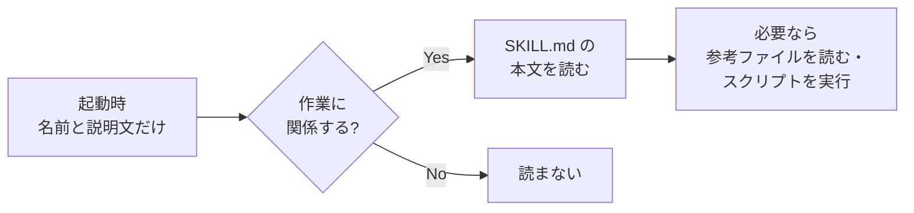

**Skill（Agent Skills）** は、エージェントに特定の作業のやり方を教える **手順書のフォルダ** です。
`SKILL.md` に手順を書いて置くだけで、Claude は関係する作業のときに自分で読み込んで使います。
`/skill-name` と入力して、人が直接呼び出すこともできます。

Skills は [Agent Skills](https://agentskills.io) というオープンな仕様に沿っており、Claude Code・Claude アプリ・Claude API で使えます。
Claude Code はこれに、呼び出し方の制御、サブエージェントでの実行、コマンド結果の埋め込みなどの機能を足しています。

## CLAUDE.md との違い — 必要なときだけ読む

最大の特徴は、**本文が使うときにしか読み込まれない** ことです。

| | `CLAUDE.md` | Skill |
| --- | --- | --- |
| 読み込み | 毎回、最初から全文 | 普段は名前と説明文だけ。使うときに本文を読む |
| 向く内容 | 全作業に共通する短い決まり | 特定の作業の手順・長い参考資料・スクリプト |
| 長さの影響 | 長いほど毎回のトークンが増える | 使うまでほぼコストがかからない |



この段階的な読み込み（progressive disclosure）は、[ハーネス設計](/ai-tech-notes/agents/harness/) の「コンテキストの整理をモデルに任せる」パターンの代表例です。

## フォルダ構成

```text
my-skill/
├── SKILL.md          # 必須。概要と手順、他のファイルへの案内
├── reference.md      # 必要なときに読む詳しい資料
├── examples.md       # 必要なときに読む例
└── scripts/
    └── helper.py     # 読み込まずに実行する
```

- 参考ファイルは `SKILL.md` から「〜のときは reference.md を読む」と案内しておくと、必要な場面で読まれます。
- スクリプトは中身を文脈に読み込まず、実行結果だけが返ります。決まった処理は文章で書くよりスクリプトにしたほうが確実で、トークンも少なく済みます。
- `SKILL.md` は 500 行以内に収め、詳しい内容は別ファイルに分けるのが推奨です。

## SKILL.md の書き方

```markdown
---
name: release-notes
description: リリースノートを作る。マージ済みの PR から変更点を集め、利用者向けの文章にまとめる。リリース準備や変更履歴の作成を頼まれたときに使う。
disable-model-invocation: true
allowed-tools: Bash(gh pr list *)
---

## 手順
1. 前回のタグ以降にマージされた PR を一覧にする
2. 「新機能」「改善」「修正」に分ける
3. 利用者に関係ない内部変更は省く
...
```

主なフロントマターの項目は次のとおりです（2026 年 11 月時点の Claude Code）。

| 項目 | 内容 |
| --- | --- |
| `name` | `/` で呼び出すときの名前。省略するとフォルダ名 |
| `description` | **何をするか・いつ使うか**。Claude はこれを見て使うかどうかを決める。一覧では 1,536 文字で切られる |
| `disable-model-invocation` | `true` にすると、Claude が自動では使わない（人が `/name` で呼んだときだけ） |
| `user-invocable` | `false` にすると `/` メニューに出さない（Claude だけが使う） |
| `allowed-tools` | Skill の実行中、確認なしで使ってよいツール |
| `context` / `agent` | `context: fork` で、Skill を別のサブエージェントで実行する。`agent` で使うサブエージェントを指定 |
| `paths` | 対象のファイルパターン。該当するファイルを扱うときに使われる |

本文では、`$ARGUMENTS` で呼び出し時の引数を、`${CLAUDE_SKILL_DIR}` で Skill のフォルダを参照できます。
また、`` !`git diff HEAD` `` のように書いた行は、Claude が読む前にコマンドの出力に置き換えられます。

:::tip[説明文が一番大事]
Claude は普段 **説明文しか見ていない** ので、説明文が Skill を使うかどうかを決めます。
「何をするか」に加えて、「どんな依頼のときに使うか」を具体的な言葉で書きます。
最も重要な用途を先頭に書くと、切り詰められても伝わります。
:::

## 置き場所

| 場所 | パス | 範囲 |
| --- | --- | --- |
| 個人 | `~/.claude/skills/<名前>/SKILL.md` | 自分のすべてのプロジェクト |
| プロジェクト | `.claude/skills/<名前>/SKILL.md` | そのリポジトリ（コミットしてチームで共有） |
| サブディレクトリ | `<サブディレクトリ>/.claude/skills/<名前>/SKILL.md` | そのディレクトリのファイルを扱うとき |
| プラグイン | `<プラグイン>/skills/<名前>/SKILL.md` | `/プラグイン名:Skill名` で呼び出す |
| 組織 | 管理設定のディレクトリ | 組織全体 |

同じ名前の Skill があるときは、組織 → 個人 → プロジェクトの順に優先されます。

## 呼び出し方の制御

| 設定 | 人が `/name` で呼ぶ | Claude が自動で使う | 向く Skill |
| --- | --- | --- | --- |
| 既定 | ○ | ○ | 規約・領域知識など、関係する場面で常に使ってほしいもの |
| `disable-model-invocation: true` | ○ | × | デプロイ・コミット・外部への送信など、**副作用のある作業** |
| `user-invocable: false` | × | ○ | 人が呼ぶ意味のない背景知識 |

副作用のある作業を Claude が自分の判断で始めないよう、`disable-model-invocation: true` を付けるのが基本です。

## スラッシュコマンドとの関係

以前の **カスタムスラッシュコマンド**（`.claude/commands/*.md`）は Skills に統合されました。
既存の `.claude/commands/` のファイルはそのまま動きます。
Skill に移すには、`.claude/commands/deploy.md` を `.claude/skills/deploy/SKILL.md` に移します。フォルダ名がコマンド名になるので、引き続き `/deploy` で呼べます。
同じ名前があるときは Skill が優先されます。

## CLAUDE.md・サブエージェント・MCP との使い分け

| 仕組み | 何を渡すか | 使う場面 |
| --- | --- | --- |
| `CLAUDE.md` | 全作業に共通する短い決まり | 「テストは `npm test`」「コミットは日本語」など |
| Skill | 特定の作業の **やり方** | 「リリースノートの作り方」「社内文書の書式」 |
| [サブエージェント](/ai-tech-notes/agents/subagents/) | 作業を **別の文脈で実行する担当者** | 調査・レビューなど、結果だけ欲しい作業 |
| MCP サーバ | 外部のデータやサービスへの **接続** | Jira・SharePoint・データベースの読み書き |

MCP が「何にアクセスできるか」を与えるのに対し、Skill は「それをどう使うか」を教えます。
例えば Jira の MCP サーバと、「障害チケットの書き方」の Skill を組み合わせて使います。

## ナレッジ AI 開発での例

| Skill | 中身 | 呼び出し |
| --- | --- | --- |
| `doc-metadata` | [メタデータの標準スキーマ](/ai-tech-notes/data-modeling/metadata/) と、付け方の規則 | 自動（文書を扱うとき） |
| `rag-eval` | 評価スクリプトの実行手順と、結果の読み方 | `/rag-eval` |
| `answer-style` | 回答テンプレートと出典の付け方、禁止表現 | 自動 |
| `ingest-confluence` | 取り込みスクリプトの実行と検証の手順 | `/ingest-confluence`（副作用ありのため自動では使わない） |

:::caution[Skill はコードと同じように扱う]
Skill にはスクリプトや、確認なしでツールを使う設定（`allowed-tools`）を含められます。
外部から入手した Skill は、中身を読んでから入れてください。
:::

## 参考・出典

- [Extend Claude with skills](https://code.claude.com/docs/en/skills) — Claude Code Docs
- [Agent Skills](https://agentskills.io) — Agent Skills（オープン仕様）
- [Agent Harness Design: 3 Patterns for Harnessing Claude's Intelligence](https://claude.com/resources/articles/harnessing-claudes-intelligence) — Anthropic（2026-04-02）
