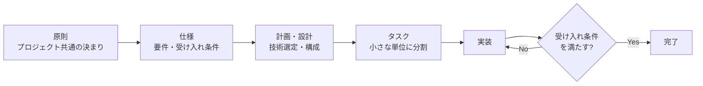

**仕様駆動開発（Spec-Driven Development, SDD）** は、**仕様（spec）を先に文書として書き、それをもとに AI エージェントに設計・実装させる** 開発の進め方です。
進め方自体は振る舞い駆動開発（BDD）などと同じ流れですが、**仕様・計画・タスクといった成果物を AI の助けを借りて作る** 点が特徴です。

思いついた指示を次々に出して作る「バイブコーディング」は、小さな試作には速い一方、
規模が大きくなると「何を作ろうとしていたか」が会話の中に埋もれ、手戻りが増えます。
SDD はその対策として 2026 年に広く使われるようになりました。

## なぜ仕様が効くのか

| 課題（仕様なし） | 仕様があると |
| --- | --- |
| 指示があいまいで、エージェントが勝手に補う | 要件と受け入れ条件が明文化され、解釈のぶれが減る |
| 長い会話で最初の前提が失われる | 仕様ファイルを毎回読み直せる（コンテキストの外に残る） |
| レビューの対象がコードしかない | **コードを書く前に** 仕様・設計の段階でレビューできる |
| 完了の基準がない | 受け入れ条件が、そのままテストやループの停止条件になる |

これは [データ設計・形式](/ai-tech-notes/data-modeling/) で扱う「AI に渡す情報は構造化された Markdown で」という原則を、開発工程に当てはめたものとも言えます。

## 基本の流れ

ツールによって名前は違いますが、流れはほぼ共通です。



| 段階 | 書くこと | 人が見るポイント |
| --- | --- | --- |
| 原則 | コード品質・テスト方針・使う技術の制約など、全機能に共通する決まり | 一度決めれば使い回す |
| 仕様 | **何を・なぜ** 作るか。ユーザーストーリーと受け入れ条件 | 要件の漏れ・矛盾。ここが最も重要 |
| 計画・設計 | **どう** 作るか。構成・データの流れ・エラー処理・テスト方針 | 既存システムとの整合 |
| タスク | 実装の単位。依存関係と順序 | 1 タスクが十分小さいか |
| 実装・検証 | コードとテスト | 受け入れ条件を満たしているか |

各段階の成果物を **人がレビューしてから次へ進む** のが基本です。

## 主なツール

2026 年時点で広く使われている SDD のツール・フレームワークを、重さ（手順の多さ）の順に並べると次のとおりです。
いずれも Claude Code で使えます。

| ツール | 一言でいうと | 重さ | 主な成果物 | ライセンス |
| --- | --- | --- | --- | --- |
| [Claude Code 単体](#claude-code-単体plan-mode--計画ファイル) | Plan Mode で計画を作り、ファイルに残す | 最軽量 | `plan.md`・`CLAUDE.md` | — |
| [Superpowers](#superpowers) | 「構想 → 計画 → TDD で実装 → レビュー」を Skill 群で自動化 | 軽 | 計画ファイル（Skill が作成） | MIT |
| [Agent OS](#agent-os) | 仕様より先に **コーディング規約** を整備して注入する | 軽 | 規約ファイル群 | MIT |
| [OpenSpec](#openspec) | 変更（change）単位で提案 → 実装 → アーカイブ。既存システムの改修向け | 軽〜中 | `proposal.md`・`design.md`・`tasks.md`・仕様の差分 | MIT |
| [cc-sdd](#cc-sdd) | Kiro 流の 3 ファイルを Claude Code などで再現。日本語対応 | 中 | `requirements.md`・`design.md`・`tasks.md` | MIT |
| [GitHub Spec Kit](#github-spec-kit) | 原則 → 仕様 → 計画 → タスク → 実装の段階を、エージェントを問わず標準化 | 中 | 原則・仕様・計画・タスク | MIT |
| [Kiro](#kiro) | 仕様が中心の AI 開発環境（IDE・CLI など） | 中 | `requirements.md`・`design.md`・`tasks.md` | 製品（有償プランあり） |
| [BMAD-METHOD](#bmad-method) | アナリスト・PM・アーキテクトなどの **役割を持つエージェント** で企画から実装まで回す | 重 | PRD・計画・チケット | MIT |

### GitHub Spec Kit

GitHub が公開しているオープンソースの SDD ツールキットです。
コマンドラインツール（`specify`）でプロジェクトにひな形を入れ、エージェントのチャット上でコマンドを順に実行します。
特定のエディタに縛られず、複数の AI コーディングエージェントで使えるのが特徴です。

```bash
uv tool install specify-cli
specify init my-project --integration <使うエージェント>
```

| コマンド（GitHub Copilot での表記） | 段階 |
| --- | --- |
| `/speckit-constitution` | 原則を定める |
| `/speckit-specify` | 仕様を書く |
| `/speckit-plan` | 計画・設計を作る |
| `/speckit-tasks` | タスクに分割する |
| `/speckit-implement` | 実装する |
| `/speckit-converge` | 仕様と実装の差を詰める。「Converged」になるまで implement と交互に繰り返す |

コマンドの書き方はエージェントによって異なります。対応エージェントと表記は公式の一覧を確認してください。
不具合修正やアイデア評価用の拡張機能も用意されています。

### Kiro

仕様を中心に作られた AI 開発環境（IDE・CLI など）です。
既存のエディタに仕様の仕組みを足すのではなく、**仕様が最初から中心にある** のが Spec Kit との違いです。
1 つの仕様ごとに次の 3 ファイルが作られます。

| ファイル | 内容 |
| --- | --- |
| `requirements.md` | ユーザーストーリーと受け入れ条件（不具合修正では `bugfix.md`） |
| `design.md` | 構成・シーケンス図・データの流れ・エラー処理・テスト方針 |
| `tasks.md` | 実装タスクと、その進捗状況 |

要件から始める進め方と設計から始める進め方を選べるほか、承認を挟まずに 3 ファイルを一度に作る簡易版もあります。
タスクは依存関係をもとにまとめて並列に実行されます。

### BMAD-METHOD

「Breakthrough Method for Agile AI Driven Development」の略で、**アジャイル開発チームの役割をエージェントとして再現する** フレームワークです。
ビジネスアナリスト・プロダクトマネージャー・プロダクトオーナー・UX デザイナー・アーキテクト・開発者といった役割ごとにエージェントが用意され、
それぞれに人名（PM の John、アーキテクトの Winston など）が付いています。

```bash
npx bmad-method install
```

- 流れは「明確化（あいまいな構想）→ 計画（大きな構想）→ 実装と検証（小さな変更）」で、学びを計画に戻すループになっています。
- 変更の規模に応じて、小さな変更・機能群（エピック）・チームや組織の計画、という 3 つの計画ルートから選びます。
- PM 役のエージェントが PRD（製品要求仕様書）を作り、それを分割したチケットが仕様として実装まで引き継がれます。
- 2026 年 11 月時点の安定版は v6 系で、Skill として導入する v7 がプレビュー版として公開されています。

製品企画から入る新規開発に向く一方、手順が多く **習得に時間がかかる** という評価が一般的です。小さな改修には重すぎます。

### OpenSpec

**既存システムへの変更（change）を単位に仕様を管理する**、軽量な SDD フレームワークです。
仕様そのもの（`openspec/specs/`）と、変更の提案（`openspec/changes/`）を分けて持つのが特徴です。

```bash
npm install -g @fission-ai/openspec@latest
openspec init
```

| コマンド | 内容 |
| --- | --- |
| `/openspec-explore` | （任意）計画を立てる前に考えを整理する |
| `/openspec-propose <作りたいもの>` | 変更を作り、提案・仕様の差分・設計・タスクを生成する |
| `/openspec-apply-change` | タスクを実装する |
| `/openspec-archive-change` | 変更をアーカイブし、本体の仕様に反映する |

- 変更ごとに `openspec/changes/<変更名>/` が作られ、`proposal.md`・`specs/`（仕様の差分）・`design.md`・`tasks.md` が置かれます。
- 仕様は「## ADDED Requirements」「#### Scenario:」のような見出しと、WHEN / THEN 形式のシナリオで書きます。
- 段階を厳密に区切らず、行き来しながら進める設計です。30 以上の AI アシスタントに対応しています。

**「仕様の差分」をレビューし、完了したら本体の仕様に取り込む** 流れは、Git のプルリクエストに近い感覚で使えます。
長く運用されているシステムの改修に向きます。

### cc-sdd

Kiro と同じ「要件・設計・タスク」の 3 ファイル方式を、**Claude Code などの既存エージェントで使えるようにする** ツールです。
日本の開発者が公開しており、**日本語で仕様を書ける**（`--lang ja`）のが特徴です。

```bash
npx cc-sdd@latest
```

| コマンド | 内容 |
| --- | --- |
| `/kiro-discovery` | 構想と全体のロードマップを整理する（`brief.md`・`roadmap.md`） |
| `/kiro-spec-init` | 仕様を作り始める |
| `/kiro-spec-requirements` | 要件を EARS 記法で書く（`requirements.md`） |
| `/kiro-spec-design` | 設計を書く（`design.md`） |
| `/kiro-spec-tasks` | タスクに分割する（`tasks.md`） |
| `/kiro-impl` | 承認済みの仕様をもとに実装する |

EARS（Easy Approach to Requirements Syntax）は「〜のとき、システムは〜しなければならない」のような決まった型で要件を書く記法で、
あいまいさを減らし、受け入れ条件やテストに落としやすくなります。
Claude Code と Codex への対応が安定版で、Cursor・GitHub Copilot・Gemini CLI などはベータ対応です。

### Superpowers

厳密には SDD 専用ツールではなく、**開発の進め方一式を Skill として Claude Code に組み込む** ライブラリです。
GitHub で最も多くのスターを集めている Claude Code 向けプロジェクトの 1 つです。

```text
/plugin install superpowers@claude-plugins-official
```

次の流れが、作業内容に応じて **Skill として自動的に呼び出されます**。

1. 構想の整理（brainstorming）— 質問を重ねて要件を固める
2. 作業用の Git ワークツリーを作る
3. 計画を書く（writing-plans）
4. 計画を実行する — サブエージェントにタスクを任せる方式か、順に実行する方式
5. テスト駆動開発（RED → GREEN → REFACTOR）
6. コードレビューを依頼し、ブランチを仕上げる

仕様ファイルを中心に据えるというより、**「計画してから作る」「テストを先に書く」を習慣として強制する** 仕組みです。
専用のコマンドを覚えなくてよいので、個人開発で SDD を試す入り口に向きます。

### Agent OS

**仕様を書く前に、そのコードベースの規約（standards）を整備してエージェントに注入する** ことを重視するツールです。
「良い仕様も、規約を知らないエージェントには活かせない」という考え方に立っています。

| コマンド | 内容 |
| --- | --- |
| `/discover-standards` | 既存コードから規約を見つけ出して文書化する |
| `/inject-standards` | 作業に関係する規約をエージェントに渡す |
| `/shape-spec` | Plan Mode で仕様を形にする |

2026 年 1 月の v3 で、タスク分割や実行の管理は廃止され、仕様づくりは Claude Code の Plan Mode に任せる形に絞り込まれました。
他の SDD ツールと **組み合わせて、規約の部分だけを担わせる** 使い方もできます。

### Claude Code 単体（Plan Mode ＋ 計画ファイル）

専用ツールを使わず、Claude Code の **Plan Mode**（コードを変更せずに調査と計画だけを行うモード）で計画を作り、
それを `plan.md` などのファイルに保存してから実装させる方法です。
プロジェクト共通の決まりは `CLAUDE.md` に書きます。
繰り返し使う手順は Skill にまとめることもできます。

## 選び方

| 状況 | おすすめ | 理由 |
| --- | --- | --- |
| 1 人で、数日以内に終わる機能 | Claude Code 単体 / Superpowers | 仕組みが軽く、すぐ始められる |
| 長く運用している既存システムの改修 | OpenSpec | 変更ごとに仕様の差分をレビューし、本体の仕様に取り込める |
| 日本語で、Kiro のような 3 ファイル方式を使いたい | cc-sdd | 日本語に対応し、Claude Code で使える |
| チームで、複数のエージェントやエディタが混在 | Spec Kit | エージェントに依存せず、共通の決まりを共有しやすい |
| 仕様とコードのずれを継続的に防ぎたい | Kiro | 仕様が開発環境の中心にあり、タスクの進捗も仕様側で追える |
| 製品企画から入る新規開発 | BMAD-METHOD | 企画・要求仕様・設計の役割分担まで含めて進められる |
| 規約が暗黙で、エージェントの出力がぶれる | Agent OS（他と併用） | 規約を文書化してから仕様に進める |
| 既存の大きなシステムの小さな修正 | 仕様は軽めに（受け入れ条件だけ） | 重い手順は手間に見合わない |

:::note[ツールより先に「型」を決める]
どのツールも、中身は **Markdown の仕様ファイルと、それを順に作らせるプロンプト（Skill・コマンド）** です。
チームで迷ったら、まず軽いもの（Claude Code 単体や OpenSpec）で「仕様に何を書くか」の型を固め、
手順が足りなくなってから重いツールに移るのが安全です。
:::

:::tip[受け入れ条件をループの停止条件にする]
SDD で書いた受け入れ条件は、そのまま [ループエンジニアリング](/ai-tech-notes/agents/loop-engineering/) の停止条件に使えます。
例えば受け入れ条件を「`test/` の全テストが通る」と書いておけば、実装段階では `/goal` や Stop フックでその条件を満たすまで作業を続けさせられます。
:::

## よくある落とし穴

| 落とし穴 | 症状 | 対策 |
| --- | --- | --- |
| 仕様と実装のずれ | 実装中の変更が仕様に戻されず、仕様が古くなる | 変更は仕様から直す。完了時に仕様と実装の差分を確認する |
| 仕様の書きすぎ | 小さな修正にも長い文書を作り、かえって遅くなる | 規模に応じて段階を省く。小さな修正は受け入れ条件だけ |
| レビューの省略 | AI が作った仕様をそのまま通し、誤った前提で実装が進む | **仕様段階のレビュー** に最も時間をかける |
| 検証できない受け入れ条件 | 「使いやすいこと」など、完了を判定できない | 数値や操作手順で書く（「3 クリック以内で〜できる」） |

## ナレッジ AI 開発での例

例えば「Confluence の取り込み処理にメタデータ付与を追加する」場合、仕様は次のように書けます。

```markdown
## 要件
- 取り込むすべてのページに、必須メタデータ（doc_id, source_url, title, updated_at, status, acl）を付ける
  （→ データ設計・形式「メタデータ」の標準スキーマに従う）

## 受け入れ条件
- [ ] テスト用スペース（50 ページ）の取り込みで、必須メタデータの欠落が 0 件
- [ ] status: archived のページは索引に入らない
- [ ] 同じページの旧版が索引に 2 件以上残らない
- [ ] 既存の取り込みテストがすべて通る
```

受け入れ条件がすべて機械的に確かめられる形になっているため、実装をエージェントに任せ、検証スクリプトで完了を判定できます。

## 参考・出典

- [github/spec-kit](https://github.com/github/spec-kit) — GitHub
- [Specs](https://kiro.dev/docs/specs/) — Kiro Docs
- [bmad-code-org/BMAD-METHOD](https://github.com/bmad-code-org/BMAD-METHOD) / [BMad Method Docs](https://docs.bmad-method.org/) — BMad Code
- [Fission-AI/OpenSpec](https://github.com/Fission-AI/OpenSpec) — GitHub
- [gotalab/cc-sdd](https://github.com/gotalab/cc-sdd) — GitHub
- [obra/superpowers](https://github.com/obra/superpowers) — GitHub
- [buildermethods/agent-os](https://github.com/buildermethods/agent-os) / [Agent OS](https://buildermethods.com/agent-os) — Builder Methods
- [From Prompt to Process: a Process Taxonomy and Comparative Assessment of Frameworks Supporting AI Software Development Agents](https://arxiv.org/abs/2606.04967) — arXiv
- [Spec-Driven Frameworks Compared: Spec Kit vs OpenSpec vs BMAD vs Superpowers](https://developertoolkit.ai/en/ecosystem/frameworks/spec-driven-frameworks/) — Developer Toolkit
- [Spec-driven development](https://en.wikipedia.org/wiki/Spec-driven_development) — Wikipedia
- [GitHub Spec Kit vs Kiro vs Claude Code SDD Workflows](https://www.glukhov.org/ai-devtools/ai-coding-assistants/spec-kit-vs-kiro-vs-claude-code/) — Rost Glukhov
- [Spec Kit vs Kiro vs plan.md: A 2026 Field Log](https://www.devmoment.dev/journal/spec-kit-vs-kiro-field-log-2026) — devmoment
