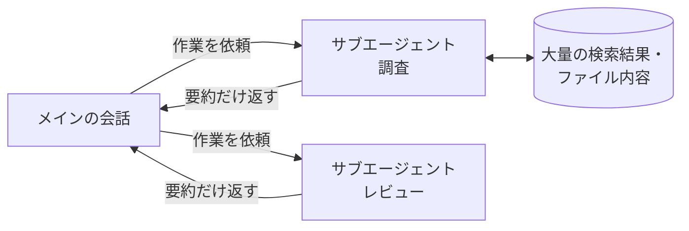

**サブエージェント** は、メインの会話から特定の作業を任される **専門の担当エージェント** です。
それぞれが **自分専用のコンテキストウィンドウ** を持ち、独自のシステムプロンプト・使えるツール・権限で動きます。
作業が終わると、**最終結果だけ** をメインの会話に返します。



## なぜ分けるのか

| 効果 | 内容 |
| --- | --- |
| 文脈を汚さない | 検索結果・ログ・ファイルの中身などの大量の出力が、メインの会話に入らない |
| 専門化 | 役割に合ったプロンプト・ツール・モデルを割り当てられる |
| 安全 | 読み取り専用など、ツールや権限を絞れる |
| 並行 | 独立した作業を同時に進められる |
| コスト | 簡単な作業を安いモデル（Haiku など）に任せられる |

Anthropic のコンテキストエンジニアリングの記事では、サブエージェントが数万トークン以上を使って調査し、
**1,000〜2,000 トークン程度の要約** を返す構成が紹介されています。
大きな調査を 1 つの会話で続けるより、メインの文脈をずっと小さく保てます。

## 組み込みのサブエージェント

Claude Code には、最初から次のサブエージェントが用意されています（2026 年 11 月時点）。

| 名前 | 役割 | ツール |
| --- | --- | --- |
| Explore | コードベースの高速な検索・分析。探す範囲の広さ（quick / medium / very thorough）を指定して使われる | 読み取り専用（書き込み・編集は不可） |
| Plan | Plan Mode での調査 | 読み取り専用 |
| general-purpose | 調査と変更の両方が必要な、複数手順の作業 | すべて |

## 自分で定義する

サブエージェントは、フロントマター付きの Markdown ファイルで定義します。本文がシステムプロンプトになります。

```markdown
---
name: doc-reviewer
description: ナレッジ文書のレビュー担当。文書を追加・更新したら積極的に使う。メタデータの欠落と表記ゆれを確認する。
tools: Read, Glob, Grep
model: haiku
---

あなたはナレッジ文書のレビュー担当です。
1. フロントマターに必須メタデータ（doc_id, title, updated_at, status, acl）があるか確認する
2. 用語集と異なる表記を指摘する
3. 問題点だけを、ファイル名と行番号付きで一覧にして返す
```

必須は `name` と `description` だけです。主な項目は次のとおりです。

| 項目 | 内容 |
| --- | --- |
| `name` | 識別名 |
| `description` | **どんなときに任せるか**。Claude はこれを見て委任を判断する |
| `tools` / `disallowedTools` | 使えるツール（省略するとすべて） / 使わせないツール |
| `model` | `haiku`・`sonnet`・`opus` などの別名、モデル ID、または `inherit`（メインと同じ） |
| `permissionMode` | 権限モード（`default`・`acceptEdits`・`plan` など） |
| `maxTurns` | ターン数の上限 |
| `skills` | 起動時に読み込んでおく [Skills](/ai-tech-notes/agents/skills/) |
| `mcpServers` | このサブエージェントだけが使う MCP サーバ |
| `hooks` | このサブエージェントだけに効くフック |
| `memory` | 会話をまたいで残すメモリの範囲（`user`・`project`・`local`） |
| `isolation` | `worktree` にすると、一時的な Git worktree（リポジトリの別コピー）で作業する |

### 置き場所と優先順位

| 場所 | 範囲 | 優先 |
| --- | --- | --- |
| 組織の管理設定 | 組織全体 | 1（最優先） |
| `--agents` オプション（JSON） | そのセッションだけ | 2 |
| `.claude/agents/` | そのプロジェクト（コミットしてチームで共有） | 3 |
| `~/.claude/agents/` | 自分のすべてのプロジェクト | 4 |
| プラグインの `agents/` | プラグインを有効にした場所 | 5 |

同じ名前があるときは、優先順位の高いものが使われます。

## 任せ方

| 方法 | 例 |
| --- | --- |
| 自動 | Claude が依頼内容と `description` を照らし合わせて任せる。説明文に「積極的に使う（use proactively）」と書くと任されやすくなる |
| 名前で指示 | 「doc-reviewer エージェントで、追加した文書をレビューして」 |
| @ メンション | `@agent-doc-reviewer` |
| セッション全体 | `claude --agent doc-reviewer` で、そのサブエージェントをメインとして起動する |

## サブエージェントに渡るもの・渡らないもの

| 渡る | 渡らない |
| --- | --- |
| 自分のシステムプロンプト（定義ファイルの本文） | メインの会話の履歴 |
| Claude が書いた依頼文 | メインの会話で読んだファイルの内容 |
| `skills` で指定した Skill | メインの会話で使った Skill |
| `CLAUDE.md`（Explore・Plan などは除く） | |

サブエージェントは **これまでの会話を知りません**。
メインの会話で決まった前提や、特に守ってほしい規則は、依頼文に書いて渡す必要があります。
逆にメインの会話に戻るのは最終結果だけなので、**返してほしい形式**（一覧・ファイル名と行番号付き、など）を定義ファイルに書いておきます。

## エージェントチームとの違い

Claude Code には、実験的な機能として **エージェントチーム**（agent teams）もあります。
既定では無効で、環境変数 `CLAUDE_CODE_EXPERIMENTAL_AGENT_TEAMS` で有効にします。
リーダー役のセッションと、それぞれ独立した Claude Code である **チームメイト** が、共有のタスクリストとメッセージで協力して作業します。

| | サブエージェント | エージェントチーム |
| --- | --- | --- |
| コンテキスト | 専用。結果は呼び出し元に返る | 専用。完全に独立 |
| やり取り | 呼び出し元に結果を返すだけ | チームメイト同士が直接メッセージを送り合う |
| 調整 | メインのエージェントがすべて管理 | 共有タスクリストで各自が作業を取る |
| 向く作業 | 結果だけが必要な、焦点の絞れた作業 | 議論や相互チェックが必要な複雑な作業 |
| トークン | 少ない | 多い（チームメイトの数に比例） |

公式ドキュメントでは、チームは 3〜5 人から始め、まずは並行実装より **調査やレビュー** に使うこと、
同じファイルを複数のチームメイトに編集させないことが勧められています。

## 使い分けの目安

| 状況 | おすすめ |
| --- | --- |
| 広い範囲を検索して、結論だけ欲しい | サブエージェント（Explore） |
| 実装とは別の観点でレビューしたい | 読み取り専用のレビュー用サブエージェント |
| 同じ種類の作業を何度も任せる | 定義ファイルを作る |
| 手順を教えたいだけで、文脈を分ける必要はない | [Skill](/ai-tech-notes/agents/skills/) |
| 複数の観点で議論させ、互いの結論を検証させたい | エージェントチーム |
| 小さな作業、または前後の文脈が強く絡む作業 | 分けずにメインの会話で行う |

:::tip[作る側と確かめる側を分ける]
[ループエンジニアリング](/ai-tech-notes/agents/loop-engineering/) で述べたとおり、作業したエージェント自身に合否を判定させると、見かけだけの完了が起きやすくなります。
実装はメインで行い、検証は **別の文脈を持つレビュー用サブエージェント** に任せると、実装の経緯に引きずられない判定になります。
:::

:::caution[コストに注意]
サブエージェントの利用もメインと同じ利用枠を消費します。
文脈が分かれる分、同じファイルを何度も読み直すこともあります。
小さな作業まで細かく分けると、かえってトークンが増える点に注意してください。
:::

## ナレッジ AI 開発での例

| サブエージェント | 役割 | 設定のポイント |
| --- | --- | --- |
| `source-explorer` | データソースの文書を調べ、取り込み対象と構成を報告する | 読み取り専用・安いモデル |
| `doc-reviewer` | 取り込み前の文書のメタデータ・表記をチェックする | 読み取り専用・結果は一覧で返す |
| `eval-runner` | [RAG の評価](/ai-tech-notes/rag/evaluation/) を実行し、数値と失敗例だけを返す | 評価スクリプトの実行だけを許可 |
| `answer-auditor` | 生成した回答の出典と根拠の対応を確認する | 実装とは別のモデル・別の文脈で判定 |

## 参考・出典

- [Create custom subagents](https://code.claude.com/docs/en/sub-agents) — Claude Code Docs
- [Agent teams](https://code.claude.com/docs/en/agent-teams) — Claude Code Docs
- [Effective context engineering for AI agents](https://www.anthropic.com/engineering/effective-context-engineering-for-ai-agents) — Anthropic（2025-09-29）
- [Agent Harness Design: 3 Patterns for Harnessing Claude's Intelligence](https://claude.com/resources/articles/harnessing-claudes-intelligence) — Anthropic（2026-04-02）
