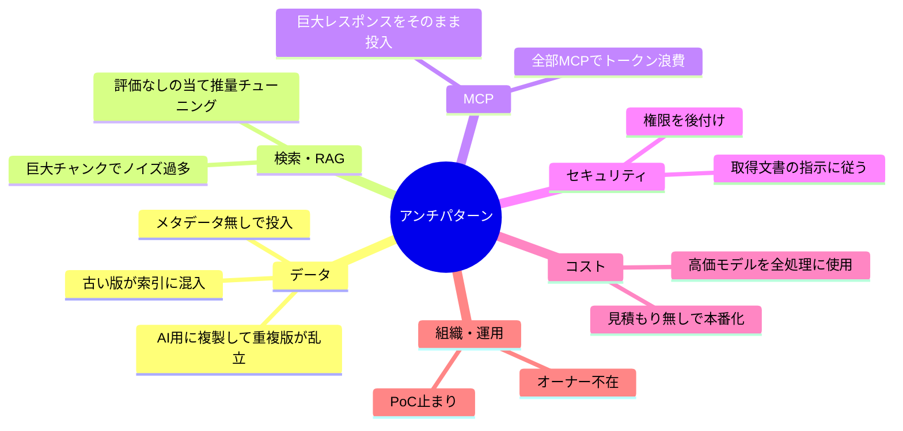

ナレッジ AI システムでよく見られる失敗パターンを集めます。
多くは **設計段階で回避可能** です。このページは、サイト内に散らばるアンチパターンの **索引** を兼ねています。

## よくある失敗の地図

## 重点トピック

| アンチパターン | 影響 | 詳細 |
| --- | --- | --- |
| データ複製と重複バージョン | 精度低下・矛盾回答 | [データ複製と重複バージョン問題](/ai-tech-notes/anti-patterns/data-duplication/) |
| 何でも MCP で取得（トークン浪費） | コスト増・レイテンシ悪化・精度低下 | [トークン消費問題と対策](/ai-tech-notes/mcp/token-cost/#よくあるアンチパターン症状と回避策) |

## 領域別アンチパターン一覧

### データ

| アンチパターン | 何が起きるか | 回避策 |
| --- | --- | --- |
| AI 用にデータを全コピー | 版ずれ・矛盾回答 | 参照を基本に → [データ複製](/ai-tech-notes/anti-patterns/data-duplication/) |
| メタデータ無しで投入 | 絞り込み・出典提示ができない | 標準スキーマで付与 → [メタデータ](/ai-tech-notes/data-modeling/metadata/) |
| PDF をプレーンテキスト化しただけ | 見出し・表が崩れる | レイアウト解析で Markdown 化 → [データ形式](/ai-tech-notes/data-modeling/) |
| 削除・アーカイブが索引に残る | 廃止済みの規程で回答する | 削除の伝播 ＋ 定期突合 → [バージョン管理](/ai-tech-notes/data-modeling/versioning/) |

### 検索・RAG

| アンチパターン | 何が起きるか | 回避策 |
| --- | --- | --- |
| ベクトル検索だけ | 固有名詞・型番の取りこぼし | ハイブリッド ＋ リランク → [検索](/ai-tech-notes/rag/retrieval/) |
| 巨大チャンク・全文投入 | ノイズ・コスト増 | 意味単位のチャンク → [チャンク戦略](/ai-tech-notes/rag/chunking/) |
| 評価なしのチューニング | 改善が当て推量になる | 評価セットで毎回計測 → [評価](/ai-tech-notes/rag/evaluation/) |
| 「分からない」と言えない設計 | 根拠が無くても答えて誤情報を出す | 根拠スコアの閾値・出典必須 → [ナレッジ回答](/ai-tech-notes/use-cases/knowledge-qa/) |

### セキュリティ

| アンチパターン | 何が起きるか | 回避策 |
| --- | --- | --- |
| 権限を後付け・無視した索引 | 見てはいけない文書が回答に混ざる | 検索段で権限フィルタ → [権限フィルタの実装](/ai-tech-notes/use-cases/knowledge-qa/#権限フィルタの実装) |
| 取得した文書の指示に従う | 間接プロンプトインジェクションで誤操作・情報流出 | 取得内容はデータとして扱う → [システム全体像](/ai-tech-notes/overview/architecture/) |
| エージェントに広い書き込み権限 | 誤操作の影響が大きくなる（過剰な権限） | 読み取りから始め、書き込みは承認付き → [MCP サーバ構成](/ai-tech-notes/mcp/server-design/) |
| 共通アカウントで MCP 接続 | 閲覧権限の無い社員にも AI 経由で見える | 利用者本人として OAuth 認可 → [MCP サーバ構成](/ai-tech-notes/mcp/server-design/) |

### コスト

| アンチパターン | 何が起きるか | 回避策 |
| --- | --- | --- |
| コスト見積もり無しで全社展開 | 想定外の請求 | 試算 ＋ 継続監視 → [コスト・ROI](/ai-tech-notes/cost-roi/) |
| 高価なモデルを全処理に使用 | コストが膨らむ | 工程ごとにモデル・effort を使い分け → [最適化](/ai-tech-notes/cost-roi/optimization/) |
| キャッシュが効かない構成 | 割引が受けられない | 安定部分を先頭に → [コンテキストとキャッシュ](/ai-tech-notes/rag/context-and-caching/) |

## 組織・運用面のアンチパターン

技術的に正しく作っても、運用の体制が無いと品質は時間とともに落ちていきます。

| アンチパターン | 何が起きるか | 回避策 |
| --- | --- | --- |
| **ナレッジのオーナー不在** | 古い文書が直されず、AI が古い情報で答え続ける | 文書・スペースごとに所有者を決め、`owner` をメタデータに持たせる。所有者不在の文書は索引から外す |
| **AI 側の運用担当が不在** | 評価・語彙・同期ジョブが放置される | 「評価セット」「タグ語彙」「同期ジョブ」それぞれに担当と頻度を決める |
| **フィードバックを集めない／放置する** | 誤回答が繰り返され、利用者が離れる | 回答ごとの 👍/👎 と誤り報告を集め、評価セットに追加して再発を防ぐ |
| **PoC 止まり** | 検証で終わり、業務効果が出ない | PoC の前に成功指標（KPI）と本番化の判断基準を決める → [ユースケース概観](/ai-tech-notes/use-cases/) |
| **いきなり全社展開** | 権限・品質の問題が一度に噴出する | 1 部門で採用率・正答率を上げてから広げる → [推奨アーキテクチャ](/ai-tech-notes/use-cases/reference-architectures/) |
| **シャドー AI の放置** | 社員が個人契約の AI に社内文書を貼り付ける | 公式に使える手段を早期に提供し、利用ルールを明示する |
| **「AI が答えたから正しい」運用** | 誤りがそのまま外部や意思決定に流れる | 出典の確認を前提にし、重要な用途では人の確認を必須にする |

:::tip[「データの品質」は AI プロジェクトの外にある]
回答品質の上限は、元の文書の品質で決まります。
AI の導入は、**文書の所有者・更新ルール・保管場所を見直すきっかけ** として扱うと、効果が長続きします。
:::

## 参考・出典

- [OWASP Top 10 for LLM Applications 2025](https://genai.owasp.org/resource/owasp-top-10-for-llm-applications-2025/) — OWASP GenAI Security Project
- [Security Best Practices（MCP）](https://modelcontextprotocol.io/specification/latest/basic/security_best_practices) — modelcontextprotocol.io
