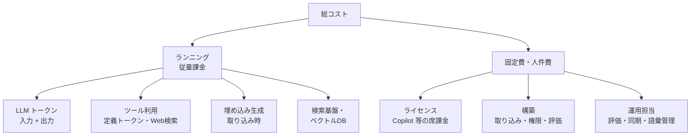

ROI を語る前に、まず **コストがどこで発生するか** を把握します。
トークン課金は「気づいたら高い」になりやすいため、設計段階で見積もり、本番では継続的に計測します。

## コストの内訳

見落としやすいのは **人件費** です。API の請求額より、評価セットの保守・同期ジョブの監視・タグ語彙の管理などの
運用工数の方が大きくなることは珍しくありません（→ [ROI の測り方](/ai-tech-notes/cost-roi/roi/)）。

## 効きやすいコスト要因

| 要因 | 影響 | 関連 |
| --- | --- | --- |
| 入力トークン量 | 投入文脈が大きいほど増える。会話は毎ターン履歴を再送する | [検索](/ai-tech-notes/rag/retrieval/) / [コンテキストとキャッシュ](/ai-tech-notes/rag/context-and-caching/) |
| 出力トークン量 | 単価は入力の **5 倍** が一般的。推論（thinking）のトークンも出力として課金 | [生成の制御](/ai-tech-notes/llm-basics/generation-controls/) |
| キャッシュの効き具合 | 効けば固定部分の入力が 1/10〜1/40 の単価に | [最適化](/ai-tech-notes/cost-roi/optimization/) |
| ツール定義・MCP レスポンス | 定義は毎リクエスト送られ、結果は履歴に積み上がる | [MCP のトークン対策](/ai-tech-notes/mcp/token-cost/) |
| モデル選択 | 同じ処理でも階層によって単価が数十倍違う | [システム選定](/ai-tech-notes/cost-roi/system-selection/) |
| 呼び出し頻度 | 高頻度ユースケースほど単価の差が効く | [最適化](/ai-tech-notes/cost-roi/optimization/) |

## 料金の基本単位（2026 年 11 月時点・Claude の例）

単位は **100 万トークン（MTok）あたりの米ドル** です。モデル一覧と位置づけは
[AIモデルの特徴と選定](/ai-tech-notes/llm-basics/models/) を参照してください。

| モデル | 入力 | 出力 | キャッシュ書き込み（5分 / 1時間） | キャッシュ読み取り |
| --- | --- | --- | --- | --- |
| Claude Fable 5.2 | $8 | $40 | $10 / $16 | $0.20（入力の 1/40） |
| Claude Opus 5.5 | $4 | $20 | $5 / $8 | $0.20（入力の 1/20） |
| Claude Sonnet 5.5 | $2 | $10 | $2.50 / $4 | $0.10（入力の 1/20） |
| Claude Haiku 5.5 ※ | $0.10 | $0.50 | $0.125 / $0.20 | $0.01（入力の 1/10） |

※ Haiku 5.5 はプロンプトが 10 万トークンを超えるリクエストだけ単価が 5 倍（入力 $0.50 / 出力 $2.50）になります。
他の現行モデルは 100 万トークンのコンテキスト全体が同じ単価です。

:::note[同じ文章でもトークン数はモデルで変わる]
Claude 4.7 以降のモデルは新しいトークナイザを使っており、同じテキストで **約 30% 多くトークン化** されます。
旧モデルの実績値をそのまま使わず、移行先のモデルでトークン数を数え直してください
（[トークン数を数える API](https://platform.claude.com/docs/en/build-with-claude/token-counting) が使えます）。
:::

## 料金を上げる要因・下げる要因

単価表の値に、次の倍率が **掛け算で** 重なります。

| 区分 | 倍率 | 条件・注意 |
| --- | --- | --- |
| **バッチ API** | **0.5 倍**（入力・出力・キャッシュすべて） | 非同期処理。多くは 1 時間以内、最大 24 時間で結果が返る |
| **プロンプトキャッシュ読み取り** | 0.025〜0.1 倍（モデルで異なる） | 先頭一致した固定部分だけ。書き込みは 1.25 倍（5分）/ 2 倍（1時間） |
| **データ処理地域の指定**（`inference_geo: "us"`） | 1.1 倍 | Claude 4.6 以降。既定の global ルーティングは標準価格 |
| **Bedrock / Vertex AI のリージョン指定エンドポイント** | 1.1 倍（グローバルエンドポイント比） | 価格はクラウド事業者が別途設定 |
| **高速モード**（fast mode） | 2 倍（Opus 5.5 は $8 / $40） | 出力速度が最大 2.5 倍。バッチとは併用不可 |
| **Haiku 5.5 の長いプロンプト** | 5 倍 | 10 万トークン超のリクエストのみ |

この他、**ツール利用** には次の追加分があります。

- ツールを 1 つでも渡すと、ツール利用用のシステムプロンプト（約 300 トークン）と、全ツールの定義が毎回入力に加わる
- Web 検索は **1,000 回あたり $10** ＋ 検索結果のトークン。Web 取得（fetch）は取得した内容のトークン代のみ

## コスト試算テンプレート

新規システムや機能を本番化する前に、最低限この粒度で月額コストを見積もります。

| 項目 | 計算式 |
| --- | --- |
| 月間リクエスト数 | 利用者数 × 1 人あたり回数 × 稼働日 |
| 入力トークン（キャッシュ対象外） | 取得文書 ＋ 質問 ＋ 会話履歴のうち変動する部分 |
| 入力トークン（キャッシュ対象） | システムプロンプト ＋ ツール定義 ＋ 固定の指示・例 |
| 出力トークン | 回答の長さ ＋ 推論（thinking）分 |
| LLM コスト/月 | 各トークン数 × 月間リクエスト数 × それぞれの単価 |
| ツール・検索 | Web 検索回数 × 単価、検索基盤のクエリ課金 |
| 埋め込み・取り込み | 初回の全件 ＋ 月次の増分（更新文書のみ） |
| インフラ | 検索基盤・ベクトル DB・ストレージの月額 |
| **合計（月額）** | 上記の総和 ＋ 予備（ピーク・再試行分として 20〜30%） |

### 試算例: 社内ナレッジ回答（Claude Sonnet 5.5）

前提: 利用者 200 人 × 1 日 5 回 × 20 日 = **月 20,000 リクエスト**。
1 リクエストあたり入力 4,000 トークン（うち固定部分 1,500、取得文書と質問 2,500）、出力 800 トークン。

| 項目 | キャッシュなし | キャッシュあり |
| --- | --- | --- |
| 固定部分 1,500 tok × 2 万回 = 3,000 万 tok | $2 × 30 = **$60** | $0.10 × 30 = **$3**（＋書き込み数ドル） |
| 変動部分 2,500 tok × 2 万回 = 5,000 万 tok | $2 × 50 = **$100** | **$100**（キャッシュ不可） |
| 出力 800 tok × 2 万回 = 1,600 万 tok | $10 × 16 = **$160** | **$160** |
| **月額合計** | **約 $320** | **約 $265** |

この例から分かること:

- **出力が支配的** — 出力は入力の 1/5 の量でも、単価が 5 倍なので入力全体と同じくらいかかる。回答を必要以上に長くしない指示が効く
- **RAG の取得文書はキャッシュが効かない** — 毎回変わるため。削減するには取得件数・チャンクサイズを絞る（[検索とリランキング](/ai-tech-notes/rag/retrieval/)）
- **モデルの階層差は大きい** — キャッシュなしで比べると、Opus 5.5 は約 $640、Haiku 5.5 は約 $16。品質を満たす最も安い構成を評価で探す（[システム選定](/ai-tech-notes/cost-roi/system-selection/)）
- **API 代は総コストの一部** — 月数百ドルの API 代に対し、運用担当の工数は桁が違うことが多い（[ROI の測り方](/ai-tech-notes/cost-roi/roi/)）

試算の精度を上げるコツ:

- 実トークン数は推測せず、**代表的なリクエストで実測**する（日本語・表・コードで大きく変わる）
- **推論（thinking）の出力トークン**を含める。effort の設定で大きく変わる（[生成の制御](/ai-tech-notes/llm-basics/generation-controls/)）
- **ピーク時**の同時実行数とレート上限も確認する（コストだけでなく可用性に影響）
- エージェント型の処理は 1 回の質問で **複数回の呼び出し** が発生する。「1 リクエスト」ではなく「1 タスク」で数える

## 計測の仕組み

本番では、見積もりではなく **実測値** でコストを管理します。

| 粒度 | 何を使うか | 分かること |
| --- | --- | --- |
| リクエスト単位 | API レスポンスの `usage`（`input_tokens` / `output_tokens` / `cache_read_input_tokens` / `cache_creation_input_tokens`） | 1 件あたりのトークン内訳、キャッシュの効き具合 |
| ユースケース単位 | 自前ログにユースケース名・利用者・タスク ID を付けて集計 | 完了タスクあたりのコスト、高コストな質問の傾向 |
| 組織単位 | Usage and Cost Analytics API、コンソールの利用状況画面 | モデル別・API キー別・ワークスペース別の請求額 |
| クラウド経由 | AWS Cost Explorer、Azure Cost Management など | Bedrock / Foundry 等を経由した利用の請求額 |

運用のポイント:

- **ユースケースごとに API キーかワークスペースを分ける** — 組織単位のレポートで用途別に切り分けられる
- **キャッシュ読み取りの比率を監視する** — 入力に占める `cache_read_input_tokens` の割合が急に下がったら、プロンプトの先頭が変わってキャッシュが無効になっている可能性が高い
- **予算アラートを設定する** — 月の予算に対する消化率で通知し、暴走（無限ループするエージェントなど）を早期に検知する
- トレースの属性は OpenTelemetry の GenAI セマンティック規約に揃えると、ベンダーを変えても集計を続けられる

:::tip
最も効くのは **入力トークン量の削減とキャッシュ** であることが多く、次に **出力の長さ** です。
まずこの 3 つを計測できる状態にしてから、モデルや構成の見直しに進みます → [コスト最適化テクニック](/ai-tech-notes/cost-roi/optimization/)。
:::

## 参考・出典

- [Pricing](https://platform.claude.com/docs/en/about-claude/pricing) — Claude Platform Docs
- [Token counting](https://platform.claude.com/docs/en/build-with-claude/token-counting) — Claude Platform Docs
- [Usage and Cost Analytics API](https://platform.claude.com/docs/en/manage-claude/usage-cost-analytics-api) — Claude Platform Docs
- [Batch processing](https://platform.claude.com/docs/en/build-with-claude/batch-processing) — Claude Platform Docs
