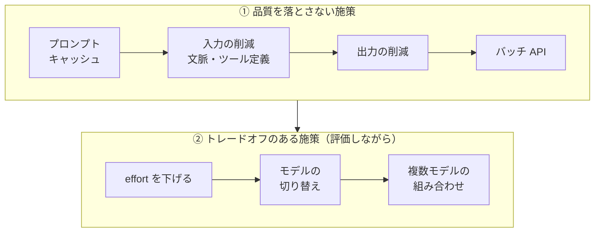
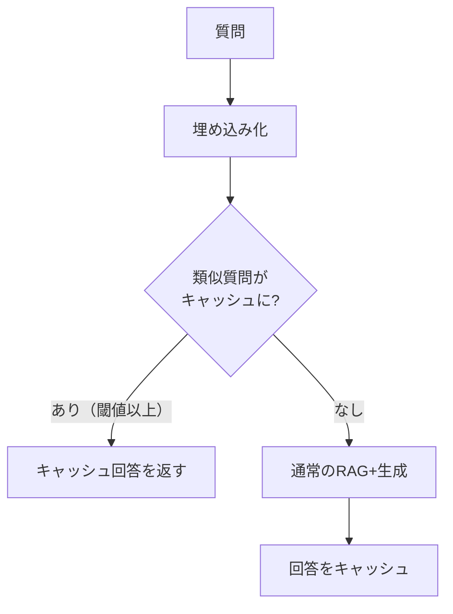
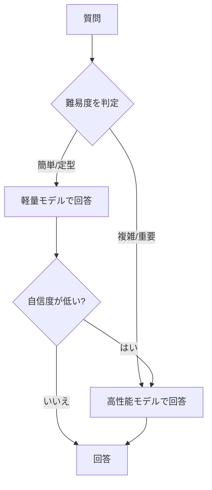
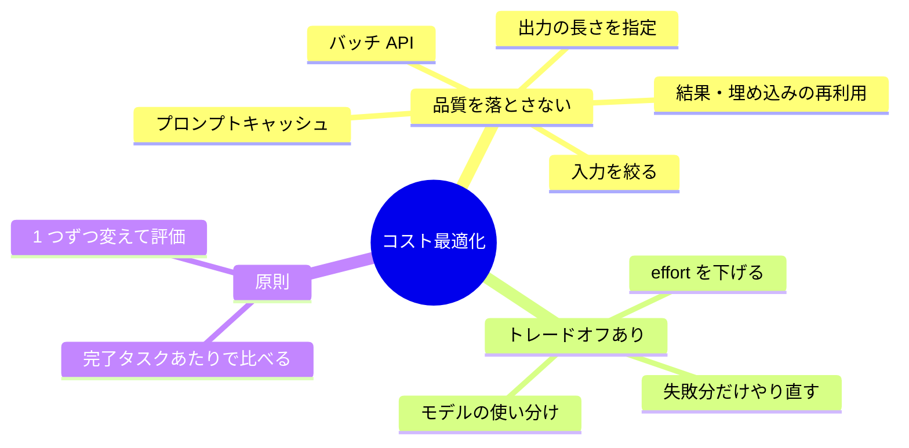

精度を落とさずにコストを下げるための実践的なテクニックをまとめます。
原則は 2 つです。

1. **品質を落とさない施策から先に** — キャッシュ・入力の削減・バッチ化は、品質に影響せずに安くなる
2. **「1 リクエストあたり」ではなく「完了タスクあたり」で比べる** — 安いモデルで失敗して再試行すれば、結局高くつく

## 施策の順番

| 施策 | 効果 | 品質への影響 | 関連 |
| --- | --- | --- | --- |
| プロンプトキャッシュ | 固定部分の入力が 1/10〜1/40 の単価に | なし | 本ページ下記 / [コンテキストとキャッシュ](/ai-tech-notes/rag/context-and-caching/) |
| コンテキストを絞る | 入力トークンの削減 | 絞りすぎると低下 | [検索とリランキング](/ai-tech-notes/rag/retrieval/) |
| ツール定義・MCP レスポンスを絞る | 毎回送る定義と結果の削減 | なし〜改善 | [トークン消費問題と対策](/ai-tech-notes/mcp/token-cost/) |
| 出力の長さを指定する | 単価の高い出力トークンの削減 | 用途に合えばなし | 本ページ下記 |
| バッチ API | 全トークン 50% 引き | なし（待ち時間が増える） | 本ページ下記 |
| 結果（セマンティック）キャッシュ | 同じ・似た質問の再計算を回避 | 閾値次第 | 本ページ下記 |
| 増分同期・埋め込みの再利用 | 取り込みコストの削減 | なし | [データソース](/ai-tech-notes/data-sources/) |
| effort を下げる | 推論トークンの削減 | 用途次第 | 本ページ下記 |
| モデルの切り替え | 単価の削減 | 用途次第 | 本ページ下記 |

## 最適化の流れ

まず **支配的なコスト** から手を付けます（小さな項目の最適化は後回し）。
対策は **1 つずつ** 適用し、そのたびに [評価](/ai-tech-notes/rag/evaluation/) でスコアを確認します。
同時に複数を変えると、どれが効いたのか、どれが品質を下げたのかが分からなくなります。

:::tip[難しいタスクの「裾」を見る]
平均的な質問ではどの構成も似た結果になりますが、請求額を決めるのは **難しい一部のタスク** です。
Anthropic の計測では、20 問の調査タスクのうち 2 問が費用の 43% を占めた例があります。
比較するときは、難しい質問だけを集めたサンプルでも確認してください。
:::

---

## ① 品質を落とさない施策

### プロンプトキャッシュ

多くの場合、**最も効果が大きい施策** です。
Anthropic の計測では、キャッシュの有無で調査エージェントのコストが 4.8〜7.2 倍、
小さな振り分けエージェントで 83〜86% 変わりました。

仕組み（先頭一致・安定した内容を先頭に置く）と RAG 特有の注意点は
[コンテキストとキャッシュ](/ai-tech-notes/rag/context-and-caching/) で詳しく扱います。ここではコスト判断に必要な点だけ挙げます。

| 判断 | 目安 |
| --- | --- |
| 元が取れる回数 | 5 分 TTL（書き込み 1.25 倍）は **1 回** 読めば得、1 時間 TTL（書き込み 2 倍）は **2 回** 読めば得 |
| TTL の選び方 | リクエストの間隔が 5 分を超えることが多い（人が考えながら使う対話など）なら 1 時間 TTL を検討。間隔が 1 時間を超えるなら効かない |
| 効いているかの基準 | 1 日を通じて、エージェント処理の入力のうち中央値で **84%** がキャッシュから読まれている。**80% を下回る** なら、キャッシュを壊している原因を探す |

:::caution[会話履歴を削る処理はキャッシュと相性が悪い]
古いツール結果を消す「コンテキスト編集」や履歴の要約は、会話の途中を書き換えるため、そこから後ろのキャッシュが無効になります。
節約のためではなく **コンテキストウィンドウを空けるため** の機能と考え、頻繁に実行せず、まとめて削るようにします。
:::

### 入力を減らす

| 対象 | 方法 |
| --- | --- |
| 取得文書 | 一次検索は広めに取り、リランク後に **上位数件だけ** を渡す（[検索](/ai-tech-notes/rag/retrieval/)） |
| 会話履歴 | 長い会話は要約して再送量を抑える |
| ツール定義 | 使うツールだけを有効化する。数が多ければツール検索で必要なものだけ読み込む（[MCP のトークン対策](/ai-tech-notes/mcp/token-cost/)） |
| ツール結果 | サーバ側で必要なフィールドだけ返す・件数を制限する |
| プロンプト本文 | 旧モデル向けに書いた冗長な指示・重複した注意書きを見直す |

### 出力を減らす

出力トークンは入力の **約 5 倍** の単価です（[試算例](/ai-tech-notes/cost-roi/)）。

- 回答の **形式と長さをプロンプトで具体的に指定** する（例: 「結論を 3 行、根拠を箇条書きで最大 5 点」）。出力例を 1 つ示すと揃いやすい
- 分類・抽出は **構造化出力**（JSON スキーマ）で必要な項目だけ返させる
- `max_tokens`（出力上限）は長さの目標ではなく **強制的な打ち切り** です。短くしたい目的で低く設定すると、回答が途中で切れて再試行が必要になります（[生成の制御](/ai-tech-notes/llm-basics/generation-controls/)）

### バッチ API（待てる処理は 50% 引き）

利用者が結果を待っていない処理は、**バッチ API** に回すと全トークンが **50% 引き** になります。
キャッシュの割引とも重ねて適用されます。結果は多くが 1 時間以内、最大 24 時間で返ります。

ナレッジ AI でバッチに向く処理:

| 処理 | 例 |
| --- | --- |
| 取り込み時の前処理 | 文書の要約、タグ付け、文脈付きチャンク（[チャンク戦略](/ai-tech-notes/rag/chunking/)）の生成 |
| 評価 | 評価セットの一括実行、回答の採点（[評価](/ai-tech-notes/rag/evaluation/)） |
| 定期処理 | 夜間の一括レビュー、週次レポートの作成 |

向かないもの: 対話的な Q&A、ツールを何度も呼びながら進むエージェント処理（バッチは 1 回の呼び出しで完結する必要があるため）。

### 結果（セマンティック）キャッシュ

同じ・似た質問に対する **最終回答そのもの** をキャッシュして返す方式です。LLM を呼ばないので、コストもレイテンシもほぼゼロになります。

- **完全一致キャッシュ:** 文字列が同一の質問に即座に回答（FAQ 的な用途で強力）
- **セマンティックキャッシュ:** 質問の埋め込みが近ければキャッシュ回答を再利用（言い換えに対応）

注意点:

- **権限ごとに分ける** — 閲覧権限の違う利用者に同じキャッシュ回答を返すと、見えないはずの情報が漏れる（[権限フィルタ](/ai-tech-notes/use-cases/knowledge-qa/#権限フィルタの実装)）
- 鮮度が重要なデータには使わない、または **TTL を短く** する（[最新性](/ai-tech-notes/mcp/rag-vs-mcp/)）
- 元文書が更新されたらキャッシュを失効させる（[バージョン管理](/ai-tech-notes/data-modeling/versioning/)）
- 閾値が緩いと「惜しいが間違った」回答を返すため、精度評価とセットで調整する

### 埋め込みの再利用

同じテキストの埋め込みは結果が決まっているため、**再計算せず保存して使い回す** のが基本です。
文書のハッシュ値を保存しておき、変わったチャンクだけを再埋め込みします → [増分同期](/ai-tech-notes/data-sources/)。

---

## ② トレードオフのある施策

ここからは品質に影響し得るため、**必ず評価セットで前後を比べてから** 採用します。

### effort（推論の深さ）を下げる

モデルを変えずに、**推論にかけるトークン量** を調整します（[生成の制御](/ai-tech-notes/llm-basics/generation-controls/)）。
モデルによって既定値が違う点に注意してください（例: Claude Opus 5.5 と Haiku 5.5 は `medium`、Sonnet 5.5 は `high`）。

Anthropic の計測（コーディングのベンチマーク、Opus 5.5）では、effort によって次のように変わりました。

| effort | 解決率 | 1 タスクあたりコスト |
| --- | --- | --- |
| low | 87.4% | $0.11 |
| medium（既定） | 92.8% | $0.21 |
| high | 95.3% | $0.29 |
| xhigh | 96.7% | $0.74 |

- 分類・要約・FAQ のような軽い処理は `low` で十分なことが多い
- 品質の差が小さいのにコストだけ増えるなら、低い方を選ぶ
- **失敗したものだけ高い effort でやり直す** 方法も有効です。上の計測では、`low` で実行して失敗分だけ `high` でやり直すと、全件 `high` と同等の解決率で約 40% 安くなりました。ただし、テストや検証ルールなど **失敗を判定する仕組み** があることが前提です

### モデルを切り替える

「すべての処理に最上位モデルを使う」のは多くの場合オーバースペックです。工程と難易度に応じて使い分けます。

#### 工程ごとの使い分け（パイプライン内）

1 リクエストの内部でも、工程によって必要な知能は異なります。

| 工程 | 推奨 | 理由 |
| --- | --- | --- |
| 意図分類・ルーティング判定 | 軽量モデル | 短い入出力・大量実行でコスト支配的 |
| 要約・抽出・タグ付け | 軽量〜標準モデル（バッチ併用） | 定型処理で十分な品質 |
| リランキング | 専用リランカ | 精度対コストが良い |
| 最終回答・ドラフト生成 | 標準〜高性能モデル | 品質が成果に直結 |

#### 難易度ベースのルーティング

まず軽量モデルで処理し、**難しい・自信がない場合だけ** 高性能モデルに回します。

:::caution[組み合わせる前に「1 モデル ＋ effort 調整」と比べる]
- **上位モデルを低い effort で使うと、下位モデルとほぼ同じコストで済むことがあります。** Anthropic の計測では、
  Opus 5.5 の `low` は Sonnet 5.5 の既定設定と同等の品質で、完了タスクあたりのコストは約 7% 高いだけでした
- **モデルを変えるとプロンプトキャッシュは使えません**（キャッシュはモデル単位）。振り分けると、キャッシュの効果が下がります
- ルーティング判定自体のコスト・遅延が、節約分を上回らないようにします（判定は軽量に）
- 複数モデルの構成は実装と運用が複雑になります。**単一モデルの「品質とコストの曲線」全体を上回る場合だけ** 採用します
:::

---

## 逆にコストを上げる設定

性能や要件のために、意図して割増を受け入れる設定もあります。使う場合は試算に織り込みます（倍率は [コスト構造](/ai-tech-notes/cost-roi/) を参照）。

| 設定 | 割増 | 使う場面 |
| --- | --- | --- |
| 高速モード | 2 倍 | 体感速度が売上や業務に直結する対話 |
| データ処理地域の指定 | 1.1 倍 | 規程で処理地域を限定する必要がある |
| 1 時間キャッシュ | 書き込み 2 倍 | 間隔の空く対話で、キャッシュを持続させたい |
| effort `xhigh` / `max` | 推論トークン増 | 正確さがコストより重要な難問 |

---

## まとめ

:::tip
**キャッシュ ＋ 入力と出力の削減 ＋ バッチ化** の 3 点で、品質を変えずにコストの大半を下げられることが多いです。
モデルや effort を変えるのはその後で、必ず評価セットで品質を確認しながら進めます。
:::

## 参考・出典

- [Optimizing for cost and intelligence](https://platform.claude.com/docs/en/about-claude/models/optimizing-for-cost-and-intelligence) — Claude Platform Docs
- [Prompt caching](https://platform.claude.com/docs/en/build-with-claude/prompt-caching) — Claude Platform Docs
- [Batch processing](https://platform.claude.com/docs/en/build-with-claude/batch-processing) — Claude Platform Docs
- [Effort](https://platform.claude.com/docs/en/build-with-claude/effort) — Claude Platform Docs
- [Pricing](https://platform.claude.com/docs/en/about-claude/pricing) — Claude Platform Docs
