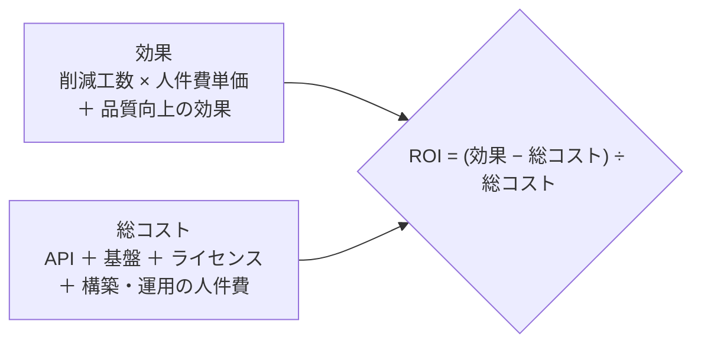
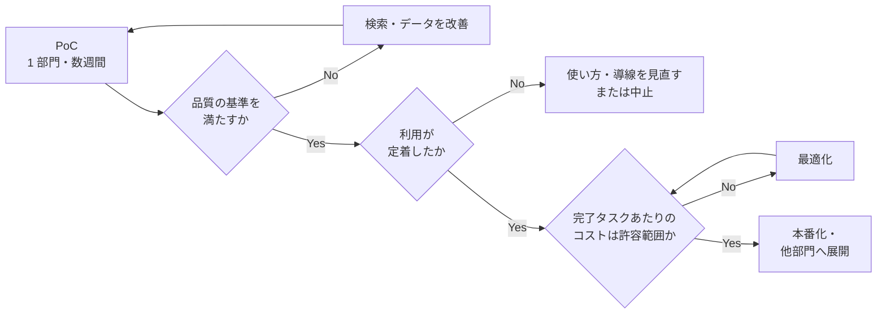

ナレッジ AI の ROI は、**API の請求額よりも「どれだけ使われ、どれだけ時間が浮いたか」** で決まります。
このページでは、効果とコストを同じ単位（金額）にそろえて比べる方法を扱います。

## ROI の基本式

### 効果の定量化

| 効果の種類 | 計算の例 | 測り方 |
| --- | --- | --- |
| **調査・作成時間の削減** | 利用回数 × 有効だった割合 × 1 回あたり削減時間 × 人件費単価 | 導入前後の作業時間の計測、サンプル調査 |
| **問い合わせの削減** | 削減件数 × 1 件あたりの対応時間 × 人件費単価 | 問い合わせ窓口のチケット数の推移 |
| **手戻り・ミスの削減** | 削減件数 × 1 件あたりの修正コスト | レビューでの指摘件数、障害・手戻りの件数 |
| **待ち時間の短縮** | 承認・レビュー待ちの短縮日数 | ワークフロー上の滞留時間 |

ユースケース別の品質・業務指標は [ユースケース概観 — 何で効果を測るか](/ai-tech-notes/use-cases/#何で効果を測るかkpi-の例) を参照してください。

### 総コストに含めるもの

| 区分 | 項目 | 見落としやすさ |
| --- | --- | --- |
| 従量 | LLM の API 代、Web 検索、埋め込み | 低（請求書に出る） |
| 固定 | 検索基盤・ベクトル DB、ライセンス（席課金） | 低 |
| 構築 | 取り込み・権限・評価の実装（人月） | 中 |
| **運用** | 評価セットの保守、同期ジョブの監視、タグ語彙の管理、誤回答への対応 | **高** |
| 利用者側 | 教育・利用ルールの整備、出典確認にかかる時間 | 高 |

## 試算例: 社内ナレッジ回答

[コスト構造の試算例](/ai-tech-notes/cost-roi/) と同じ条件（利用者 200 人、Claude Sonnet 5.5、キャッシュあり）で、効果を金額にします。
仮定: 1 回の利用で調査時間が **5 分** 減る、役に立った回答は **50%**、人件費単価 **5,000 円/時**、1 ドル = 150 円。

| 項目 | 1 人 1 日 5 回使う場合 | 1 人 1 日 1 回しか使わない場合 |
| --- | --- | --- |
| 月間利用回数 | 20,000 回 | 4,000 回 |
| 削減時間 | 20,000 × 50% × 5 分 ≒ 833 時間 | 4,000 × 50% × 5 分 ≒ 167 時間 |
| **効果（月）** | **約 417 万円** | **約 83 万円** |
| API 代 | 約 4 万円（約 $265） | 約 1 万円 |
| 検索基盤 | 10 万円 | 10 万円 |
| 運用担当（0.5 人月） | 50 万円 | 50 万円 |
| 構築費の月割り（300 万円 ÷ 12 か月） | 25 万円 | 25 万円 |
| **総コスト（月）** | **約 89 万円** | **約 86 万円** |
| **ROI** | **約 +370%** | **約 −3%（赤字）** |

この例から分かること:

- **API 代は総コストの 5% 未満** — コストの大半は運用と構築の人件費。トークン単価の最適化だけでは ROI はあまり動かない
- **ROI を決めるのは利用率** — 固定費がほぼ同じなので、使われなければ赤字になる。利用者への定着が最大の課題
- **「役に立った割合」も効く** — 回答品質が上がると、同じ利用回数でも効果が増える。品質改善は ROI 改善に直結する

:::caution[「浮いた時間」はそのまま現金にはならない]
削減時間 × 時給は **上限の見積もり** です。浮いた時間が他の業務に使われなければ、実際の効果は小さくなります。
経営判断に使う場合は、「残業の削減」「採用の抑制」「処理件数の増加」など、**実際に変わった数字** で裏付けてください。
:::

## 効果の測り方

| 方法 | 内容 | 注意 |
| --- | --- | --- |
| **導入前の基準値を取る** | 導入前に、対象業務の作業時間・問い合わせ件数を記録しておく | 導入後に測り始めると比較できない |
| **利用ログ** | 利用回数・利用者数・継続利用率（翌月も使った人の割合） | 回数が多くても、役に立っていない可能性がある |
| **回答ごとの評価** | 👍/👎、「この回答で解決したか」の回答 | 回答率が低いと偏る |
| **比較グループ** | 先行導入した部署と未導入の部署の指標を比べる | 部署の特性の違いに注意 |
| **サンプル調査** | 利用者に「この回答で何分短縮できたか」を定期的に聞く | 自己申告は過大になりやすい。控えめに補正する |

## PoC から本番化への判断基準

PoC の前に、**本番化する条件** を数値で決めておきます。後から決めると、印象論で延長を繰り返しがちです
（→ [アンチパターン — PoC 止まり](/ai-tech-notes/anti-patterns/#組織運用面のアンチパターン)）。

| 判断項目 | 基準の例 |
| --- | --- |
| 品質 | 評価セットでの正答率 ○% 以上、出典の正確さ ○% 以上（[評価](/ai-tech-notes/rag/evaluation/)） |
| 定着 | 対象者の ○% が週 1 回以上利用、翌月の継続利用率 ○% 以上 |
| 効果 | 対象業務の作業時間が ○% 短縮（基準値との比較） |
| コスト | 完了タスクあたりのコストが ○ 円以下、月額が予算内 |
| リスク | 権限外の情報が回答に含まれた件数が 0 件 |

:::tip[中止の基準も決めておく]
「品質は出たが使われない」場合は、技術ではなく業務への組み込み方が問題です。
期限までに定着しなければ **中止または対象業務の変更** を判断できるよう、撤退の条件も PoC 計画に書いておきます。
:::

## 規模を広げるときの注意

- **全社展開で従量コストは利用者数に比例して増える** — 部門展開時の実測値（1 人あたり月額）から再試算する
- **固定費は部門をまたいで共有できる** — 検索基盤・評価の仕組み・運用担当を共通化すると、2 部門目以降の ROI が上がる
- **ヘビーユーザーの割合が増えたら席課金と比べ直す** — 従量の 1 人あたり月額が席課金の単価を超えるなら、提供形態を見直す
  （[システム選定 — 提供形態](/ai-tech-notes/cost-roi/system-selection/#3-提供形態-席課金か従量課金かbuild-vs-buy)）

## 参考・出典

- [Optimizing for cost and intelligence](https://platform.claude.com/docs/en/about-claude/models/optimizing-for-cost-and-intelligence) — Claude Platform Docs
- [Usage and Cost Analytics API](https://platform.claude.com/docs/en/manage-claude/usage-cost-analytics-api) — Claude Platform Docs
