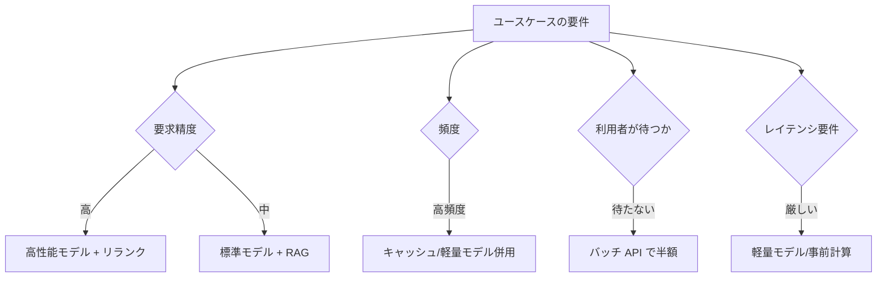

「最高性能を全処理に使う」のではなく、**ユースケースに見合った構成** を選ぶことが ROI を最大化します。
このページでは、コストに関わる 4 つの選択（モデル・調達経路・提供形態・検索基盤）を扱います。

## 選定の判断軸

## 1. モデル: 単価ではなく「完了タスクあたり」で比べる

モデルの階層・機能・選定フローは [AIモデルの特徴と選定](/ai-tech-notes/llm-basics/models/) にまとめています。
コストの観点では、同じ処理を各モデルで実行したときの金額差を把握しておくと判断しやすくなります。

**1,000 リクエストあたりのコスト**（入力 4,000 / 出力 800 トークン、キャッシュなし、2026 年 11 月時点）:

| モデル | 入力 | 出力 | 合計 | Haiku 比 |
| --- | --- | --- | --- | --- |
| Claude Fable 5.2 | $32 | $32 | **$64** | 80 倍 |
| Claude Opus 5.5 | $16 | $16 | **$32** | 40 倍 |
| Claude Sonnet 5.5 | $8 | $8 | **$16** | 20 倍 |
| Claude Haiku 5.5 | $0.40 | $0.40 | **$0.80** | 1 倍 |

ただし、この表は **1 回で正しく答えられる前提** の比較です。実際には次の点で順位が変わります。

- 安いモデルが失敗して **やり直し・人の手直し** が発生すれば、その分のコストがかかる
- 上位モデルは **少ない往復・短い推論** で終わることがあり、effort を下げれば下位モデルとほぼ同じコストになる場合もある
  （[effort を下げる](/ai-tech-notes/cost-roi/optimization/)）
- 推論（thinking）トークンの量はモデルと effort で大きく変わり、出力単価で課金される

Anthropic の指針では、多くのエージェント処理は **Opus 5.5 の既定設定から始め**、
大量かつ結果を検証できる処理（分類・抽出など）は **Haiku 5.5 から試す** ことが推奨されています。
いずれも評価セットで品質を確認してから、下げられるかを試します。

| 観点 | 軽量モデル | 標準モデル | 高性能モデル |
| --- | --- | --- | --- |
| 主な用途 | 分類・一次処理・タグ付け・FAQ | 一般的な回答 | 複雑な推論・重要なレビュー |
| コスト | 低 | 中 | 高 |
| レイテンシ | 速い | 中 | 遅め |
| 選定の目安 | 大量・定型・結果を検証できる | 対話型の既定候補 | 難所のみ、または低い effort で全体に |

## 2. 調達経路: 同じモデルでも請求のされ方が違う

同じ Claude のモデルでも、どこから使うかで価格と請求先が変わります。
社内の契約・データの所在要件・既存のクラウド割引をあわせて判断します。

| 経路 | 価格 | 請求 | 備考 |
| --- | --- | --- | --- |
| Claude API（直接契約） | 標準価格 | Anthropic から請求 | 新機能が最も早く使える |
| Claude Platform on AWS | 標準価格 | AWS Marketplace 経由 | Anthropic が運用。AWS の請求にまとめられる |
| Microsoft Foundry | 標準価格 | Azure Marketplace 経由 | Azure の請求・既存の契約にまとめられる |
| Amazon Bedrock / Google Cloud Vertex AI | **クラウド事業者が設定** | 各クラウドから請求 | リージョン指定のエンドポイントはグローバル比 1.1 倍 |

- データの処理地域を限定する場合は割増になることがある（Claude API の `inference_geo: "us"` は 1.1 倍）
- クラウドのコミット割引（利用額の事前契約）を消化できる経路を選ぶと、実質の単価が下がる場合がある
- 機能の提供状況は経路で異なる（例: 一部の新機能やバッチ API の提供時期）。必要な機能が使えるかを先に確認する

## 3. 提供形態: 席課金か従量課金か（Build vs Buy）

| 形態 | 料金体系 | 向くケース | 注意点 |
| --- | --- | --- | --- |
| **既製の AI アシスタント**（M365 Copilot、Claude の Team / Enterprise プランなど） | 利用者 1 人あたりの **席課金**（固定） | 全社員の日常業務。利用頻度にばらつきがある | 使わない人の席も課金される。回答ロジックの制御は限定的 |
| **マネージド検索基盤 ＋ 自前のエージェント** | API と検索基盤の **従量課金** | 業務特化の回答・ドラフト・レビュー | 検索基盤の料金（リランク・クエリ計画のトークン課金）も試算する |
| **フルスクラッチ**（OSS ベクトル DB 等） | インフラ費 ＋ API 従量 ＋ **運用人件費** | 特殊要件・大規模で単価を下げたい | 権限・同期・監視の運用負荷が大きい |

判断のポイント:

- **1 人あたりの月額 API コスト** と **席課金の単価** を比べる。ヘビーユーザーが多い業務は席課金、限られた部署の特定業務は従量課金が有利になりやすい
- 両方を組み合わせる構成も一般的です（日常は既製のアシスタント、業務特化の処理は自前）。全体像は
  [システム全体像 — 作るか・使うか](/ai-tech-notes/overview/architecture/#作るか使うかbuild-vs-buy) と
  [参考アーキテクチャ — M365 Copilot × Claude](/ai-tech-notes/mcp/m365-copilot-claude-reference/) を参照してください
- 自前構成の運用工数は見落とされがちです。[ROI の測り方](/ai-tech-notes/cost-roi/roi/) で人件費まで含めて比べます

:::note
席課金の単価・含まれる機能・利用上限は契約によって異なり、頻繁に改定されます。比較の際は最新の契約条件で確認してください。
:::

## 4. 検索基盤・ベクトル DB の選定観点

| 観点 | 確認すること |
| --- | --- |
| デプロイ形態 | マネージド / セルフホスト（運用負荷とコストのバランス） |
| スケール | 想定ベクトル件数・次元数に耐えるか。次元数はストレージ費に直結する |
| ハイブリッド検索 | ベクトル + キーワードを併用できるか（[検索](/ai-tech-notes/rag/retrieval/)） |
| メタデータフィルタ・権限 | 部署・期間・閲覧権限で絞れるか（[メタデータ](/ai-tech-notes/data-modeling/metadata/)） |
| 既存基盤との親和性 | 既存 DB の拡張で足りないか（新規導入のコストを避けられる） |
| コスト構造 | ストレージ / クエリ / インデックス更新 / エージェント型検索のトークン課金 |
| 埋め込みモデルの変更 | 変更すると全文書の再埋め込みが必要。その費用と時間（[埋め込みモデルの選び方](/ai-tech-notes/rag/retrieval/#埋め込みモデルの選び方)） |

:::tip
まずは **既存のデータ基盤（RDB のベクトル拡張など）で要件を満たせないか** を検討すると、
新規コンポーネントの導入・運用コストを避けられる場合があります。
:::

## 参考・出典

- [Pricing](https://platform.claude.com/docs/en/about-claude/pricing) — Claude Platform Docs
- [Optimizing for cost and intelligence](https://platform.claude.com/docs/en/about-claude/models/optimizing-for-cost-and-intelligence) — Claude Platform Docs
- [Data residency](https://platform.claude.com/docs/en/manage-claude/data-residency) — Claude Platform Docs
