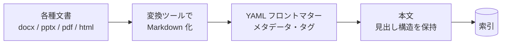

AI が高精度に扱えるかは、**データ形式の良し悪し** に大きく依存します。
本セクションでは、推奨フォーマット・メタデータ・タグ・バージョン管理を扱います。

## なぜ Markdown を推奨するか

| 観点 | Markdown の利点 |
| --- | --- |
| 構造 | 見出し階層がチャンク分割と相性が良い → [チャンク戦略](/ai-tech-notes/rag/chunking/) |
| 軽量 | 装飾・レイアウト情報が無く、ノイズが少なくトークン効率が良い |
| LLM との相性 | LLM は Markdown を大量に学習しており、見出し・表・コードブロックを正しく解釈しやすい |
| 差分管理 | Git で版管理・レビューしやすい |
| 移植性 | 各システムへの変換が容易 |

## コンテンツ種別ごとの推奨形式

| コンテンツ種別 | 推奨形式 | 理由 |
| --- | --- | --- |
| 文章・手順・仕様・FAQ | **Markdown** | 見出し構造がチャンクと相性◎・軽量・差分管理しやすい |
| 表・一覧・マスタ・設定値 | **CSV**（小さい表は Markdown の表） | 「1行＝1レコード」で意味が明確・構造化検索しやすい |
| 厳密な構造データ・設定 | JSON / YAML | スキーマがあり機械処理に向く |
| 図・画像 | 画像 ＋ **説明テキスト**（または Mermaid 等のテキスト図） | 画像だけでは検索索引に内容が入らない |
| （上記すべてに）付帯情報 | **＋メタデータ** | 出典・更新日・権限・タグで絞り込みと出典提示が効く → [メタデータ](/ai-tech-notes/data-modeling/metadata/) |

### 表データの扱い

- **ヘッダ＋値の対応（1行＝1レコード）を保つ** ことが最重要です。行だけを切り出したチャンクは列の意味を失います
- 大きな表は、**1行ごと（または数行ごと）に「列名: 値」の文章へ展開** してから索引化すると、検索で当たりやすくなります
- 集計・比較が必要な表（売上一覧など）は、RAG で探させるより **構造化データとして SQL やツールで引かせる** 方が正確です

### 図・画像の扱い

2026 年時点の主要モデルは画像を読めますが、**検索索引に入るのはテキスト** です。

- 図には **説明文（代替テキスト）** を付ける。フロー図・構成図は Mermaid などのテキスト図で書くと検索にも差分管理にも強い
- 取り込み時にマルチモーダルな LLM で図の説明文を自動生成する方法もある（コストと精度を評価して判断）

## 推奨するデータの形

## Office / PDF を Markdown に変換するツール

| ツール | 種類 | 得意なこと | 注意点 |
| --- | --- | --- | --- |
| **MarkItDown**（Microsoft） | OSS（Python） | Word / Excel / PowerPoint / PDF など多形式を手軽に Markdown 化 | 複雑な PDF のレイアウトや表の再現は限定的。信頼できない入力は無害化してから |
| **Docling** | OSS（Python、LF AI & Data） | PDF のレイアウト解析・表構造の復元に強い。Markdown / JSON 出力 | 処理が重め（GPU があると速い） |
| **Pandoc** | OSS（CLI） | docx・HTML など構造のある文書の相互変換が安定 | PDF からの変換は不得意 |
| **Azure AI Document Intelligence**（Layout） | マネージド | スキャン PDF の OCR、見出し・表を保った Markdown 出力 | ページ単位の従量課金 |
| **マルチモーダル LLM での変換** | API | 図・複雑なレイアウトを含むページを読み取って Markdown 化 | コストが高く、まれに内容を補ってしまうことがある。大量処理には向かない |

選び方の目安:

- **Office 文書（docx / pptx / xlsx）が中心** → MarkItDown や Pandoc で十分なことが多い
- **PDF（特にスキャン・表が多い）が中心** → Docling または Document Intelligence
- **少量だが重要で、図や複雑なレイアウトが多い** → マルチモーダル LLM での変換も候補

:::tip[ツールを決める前に「変換結果を目で見る」]
代表的な文書を 10〜20 件選び、各ツールで変換した Markdown を並べて比較してください。
見出しが本文に埋もれていないか、表の行と列が崩れていないかを確認するだけで、どのツールが自社の文書に合うかがほぼ分かります。
:::

## 横断アンチパターン

| アンチパターン | なぜダメか | 対策 |
| --- | --- | --- |
| スキャンPDF（画像）を丸ごと投入 | テキストが無く検索不能 | OCR、可能なら原本を MD 化 |
| Excel「方眼紙」/結合セル | 行＝レコードにならず表が壊れる | データ表に整形し CSV へ |
| 図表を画像で貼る（テキスト化なし） | 内容が索引に入らない | 代替テキスト・表（MD/CSV）で併記 |
| メタデータ無しで丸投げ | 絞り込み・出典提示ができない | 取り込み時に付与 |
| 巨大な単一ファイル | チャンクが粗くノイズ増 | 適切に分割（[チャンク戦略](/ai-tech-notes/rag/chunking/)） |
| 変換のたびに形式を往復させる | 変換のたびに構造が劣化する | 一次情報を Markdown に寄せ、変換は一方向に |

ソースごとの特徴（どこに良いメタデータがあるか等）は [データソース概観](/ai-tech-notes/data-sources/) を参照してください。

## 原則

1. **一次情報を Markdown 中心に寄せる**（変換のたびに劣化させない）
2. **メタデータを必ず付ける** → [メタデータ](/ai-tech-notes/data-modeling/metadata/)
3. **タグ語彙を統制する** → [YAML タグ](/ai-tech-notes/data-modeling/yaml-tags/)
4. **版を一意にする** → [バージョン管理](/ai-tech-notes/data-modeling/versioning/)

## 参考・出典

- [MarkItDown](https://github.com/microsoft/markitdown) — Microsoft（GitHub）
- [Docling](https://github.com/docling-project/docling) — Docling Project（GitHub）
- [Pandoc](https://pandoc.org/) — pandoc.org
- [Retrieval-Augmented Generation with Azure AI Document Intelligence](https://learn.microsoft.com/azure/ai-services/document-intelligence/concept/retrieval-augmented-generation) — Microsoft Learn
