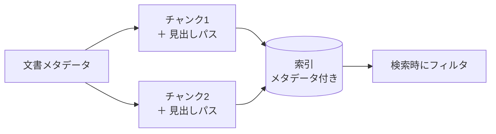

メタデータは **検索の絞り込み・権限制御・出典提示** を支える土台です。
本文だけを索引化すると「いつの・誰の・どの版か」が失われ、精度が落ちます。

## 標準スキーマ案（必須 / 任意）

まずは次の項目から始め、ユースケースに応じて追加します。

### 必須

| フィールド | 型 | 用途 | 例 |
| --- | --- | --- | --- |
| `doc_id` | 文字列 | 文書の一意な識別子。更新・削除の追跡に使う | `sp:site-hr/doc-12345` |
| `source_url` | URL | 出典リンク（**元システム** の URL） | `https://contoso.sharepoint.com/...` |
| `title` | 文字列 | 表示・検索 | `出張申請の手順` |
| `updated_at` | 日時 | 新しさでの絞り込み・並べ替え・表示 | `2026-04-01T09:00:00Z` |
| `status` | 列挙 | 最新・正本の判定（`draft` / `published` / `archived`） | `published` |
| `acl` | 文字列の配列 | 閲覧できるユーザー/グループ ID。**検索時の権限フィルタ** に使う | `["grp:hr-all"]` |

### 任意（推奨）

| フィールド | 型 | 用途 |
| --- | --- | --- |
| `doc_type` | 列挙 | 種別フィルタ（仕様 / 手順 / 議事録 / FAQ など） |
| `owner` / `team` | 文字列 | 責任の所在・部署での絞り込み |
| `tags` | 列挙の配列 | 主題での絞り込み → [YAML タグ](/ai-tech-notes/data-modeling/yaml-tags/) |
| `version` | 文字列/数値 | 版の識別 → [バージョン管理](/ai-tech-notes/data-modeling/versioning/) |
| `language` | 文字列 | 多言語文書の振り分け |
| `summary` | 文字列 | 文書の要約（検索結果の表示や、[文脈付きチャンク](/ai-tech-notes/rag/chunking/#文脈付きチャンクcontextual-retrieval) に利用） |
| `valid_until` | 日付 | 有効期限のある規程・案内の失効管理 |

:::tip[値は「選択式」にする]
`doc_type` や `tags` を自由記述にすると、「手順書」「手順」「マニュアル」のように表記が揺れ、絞り込みが効かなくなります。
**許可された値のリスト（列挙）から選ぶ** 形にしてください。
:::

## チャンクにもメタデータを継承する



- 文書メタデータをチャンクへ継承し、**見出しパス**（章 > 節）を追加すると出典提示が精密になる
- 索引に保存される 1 チャンクのイメージ:

```json
{
  "chunk_id": "sp:site-hr/doc-12345#3",
  "doc_id": "sp:site-hr/doc-12345",
  "title": "出張申請の手順",
  "heading_path": "出張申請の手順 > 2. 申請期限",
  "content": "出張の申請は、出発日の 5 営業日前までに...",
  "source_url": "https://contoso.sharepoint.com/sites/hr/...",
  "updated_at": "2026-04-01T09:00:00Z",
  "status": "published",
  "doc_type": "procedure",
  "tags": ["総務", "申請"],
  "acl": ["grp:hr-all", "grp:all-employees"]
}
```

## 検索基盤側の設定

メタデータは、索引のスキーマで **絞り込み可能（filterable）** に設定して初めて検索に使えます。

| 設定 | 対象のフィールド | 注意 |
| --- | --- | --- |
| 絞り込み（filterable） | `status`、`doc_type`、`team`、`tags`、`acl`、`updated_at` | 文字列の絞り込みは完全一致。表記揺れがあると漏れる |
| 並べ替え（sortable） | `updated_at` | 新しい順の表示に使う |
| 集計（facetable） | `doc_type`、`tags` | 検索画面で「種別ごとの件数」を出す場合に |
| 検索対象（searchable） | `title`、`content`、`summary` | メタデータの全項目を検索対象にする必要はない |

Azure AI Search などでは、**後から属性を変えると索引の作り直しが必要** になる場合があります。最初に設計を固めておきます。

## メタデータ付与の自動化

人手ですべてのメタデータを付けるのは現実的ではありません。次の順で自動化します。

| 取得元 | 自動化できる項目 | 方法 |
| --- | --- | --- |
| 元システムの属性 | `doc_id`、`source_url`、`title`、`updated_at`、`owner`、`acl` | コネクタ・API から取得（最も信頼できる） |
| 格納場所・命名規則 | `team`、`doc_type` | フォルダ / サイト / スペースとの対応表で変換 |
| 本文の内容 | `summary`、`tags`、`doc_type` | LLM で抽出。**選択肢を構造化出力で固定** し、語彙外の値を出させない |

- LLM で付けたタグ・種別は、一定割合を人が抜き取り確認し、精度を測ってから全件に適用します
- 元システムの属性（特に権限）は LLM に推測させず、必ずシステムから取得します

## 参考・出典

- [Create an index in Azure AI Search（フィールド属性）](https://learn.microsoft.com/azure/search/search-how-to-create-search-index) — Microsoft Learn
- [Faceted navigation in Azure AI Search](https://learn.microsoft.com/azure/search/search-faceted-navigation) — Microsoft Learn
- [Structured outputs](https://platform.claude.com/docs/en/build-with-claude/structured-outputs) — Claude Platform Docs
