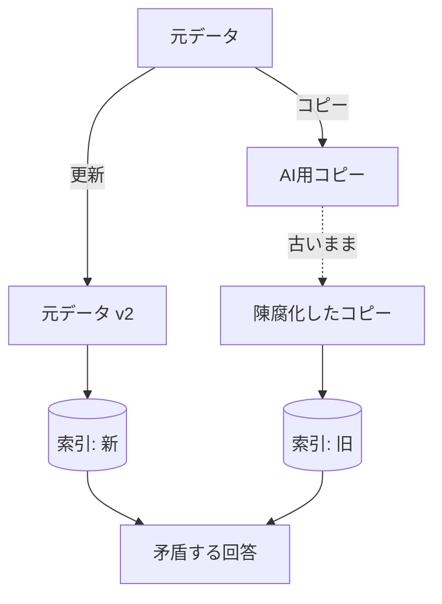
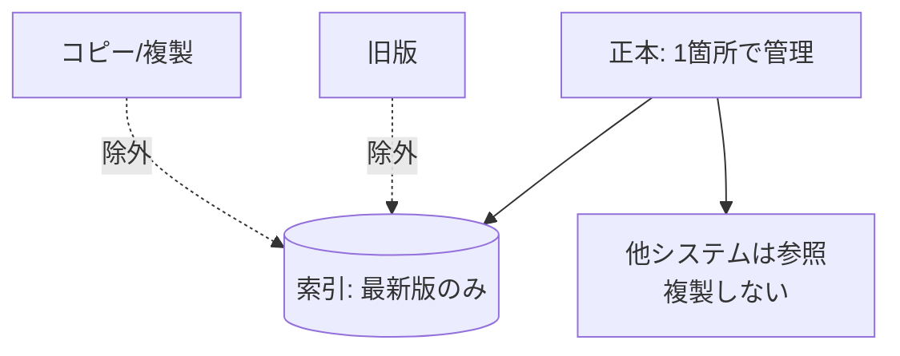
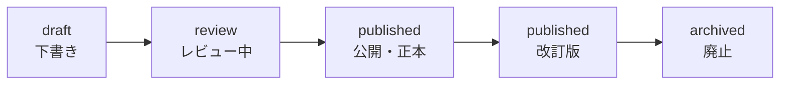
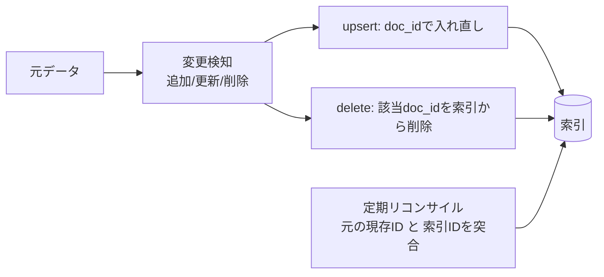

ナレッジ AI の精度低下で最も多い原因のひとつが、**古い版や複製が索引に混在** することです。
このページでは、なぜそれが起きるのかを確認してから、版を一意に保つ設計と、
索引を元データに追従させ続ける同期の仕組みを扱います。

## 何が起きるか — AI 用コピーの落とし穴

「AI に読ませるために、データを別の場所へコピーする」——
一見便利ですが、**重複と版ずれ** を生み、回答の矛盾や精度低下を招く代表的なアンチパターンです。

- 元が更新されてもコピーは古いまま → **古い情報で回答**
- 同じ内容が複数版で索引化 → **検索が割れて精度低下**
- どれが正本か不明 → **信頼性の喪失**

## 原則: 一次情報は1つ（Single Source of Truth）

| 対策 | 内容 |
| --- | --- |
| 参照を基本に | 複製せず元を参照（[データソース](/ai-tech-notes/data-sources/)） |
| そもそも索引を持たない | SharePoint なら Retrieval API、JIRA などは公式 MCP で **元から直接取得** する（[接続手段の選択肢](/ai-tech-notes/data-sources/#接続手段の選択肢2026-年時点)） |
| 正本を1つに定める | 文書ごとに正本の置き場所を決め、他所にはコピーではなく **リンク** を置く |
| 最新版のみ索引 | 文書の状態と版を見て、公開中の最新版だけを索引に入れる（下記） |
| 同期 ＋ 削除の伝播 | 元の更新・削除を索引へ反映し続ける（[同期ジョブと失効ルール](#同期ジョブと失効ルール)） |

## 文書の状態（ライフサイクル）を決める

「どの状態の文書を索引に入れるか」を明確にします。

| 状態 | 索引 | 補足 |
| --- | --- | --- |
| draft / review | 入れない | 未確定の情報で回答させない |
| published | **入れる（最新の 1 版のみ）** | 改訂されたら旧版のチャンクを削除して入れ替える |
| archived | 入れない（または別索引） | 「過去の規程」を調べる用途があれば、通常検索とは分けて明示的に検索させる |

## 元システムごとの「最新版」の扱い

| ソース | 版の仕組み | 索引での扱い |
| --- | --- | --- |
| SharePoint | ファイルごとのバージョン履歴（同じ URL） | 現行版だけを取得すれば自動的に最新になる。**別名保存したコピー** が重複の原因 |
| Confluence | ページの版履歴・下書き・アーカイブ | 公開中の最新版のみ。アーカイブ済みスペース・ページは除外 |
| GitHub | ブランチ・タグ | 既定ブランチ（main）の内容のみ。リリース単位の文書はタグで固定 |
| File Server | 仕組みなし（ファイル名で区別） | `_v2`・`最終` 等の命名から版を判定するのは困難。正本フォルダを決めて限定する |

## 実装の勘所

| 施策 | 内容 |
| --- | --- |
| 正本の明示 | `status: published` / `canonical: true` で正本を識別 |
| 最新版のみ索引 | `version` / `updated_at` で最新だけを採用 |
| 重複排除 | 内容のハッシュ値で同一文書を、類似度で「ほぼ同じ」文書を検出し統合 |
| 失効の伝播 | 元が更新/削除されたら索引も更新（増分同期） |
| 出典の一意化 | `source_url` で原文に一意に辿れる |

### 重複の検出方法

| 種類 | 検出方法 | 例 |
| --- | --- | --- |
| 完全一致 | 本文（正規化後）のハッシュ値を比較 | 同じファイルが 2 つのフォルダに置かれている |
| ほぼ一致 | 類似度（埋め込みのコサイン類似度、MinHash など）が閾値以上 | 日付だけ違う版、体裁だけ直したコピー |
| 正本の判定 | 重複グループ内で、`status`・格納場所・更新日から正本を 1 つ選ぶ | 正本以外は索引から外し、管理者に整理を依頼 |

重複を検出したら **自動で消すのではなく、まず一覧化して所有者に確認** します。
誤って正本を消すと回答できなくなるためです。

## 同期ジョブと失効ルール

「複製しない」が理想ですが、RAG では結局 **索引（コピーの一種）** を持ちます。
大事なのは **索引を元データに追従させ続ける** ことです。どのソースでも共通する型は次の通りです。

- **安定した doc_id:** 元システムの **不変 ID** を doc_id にする（パスや表示名は使わない）。
  各チャンクに doc_id を持たせ、文書単位でまとめて削除・入れ替えできるようにする
- **upsert（冪等）:** 更新時は古いチャンクを delete してから入れ直す（重複防止・再実行しても安全）
- **削除の伝播（失効）:** 元の削除・アーカイブ・権限変更を検知し、索引にも反映する。
  更新日時だけを見る方式では **削除を検知できない** ので、差分取得 API などで削除も拾う
- **リコンサイル（棚卸し）:** 取りこぼした削除を拾うため、定期的に「元の現存 ID の集合」と「索引の ID 集合」を突き合わせ、差分を削除する
- **イベント駆動 or ポーリング:** Webhook で即時反映するか、定期バッチで差分を取得する

### ソース別の変更検知（要点）

| ソース | 変更検知 | 削除検知 | 即時連携 | 安定キー |
| --- | --- | --- | --- | --- |
| SharePoint | Graph **delta クエリ** | delta の `deleted` ファセット | Graph 変更通知（webhook） | driveItem / list item の ID |
| Network File Server | 更新日時＋サイズ＋**内容ハッシュ**のマニフェスト比較 | 全列挙の差分（前回有・今回無→削除） | NTFS 変更ジャーナル(USN) / FileSystemWatcher | 内容ハッシュ（パスは不安定） |
| Confluence | CQL `lastmodified` ＋ `version.number` | 現存ページID と 索引IDの突合 | Confluence **webhook** | content id |
| JIRA | JQL `updated >= ...`（新しい検索 API で） | 現存課題IDとの突合 | Jira **webhook** | issue id |
| GitHub | コミット差分（前回同期のコミット以降） | 差分に含まれる削除ファイル | GitHub **webhook**（push） | リポジトリ＋パス（または blob SHA） |

### ソース別の具体例

#### SharePoint（Microsoft Graph）

- **delta クエリ:** ライブラリ/リストに `/delta` を発行し、前回の deltaLink トークン以降の
  **追加・更新・削除** をまとめて取得。削除は `deleted` ファセット付きで返るので、その ID の索引チャンクを delete。
- **バージョン:** アイテムにバージョン履歴がある → **最新版のみ索引**。`eTag` / `cTag` で内容変更を判定。
- **即時化:** Graph の変更通知（subscription / webhook）でニアリアルタイム同期。大規模では delta との併用が定番。
- **正本化:** 「この文書は SharePoint が正本」と決め、他所にはコピーではなく **リンク** を置く。

#### Network File Server（SMB / Windows 共有）

変更フィードが無いのが難点で、自前の検知が必要です。

- **マニフェスト方式（一般的）:** `パス → (更新日時, サイズ, 内容ハッシュ)` を前回分として保存。
  クロールで差分を検出し、**消失したパス＝削除** として索引から delete。
- **NTFS 変更ジャーナル（USN Journal）/ FileSystemWatcher:** より即時・高度なイベント検知。
- **キー設計:** ファイルパスは改名・移動で変わり不安定。**内容ハッシュを doc_id** にすると移動に強く、
  重複排除も同時に効く（同一ハッシュ＝重複として1件に統合）。
- **正本化:** 可能なら一次情報を Confluence / SharePoint 等の管理された場所へ移し、ファイルサーバーは縮小する。

#### Confluence

- **増分取得:** CQL（例 `lastmodified >= "2026/01/01 00:00"`）で更新ページのみ取得。`version.number` で版を判定し最新のみ索引。
- **削除/アーカイブ:** 削除が API で拾いにくい場合がある → スペース単位で **現存ページ ID の集合** を取得し、
  索引の ID 集合と突合して差分を delete（リコンサイル）。ゴミ箱・アーカイブも反映。
- **即時化:** Confluence の **webhook**（page_created / updated / removed / trashed）でイベント駆動同期。
- **正本化:** Wiki を「手順・仕様の正本」と位置づけ、各所からはページに **リンク**（PDF 等で配り直さない）。

:::tip[共通の勘所]
**削除の取りこぼし** が最も多い失敗です。**イベント（webhook / delta）＋定期リコンサイル** の二重化で、
「消えた・古くなった情報が索引に残り続ける」状態を防ぎます。
:::

## チェックリスト

- [ ] 同一文書が複数ソース・複数経路で重複していないか（例: SharePoint の Copilot 知識と、同じ文書を自前索引にも登録）
- [ ] AI 用に作ったコピーが元の更新に追従できているか
- [ ] 旧版・下書きが検索に出てこないか
- [ ] 削除・アーカイブ・権限変更が索引に反映されるか（どのくらいの遅れで）
- [ ] 重複を検出したときの確認・整理の担当者が決まっているか

:::caution
やむを得ず複製する場合も、**同期ジョブと失効ルール** を必ずセットで設計してください。
:::

## 参考・出典

- [Use delta query to track changes in Microsoft Graph data](https://learn.microsoft.com/graph/delta-query-overview) — Microsoft Learn
- [Microsoft Graph change notifications overview](https://learn.microsoft.com/graph/change-notifications-overview) — Microsoft Learn
- [Versioning in SharePoint](https://learn.microsoft.com/sharepoint/document-library-version-history-limits) — Microsoft Learn
- [Retrieval API overview](https://learn.microsoft.com/microsoft-365-copilot/extensibility/api-reference/retrieval-api-overview) — Microsoft Learn
- [Change journals（NTFS USN）](https://learn.microsoft.com/windows/win32/fileio/change-journals) — Microsoft Learn
- [Advanced searching using CQL](https://developer.atlassian.com/cloud/confluence/advanced-searching-using-cql/) — Atlassian Developer
- [Confluence webhooks](https://developer.atlassian.com/cloud/confluence/modules/webhook/) — Atlassian Developer
