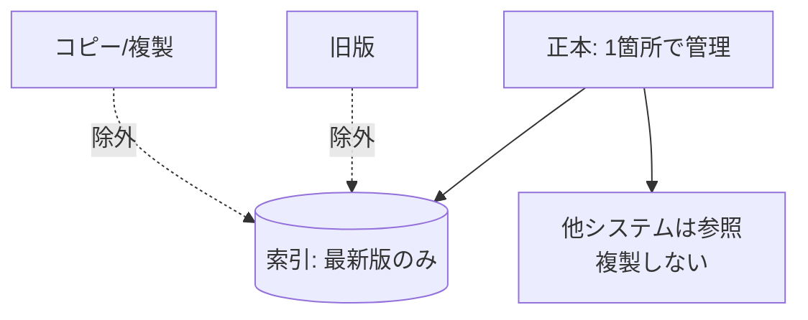
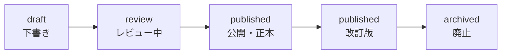

ナレッジ AI の精度低下で最も多い原因のひとつが、**古い版や複製が索引に混在** することです。
ここでは版を一意に保つ設計を扱います（落とし穴の詳細は
[アンチパターン](/ai-tech-notes/anti-patterns/data-duplication/)）。

## 原則: 一次情報は1つ（Single Source of Truth）

## 文書の状態（ライフサイクル）を決める

「どの状態の文書を索引に入れるか」を明確にします。

| 状態 | 索引 | 補足 |
| --- | --- | --- |
| draft / review | 入れない | 未確定の情報で回答させない |
| published | **入れる（最新の 1 版のみ）** | 改訂されたら旧版のチャンクを削除して入れ替える |
| archived | 入れない（または別索引） | 「過去の規程」を調べる用途があれば、通常検索とは分けて明示的に検索させる |

## 元システムごとの「最新版」の扱い

| ソース | 版の仕組み | 索引での扱い |
| --- | --- | --- |
| SharePoint | ファイルごとのバージョン履歴（同じ URL） | 現行版だけを取得すれば自動的に最新になる。**別名保存したコピー** が重複の原因 |
| Confluence | ページの版履歴・下書き・アーカイブ | 公開中の最新版のみ。アーカイブ済みスペース・ページは除外 |
| GitHub | ブランチ・タグ | 既定ブランチ（main）の内容のみ。リリース単位の文書はタグで固定 |
| File Server | 仕組みなし（ファイル名で区別） | `_v2`・`最終` 等の命名から版を判定するのは困難。正本フォルダを決めて限定する |

## 実装の勘所

| 施策 | 内容 |
| --- | --- |
| 正本の明示 | `status: published` / `canonical: true` で正本を識別 |
| 最新版のみ索引 | `version` / `updated_at` で最新だけを採用 |
| 重複排除 | 内容のハッシュ値で同一文書を、類似度で「ほぼ同じ」文書を検出し統合 |
| 失効の伝播 | 元が更新/削除されたら索引も更新（増分同期） |
| 出典の一意化 | `source_url` で原文に一意に辿れる |

### 重複の検出方法

| 種類 | 検出方法 | 例 |
| --- | --- | --- |
| 完全一致 | 本文（正規化後）のハッシュ値を比較 | 同じファイルが 2 つのフォルダに置かれている |
| ほぼ一致 | 類似度（埋め込みのコサイン類似度、MinHash など）が閾値以上 | 日付だけ違う版、体裁だけ直したコピー |
| 正本の判定 | 重複グループ内で、`status`・格納場所・更新日から正本を 1 つ選ぶ | 正本以外は索引から外し、管理者に整理を依頼 |

重複を検出したら **自動で消すのではなく、まず一覧化して所有者に確認** します。
誤って正本を消すと回答できなくなるためです。

### 削除・更新の伝播

元の文書が削除・移動・権限変更されたら、索引も追随させる必要があります。

- 各チャンクに `doc_id` を持たせ、**文書単位でまとめて削除・入れ替え** できるようにする
- 差分取得 API（SharePoint の delta クエリなど）で削除も検知する。更新日時だけを見る方式では **削除を検知できない**
- 定期的に「索引にあるのに元に無い文書」を突き合わせる全件チェックも行う（差分同期の取りこぼし対策）

## チェックリスト

- [ ] 同一文書が複数ソースに重複していないか
- [ ] 旧版・下書きが検索に出てこないか
- [ ] 削除・アーカイブ・権限変更が索引に反映されるか（どのくらいの遅れで）
- [ ] 重複を検出したときの確認・整理の担当者が決まっているか

:::tip
「AI 用にデータを別の場所へコピー」は重複バージョン問題を生みます。**参照** を基本に。
:::

## 参考・出典

- [Use delta query to track changes in Microsoft Graph data](https://learn.microsoft.com/graph/delta-query-overview) — Microsoft Learn
- [Versioning in SharePoint](https://learn.microsoft.com/sharepoint/document-library-version-history-limits) — Microsoft Learn
