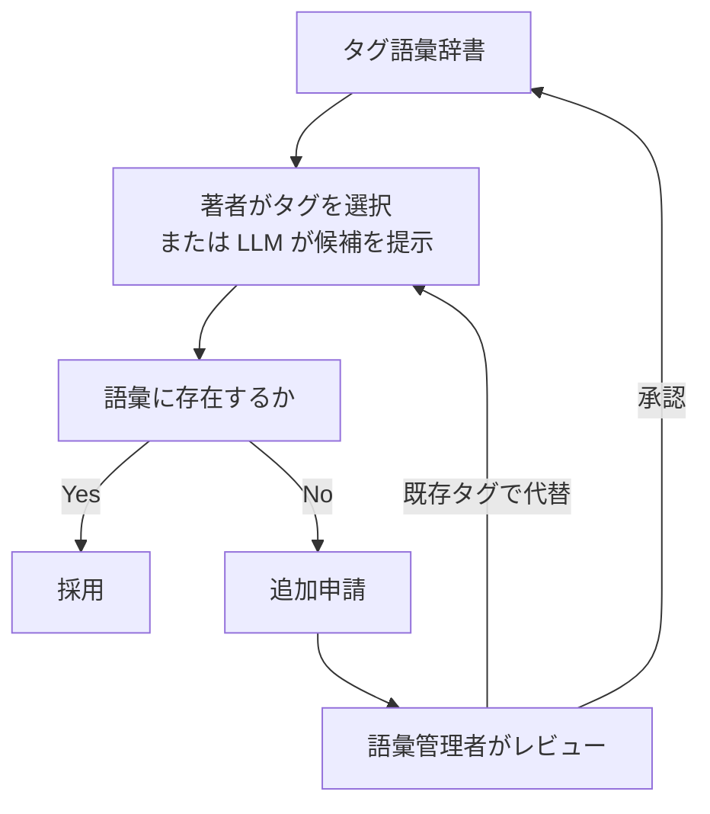

Markdown の **YAML フロントマター** にメタデータとタグを書くと、
人にも機械にも扱いやすい形でナレッジを構造化できます。

## フロントマターの例

```markdown
---
title: 出張申請の手順
doc_type: procedure
team: 総務
status: published
version: 3
updated_at: 2026-04-01
tags: [総務, 申請, ワークフロー]
source: confluence://SPACE/12345
---

本文（見出し構造を保ったまま）...
```

項目の意味と必須/任意の区分は [メタデータ付与](/ai-tech-notes/data-modeling/metadata/) の標準スキーマに合わせます。

## タグ設計の原則

- **統制語彙（controlled vocabulary）:** 自由記述を避け、許可リストから選ぶ
- **粒度を揃える:** 「人事」「人事制度」「採用」が混在しないよう階層を決める
- **件数を絞る:** 1 文書に多すぎるタグはノイズになる（目安: 3〜5 個）
- **同義語を辞書で吸収する:** 「出張」「旅費」のような言い換えは、タグを増やさず同義語として登録する

## タグ語彙辞書のサンプル

語彙辞書は、それ自体を YAML などのファイルで管理し、Git でレビュー・履歴管理します。

```yaml
# tags.yaml — タグ語彙辞書
version: 2026-11
tags:
  - id: 総務
    description: 総務部が所管する手続き・規程
    children:
      - id: 申請
        description: 各種申請の手順・様式
        synonyms: [届出, 申込]
      - id: 出張
        synonyms: [旅費, 出張旅費]
  - id: 人事
    children:
      - id: 採用
      - id: 評価
        synonyms: [人事考課]
  - id: 情報システム
    children:
      - id: アカウント
        synonyms: [ID, パスワード]
deprecated:
  - id: 人事制度        # 2026-04 廃止。「人事」配下に再編
    replaced_by: 人事
```

- `synonyms` は、検索時のクエリ拡張（同義語マップ）にも流用できる
- 廃止したタグは消さずに `deprecated` に残し、`replaced_by` で移行先を示す（過去文書の自動変換に使う）

## 運用フロー



| 役割 | 担当 | 頻度 |
| --- | --- | --- |
| 語彙辞書の管理者 | 部門ごとに 1 名（全体の調整役を 1 名） | 追加申請のたびに審査 |
| 棚卸し | 管理者 | 四半期ごと。使われていないタグ・表記揺れ・肥大化した分類を見直す |
| 利用状況の確認 | 管理者 | 検索ログで「タグで絞り込まれているか」「0 件ヒットが多いタグ」を確認 |

## 自動付与と検証

### LLM によるタグの自動付与

既存文書に大量にタグを付けるときは、LLM に本文を読ませて候補を出させます。
このとき、**語彙辞書の ID を選択肢として構造化出力のスキーマ（列挙型）に入れる** と、
辞書に無いタグを勝手に作らせずに済みます。

### フロントマターの機械的な検証

フロントマターは人が書くため、誤りが入ります。**取り込み前、または Git へのコミット時に自動で検証** します。

- 必須項目（`title`、`status`、`updated_at` など）が揃っているか
- `tags` の値が語彙辞書に存在するか（廃止タグは置き換えを提案）
- `status` や `doc_type` が許可された値か
- 日付の形式が正しいか

JSON Schema などでスキーマを定義し、CI（プルリクエストのチェック）で検証すると、誤りが索引に入る前に止められます。

## 注意

- 語彙を放置すると表記揺れで検索精度が落ちる → 定期的な棚卸し
- タグはメタデータフィルタ（[メタデータ](/ai-tech-notes/data-modeling/metadata/)）と連動させる
- タグ付けを著者任せにしすぎない。必須にするのは少数の重要な分類だけに絞り、残りは自動付与で補う

## 参考・出典

- [Structured outputs](https://platform.claude.com/docs/en/build-with-claude/structured-outputs) — Claude Platform Docs
- [Synonyms in Azure AI Search](https://learn.microsoft.com/azure/search/search-synonyms) — Microsoft Learn
- [JSON Schema](https://json-schema.org/) — json-schema.org
