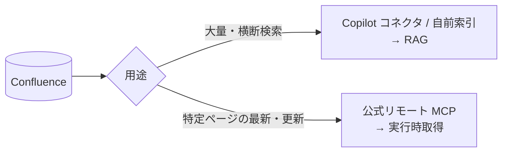

Confluence は Wiki・仕様・手順書の中心的な置き場です。
**ページ構造・ラベル・スペース**という良質なメタデータを持つのが強みです。

## 活用ポイント

- **スペース/ページ階層** をメタデータとして検索フィルタに使う
- **ラベル**を [タグ設計](/ai-tech-notes/data-modeling/yaml-tags/) に取り込む
- ページ本文は HTML → [Markdown 正規化](/ai-tech-notes/data-modeling/) して索引化

## 接続方式

| 方式 | 向くケース | 注意 |
| --- | --- | --- |
| **Copilot コネクタ**（Confluence Cloud / On-premises） | M365 Copilot から全社 Wiki を横断検索 | スペースの権限が反映されるか、対象スペースの範囲を確認 |
| **公式リモート MCP**（Atlassian Rovo MCP Server） | 特定ページの最新取得・ページ作成 | 利用者本人の権限で動作。プラン別のレート制限あり |
| **REST API（v2）で自前取り込み** | 自前の索引で検索を作り込みたい | 増分同期・ページング・権限の取得を自前で実装 |

## 注意

- 版管理が効くので、**最新版のみ索引** する（古い版を混ぜない）
- アーカイブ済みページの扱いを決める
- Data Center（オンプレミス）版は **2029 年 3 月 28 日に提供終了** 予定。新規の接続は Cloud を前提に設計する

## おすすめのデータ形式

Confluence は **良質なメタデータ（スペース・ラベル・階層）** を最初から持つのが強みです。

| 要素 | おすすめの扱い |
| --- | --- |
| ページ本文（ADF 形式の JSON、または HTML 相当の storage 形式） | **Markdown 正規化**。見出し構造を保持 |
| 表 | 小さい表は **MD 表**、大きい/分析用は **CSV** |
| ラベル | [タグ](/ai-tech-notes/data-modeling/yaml-tags/) として取り込む |
| スペース・ページ階層 | 検索フィルタ用の **メタデータ** に |
| 添付（Office/PDF） | [File Server](/ai-tech-notes/data-sources/file-server/) と同様に抽出して MD/CSV 化 |

## アンチパターン

| アンチパターン | なぜダメか | 対策 |
| --- | --- | --- |
| マクロ・動的コンテンツ依存 | 静的テキスト化されず欠落する | 重要情報は本文テキストで持つ |
| 1ページに巨大な内容を詰める | チャンクが粗くなり精度低下 | ページ分割・見出しで構造化 |
| 図・表を画像添付のみで載せる | 索引に内容が入らない | テキスト/表で併記、代替テキスト |
| 旧版・下書きページが混在 | 古い情報で回答してしまう | 公開・最新（status）のみ索引 |

## 大きなデータの扱い

- 添付の最大サイズはプラン/環境（Cloud / Data Center）で異なる → 事前に確認
- **巨大な1ページ**は分割し、見出しで構造化（チャンクが粗くなるのを防ぐ）
- 巨大な添付（Office/PDF）は [File Server](/ai-tech-notes/data-sources/file-server/) と同様に**抽出して必要部分のみ**索引化
- 全 Wiki の取得は **API のページング**で行い、増分同期で差分のみ更新

## 参考・出典

- [Confluence Cloud REST API v2](https://developer.atlassian.com/cloud/confluence/rest/v2/intro/) — Atlassian Developer
- [Getting started with the Atlassian Rovo MCP Server](https://support.atlassian.com/rovo/docs/atlassian-remote-mcp-server/) — Atlassian
- [Copilot connectors gallery（Microsoft 提供）](https://learn.microsoft.com/microsoft-365/copilot/connectors/connectors-gallery-microsoft) — Microsoft Learn
- [Data Center end of life](https://www.atlassian.com/licensing/data-center-end-of-life) — Atlassian
