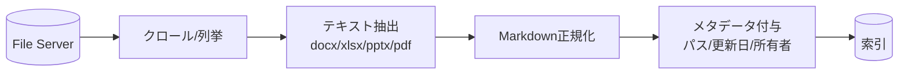

共有ファイルサーバ（SMB/Windows 共有）には Office 文書・PDF・図面などが蓄積されます。
**非構造データが多く、メタデータが乏しい**のが特徴です。

## 取り込みの流れ

## 勘所と注意

- **抽出品質がすべて:** スキャンPDFはOCRが必要。表・図は欠落しやすい
- **メタデータが薄い:** フォルダ構成・更新日・所有者を補助メタデータに使う
- **重複の温床:** `最終_v2_本当に最終.docx` 問題 → [重複対策](/ai-tech-notes/anti-patterns/data-duplication/)
- **権限:** NTFS/共有権限をインデックスのアクセス制御に反映

## 接続手段

| 手段 | 内容 | 注意点 |
| --- | --- | --- |
| **Copilot コネクタ（File Share）** | 社内の Windows サーバにコネクタのエージェントを入れ、ファイル共有を M365 の索引に取り込む | 読み取り用アカウントに全ファイルの閲覧権限が必要。NTFS の権限と Entra ID のユーザー/グループの対応を事前に確認 |
| **SharePoint / Azure Files へ移行してから接続** | ファイルサーバ自体をクラウドへ移し、クラウド側の接続手段を使う | 移行のついでに重複・古いファイルを整理できる。長期的には最も筋が良い |
| **自前のクローラ** | SMB 共有を列挙・抽出して自前の索引へ | NTFS ACL の取得と、Entra ID の ID への対応付けを自前で行う必要がある |

:::caution[ファイルをクラウドへ「コピー」して索引化しない]
索引化のためだけにファイルサーバの内容を Blob ストレージなどへコピーすると、
元とコピーの **二重管理（版ずれ）** が始まります。コピーするなら「移行」として元を廃止するか、元を直接読む手段を選びます。
→ [データ複製と重複バージョン問題](/ai-tech-notes/anti-patterns/data-duplication/)
:::

## 推奨

- 可能なら一次情報を [Markdown 中心](/ai-tech-notes/data-modeling/) の管理へ、あるいは SharePoint へ移行
- 増分クロール（更新日時ベース）でコスト削減
- Office・PDF からのテキスト抽出は、見出し・表を保つ **レイアウト解析**（Azure AI Document Intelligence など）を使う → [チャンク戦略](/ai-tech-notes/rag/chunking/)

## おすすめのデータ形式

非構造データが多く、**変換の質がそのまま精度になる**のが File Server の特徴です。

| 元データ | おすすめの扱い |
| --- | --- |
| Word / PowerPoint（docx/pptx） | 見出し構造を保って **Markdown 化** |
| Excel（xlsx） | **CSV として抽出**。1行＝1レコードになるよう整形 |
| PDF（テキスト） | テキスト抽出 → Markdown 化 |
| 図面・スキャンPDF | OCR でテキスト化し、代替テキストを付与 |

- メタデータが薄いので、**フォルダ構成・ファイル名規約・更新日・所有者**を補助メタデータに変換する
- 中長期的には、頻繁に参照される一次情報を **Markdown ＋ メタデータ** で管理する形へ寄せると精度が安定

## アンチパターン

| アンチパターン | なぜダメか | 対策 |
| --- | --- | --- |
| `最終_v2_本当に最終.docx` | 重複版が索引に乱立し古い情報で回答 | 正本を1つに（[重複対策](/ai-tech-notes/anti-patterns/data-duplication/)） |
| Excel「方眼紙」・結合セル | 表が壊れ CSV 化できない | レイアウト用途をやめ、データ表に整形 |
| スキャンPDF（画像のみ） | テキストが無く検索不能 | OCR、可能なら原本を MD 化 |
| パスワード付き・独自バイナリ | テキスト抽出ができない | 解除・標準形式へ変換してから取り込む |
| フォルダ階層に意味を埋める | メタデータとして扱われない | 階層をタグ／メタデータへ写す |

## 大きなデータの扱い

ファイルサーバーには動画・CAD 図面・高解像度 PDF など、**巨大ファイル**が紛れがちです。

- 大容量ファイルは**丸ごと索引化せず**、テキスト抽出・要約・必要ページのみを索引に
- 動画/音声は**文字起こし**してテキスト化
- **サイズ閾値**で取り込み対象を線引きし、巨大バイナリは除外
- 全件再スキャンを避け、**更新日時ベースの増分クロール**でコストを抑える

## 参考・出典

- [File share Microsoft 365 Copilot connector](https://learn.microsoft.com/microsoftsearch/fileshare-connector) — Microsoft Learn
- [What is Azure AI Document Intelligence?](https://learn.microsoft.com/azure/ai-services/document-intelligence/overview) — Microsoft Learn
