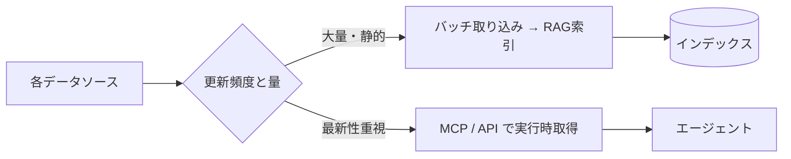
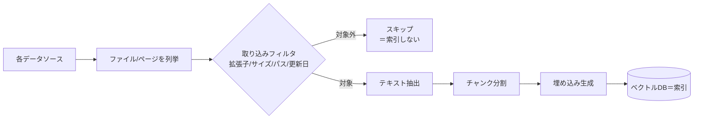

社内ナレッジは複数のシステムに分散しています。本セクションでは
**Microsoft 系を中心とした主要データソース**への接続戦略を整理します。
（Google Workspace 系は本サイトのスコープ外です）

## 対象データソース

| ソース | 主なコンテンツ | 接続方式の例 | 詳細 |
| --- | --- | --- | --- |
| Network File Server | Office文書・PDF・図面 | Copilot コネクタ（File Share）/ バッチ取り込み | [File Server](/ai-tech-notes/data-sources/file-server/) |
| Confluence | Wiki・仕様・手順 | 公式リモート MCP / Copilot コネクタ / REST API | [Confluence](/ai-tech-notes/data-sources/confluence/) |
| JIRA | チケット・要件・履歴 | 公式リモート MCP / Copilot コネクタ / REST API | [JIRA](/ai-tech-notes/data-sources/jira/) |
| GitHub | コード・PR・Issue | 公式 MCP サーバ / Copilot コネクタ / API | [GitHub](/ai-tech-notes/data-sources/github/) |
| SharePoint | 文書・社内ポータル | Retrieval API / Azure AI Search / Graph API | [SharePoint](/ai-tech-notes/data-sources/sharepoint/) |

## 接続戦略の基本



## 接続手段の選択肢（2026 年時点）

数年前は「各 API を叩いて自前で取り込む」しかありませんでしたが、現在は **既製の接続手段** が揃っています。
自前実装の前に、次の選択肢で要件を満たせないかを確認します。

| 接続手段 | 仕組み | 権限の扱い | 向くケース |
| --- | --- | --- | --- |
| **Copilot コネクタ（Synced）** | 外部データを Microsoft 365 の索引に取り込む | 元システムの ACL を取り込んで反映（コネクタにより差あり） | M365 Copilot / Copilot Studio から横断検索させたい |
| **Copilot コネクタ（Federated）** | MCP で実行時に取得し、索引化しない | 利用者本人の権限で取得 | 最新性が重要なデータ |
| **Microsoft 365 Retrieval API** | M365 Copilot と同じ索引から、関連するテキスト断片を取得する API | **問い合わせ時に利用者の権限でトリミング** | 自前のエージェントから SharePoint / OneDrive / コネクタの内容を RAG に使いたい（自前の索引が不要） |
| **Azure AI Search のインデクサー** | SharePoint・Blob などから定期的に取り込み、自前の索引を作る | ACL の取り込みに対応（一部プレビュー） | 検索の作り込み（チャンク・リランク・評価）を自社で行いたい |
| **公式リモート MCP サーバ** | ベンダーが提供する MCP サーバで実行時に取得・操作 | 利用者本人として OAuth 認可 | JIRA / Confluence / GitHub の最新状態の参照・操作 |
| **API で自前実装** | 各サービスの REST API / Graph API から取得 | 自前で ACL を取得・反映する必要がある | 上記で要件を満たせない場合 |

:::tip[自前の索引を作らない選択肢も増えた]
SharePoint 中心なら、Retrieval API を使うと **データを複製せず、権限も問い合わせ時に効く** 形で RAG を構成できます。
自前の索引は「検索品質を作り込みたい」「M365 外のデータと統合したい」場合に絞ると、
[データ複製の問題](/ai-tech-notes/data-modeling/versioning/) と権限同期の負担を避けられます。
:::

:::caution[Atlassian Data Center の提供終了]
Atlassian は Jira / Confluence などの Data Center 製品について、**2029 年 3 月 28 日の提供終了（読み取り専用化）** を発表しています。
オンプレミス版を対象に新たに接続を作る場合は、Cloud 移行の計画と合わせて検討してください。
:::

## 横断的に押さえる点

- **権限の継承:** 元システムのアクセス権を回答にも反映する
- **重複の排除:** 同じ文書が複数ソースに存在しうる → [重複対策](/ai-tech-notes/data-modeling/versioning/)
- **正規化:** 取り込み後は [Markdown 等に正規化](/ai-tech-notes/data-modeling/) して扱う
- **増分更新:** 変更分のみ再取り込みしてコストを抑える

## データ形式とソース別の特徴

AI が高精度に扱えるかは、保存されている **データ形式** に大きく依存します。
文章は **Markdown**、表は **CSV**、すべてに **メタデータ** が基本方針です。
形式の選び方・変換ツール・横断的なアンチパターンは [データ形式の方針](/ai-tech-notes/data-modeling/) にまとめています。

### ソース別の「効きどころ」早見表

| ソース | Markdown | CSV / 表 | メタデータの源泉 |
| --- | --- | --- | --- |
| File Server | Office → MD 化 | Excel → CSV 抽出 | フォルダ/更新日/所有者（薄い→補完が必要） |
| Confluence | ページ → MD | 表 → MD表/CSV | スペース/ラベル/階層（良質） |
| JIRA | 説明・コメント = MD | エクスポート CSV | フィールド（最良・構造化済み） |
| GitHub | README/docs = MD（最良） | 設定=YAML/JSON・データ=CSV | パス/リポジトリ/PR・Issue ラベル |
| SharePoint | Office → MD 化 | リスト → CSV/構造化 | ライブラリの列（良質） |

### 大きなデータ・容量の扱い（共通）

各ストレージには **ファイルサイズ・件数・記憶域の上限**があり、大規模データはそのまま扱えません。
データ特性に応じて「丸ごと」ではなく**絞って**取り込むのが原則です。

- 巨大ファイルは**丸ごと索引化せず**、テキスト抽出・要約・必要部分のみを索引に
- 動画・画像・スキャンは**文字起こし／OCR／代替テキスト**でテキスト化
- 全件スキャンを避け、**増分同期 ＋ ページング**で取得
- **サイズ/件数の閾値**で取り込み対象を線引きする

ソース別の代表的な上限（目安、変更されるため最新の公式ドキュメントで確認）:

| ソース | 効いてくる上限の例 |
| --- | --- |
| SharePoint | リストビュー **5,000 アイテム**、1ファイル約 250 GB、サイト約 25 TB |
| GitHub | 1ファイル **100 MB でブロック**（大物は Git LFS）、API レート制限 |
| Confluence / JIRA | 添付サイズ上限（環境依存）、検索結果のページング上限 |
| File Server | 実質ストレージ次第だが、動画・CAD 等の巨大ファイルに注意 |

## 補足: 「索引から外す」とは具体的に何をするのか

本セクションでは「索引から外す」「取り込み対象外」といった表現が頻出します。
これらが具体的にどんな処理を指すのかを補足します。

### 前提: 「インデックス（索引）」と「取り込み」

RAG が検索できるようにするには、元データを次の順で処理して**ベクトル DB に保存**します。
この一連の処理を **取り込み（ingestion）** と呼びます。



つまり **「索引」＝検索対象として DB に入っている状態**、
**「索引から外す／取り込み対象外」＝この取り込みの入口フィルタで弾き、抽出も埋め込みも保存もしない（＝何もしない）** ことです。

### どうやって「外す」のか（取り込み前のフィルタ）

取り込みジョブに**除外ルール**を設定します。代表的な条件:

- **拡張子 / 種別（MIME）**: `.zip` `.mp4` `.iso` `.dwg` など非対象を弾く
- **ファイルサイズ**: 例「25 MB を超えるものは取り込まない」
- **パス / フォルダ**: `**/_archive/**` `**/old/**` などを除外
- **更新日**: 「5 年より古い文書は対象外」（任意）
- **命名規則 / メタデータ・ラベル**: `下書き` 状態などを除外

設定のイメージ（擬似的な取り込み設定ファイル）:

```yaml
ingest:
  include:
    extensions: [.md, .docx, .pdf, .csv, .txt]
  exclude:
    extensions: [.zip, .mp4, .iso, .dwg]   # 動画・バイナリは索引しない
    max_size_mb: 25                          # これを超えるファイルは取り込まない
    path_globs: ["**/_archive/**", "**/old/**"]
    status_not_in: ["draft"]                 # 下書きは除外
  transform:
    extract_text: true        # docx/pdf 等から本文を抽出
    ocr: true                 # 画像PDFはOCRでテキスト化
    summarize_over_tokens: 8000  # 長すぎる文書は要約してから索引
```

### すでに索引済みのものを「外す」場合

一度入れたものを外す／元が削除された場合は、**ベクトル DB から該当ドキュメントを削除**します。

- 各チャンクに `doc_id`（[メタデータ](/ai-tech-notes/data-modeling/metadata/)）を持たせておく
- 除外ルールに該当・元が削除/更新 → その `doc_id` のチャンクを **DB から delete**（更新時は delete してから入れ直し）
- これを定期ジョブで回すのが **失効同期**（[同期ジョブと失効ルール](/ai-tech-notes/data-modeling/versioning/#同期ジョブと失効ルール)）

### 用語の対応表（曖昧な表現 → 具体的な処理）

| 本文中の表現 | 具体的に行うこと |
| --- | --- |
| 索引から外す / 取り込み対象外 | 取り込みフィルタでスキップ（抽出も保存もしない） |
| テキスト抽出 | docx/pdf/xlsx 等から本文テキスト（MD/CSV）を取り出す |
| 要約してから索引 | 抽出後、長文を LLM で要約し、その要約をチャンク・埋め込み |
| 文字起こし / OCR | 動画・音声→文字起こし、画像PDF→OCR でテキスト化 |
| 増分同期 / ページング | 変更分のみ再取り込み（更新日時/delta）・分割取得 |
| 失効（元の削除を反映） | 元の削除/更新を検知し、該当 `doc_id` を DB から削除/入れ直し |

各ソースの具体的な推奨形式・アンチパターン・容量の扱いは、それぞれの個別ページにまとめています。

## 参考・出典

- [Microsoft 365 Copilot connectors overview](https://learn.microsoft.com/microsoftsearch/connectors-overview) — Microsoft Learn
- [Copilot connectors gallery（Microsoft 提供）](https://learn.microsoft.com/microsoft-365/copilot/connectors/connectors-gallery-microsoft) — Microsoft Learn
- [Retrieval API overview](https://learn.microsoft.com/microsoft-365-copilot/extensibility/api-reference/retrieval-api-overview) — Microsoft Learn
- [Index data from SharePoint document libraries](https://learn.microsoft.com/azure/search/search-howto-index-sharepoint-online) — Microsoft Learn
- [Data Center end of life](https://www.atlassian.com/licensing/data-center-end-of-life) — Atlassian
