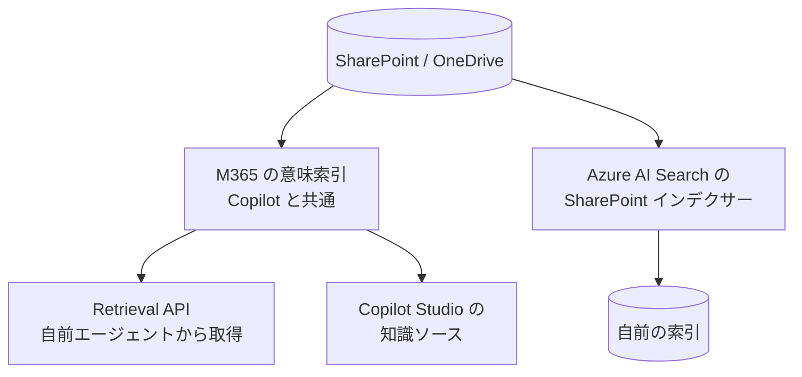

SharePoint（および OneDrive for Business）は、社内ポータル・文書ライブラリの中心です。
**Microsoft Graph API** 経由でアクセスでき、メタデータ列を活用できます。

## 活用ポイント

- **ドキュメントライブラリの列（メタデータ）** を検索フィルタに使う
- Office 文書はテキスト抽出 → [Markdown 正規化](/ai-tech-notes/data-modeling/)
- サイト/ライブラリ単位の権限を尊重（Graph の権限モデル）

## 接続手段

SharePoint は Microsoft 自身が RAG 向けの接続手段を複数用意しており、**自前で索引を作らずに済む** ケースが増えています。

| 方式 | 仕組み | 権限 | 向くケース |
| --- | --- | --- | --- |
| **Retrieval API** | M365 Copilot と同じ索引から関連テキストを取得 | **問い合わせ時に利用者の権限でトリミング** | 自前エージェントで SharePoint を RAG に使う。索引・権限同期が不要 |
| **Copilot Studio の知識ソース** | サイト・フォルダを指定してグラウンディング | 利用者の権限が効く | ノーコードでエージェントを作る |
| **Azure AI Search の SharePoint インデクサー** | ドキュメントライブラリを取り込み自前の索引を作る | ACL の取り込みに対応（プレビュー） | 検索の作り込み、M365 外のデータとの統合 |
| **Graph API で自前実装** | delta クエリで差分を取得し自前の索引へ | 自前で権限を取得・反映 | 上記で要件を満たせない場合 |

:::tip[まず Retrieval API を検討する]
自前の索引にコピーすると、SharePoint 側の権限変更が自動では伝わらず、権限同期を自前で作り込む必要があります。
Retrieval API は問い合わせ時に権限を評価するため、この問題がありません。
利用には Microsoft 365 Copilot のライセンス、または従量課金（一部プレビュー）が必要です。
:::

## 注意

- 大規模テナントでは **増分同期（delta クエリ）** が必須
- バージョン履歴があるため **最新版のみ索引**（[重複対策](/ai-tech-notes/data-modeling/versioning/)）
- スロットリング（レート制限）に注意

## おすすめのデータ形式

SharePoint は **ドキュメントライブラリの列（メタデータ）** が強力です。形式変換に加え、
この列をどれだけ活かすかで検索精度が変わります。

| 要素 | おすすめの扱い |
| --- | --- |
| ライブラリの列（部署/種別/レビュー状態 等） | そのまま **メタデータ**（検索フィルタの軸） |
| Office 文書 | 構造を保って **Markdown 化** |
| SharePoint リスト | **CSV / 構造化データ**として取り込む |
| 図・表 | 代替テキスト・表（MD/CSV）で併記 |

## アンチパターン

| アンチパターン | なぜダメか | 対策 |
| --- | --- | --- |
| Excel「方眼紙」・結合セル | 表が壊れて構造化できない | データ表に整形し CSV へ |
| メタデータ列を未設定/未活用 | 絞り込みが効かない | 必須列を定義し運用ルール化 |
| フォルダ階層に意味を埋める | メタデータとして扱われない | 列（メタデータ）へ移す |
| バージョン履歴を区別せず索引 | 古い版が混ざり精度低下 | 最新版のみ索引 |

## 容量・上限と大きなデータの扱い

SharePoint Online には複数の上限があり、**大規模ライブラリでは取り込み設計に直結**します。

| 項目 | 代表的な上限（目安） |
| --- | --- |
| 1 ファイルの最大サイズ | 約 250 GB |
| ライブラリ/リストのアイテム数 | 最大 約 3,000 万 |
| **リストビューのしきい値** | **5,000 アイテム**（一度に列挙/フィルタできる上限） |
| サイトの記憶域 | 最大 約 25 TB／サイト |
| テナント全体の記憶域 | 1 TB ＋（ライセンスユーザー数 × 10 GB）＋購入分 |

:::caution[最大の落とし穴は「5,000 アイテムのしきい値」]
5,000 件を超えるライブラリを素朴に列挙・フィルタするとエラーになります。
**インデックス列でのフィルタ**と**ページング**が前提です。
:::

大きなデータを扱う際の指針:

- **増分同期（delta クエリ）** で全件スキャンを避ける
- 取得は**ページング**し、**インデックス列**でフィルタして 5,000 しきい値を回避
- 大容量ファイル（動画・大きな PDF・CAD など）は**本文を丸ごと索引化せず**、テキスト/要約のみ抽出（動画は文字起こし）
- **サイズ閾値で取り込み対象外**にするフィルタを設ける
- スロットリング（レート制限）に備え、バックオフ＋夜間バッチで取り込む

:::note
上限値はサービス更新で変わります。実装前に Microsoft の最新公式ドキュメントで必ず確認してください。
:::

## 参考・出典

- [Retrieval API overview](https://learn.microsoft.com/microsoft-365-copilot/extensibility/api-reference/retrieval-api-overview) — Microsoft Learn
- [Index data from SharePoint document libraries](https://learn.microsoft.com/azure/search/search-howto-index-sharepoint-online) — Microsoft Learn
- [SharePoint ACL ingestion with indexers](https://learn.microsoft.com/azure/search/search-indexer-sharepoint-access-control-lists) — Microsoft Learn
- [Use delta query to track changes in Microsoft Graph data](https://learn.microsoft.com/graph/delta-query-overview) — Microsoft Learn
- [Microsoft Graph throttling guidance](https://learn.microsoft.com/graph/throttling) — Microsoft Learn
- [SharePoint limits](https://learn.microsoft.com/office365/servicedescriptions/sharepoint-online-service-description/sharepoint-online-limits) — Microsoft Learn
- [Add SharePoint as a knowledge source（Copilot Studio）](https://learn.microsoft.com/en-us/microsoft-copilot-studio/knowledge-add-sharepoint) — Microsoft Learn
