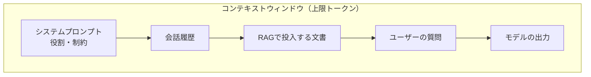
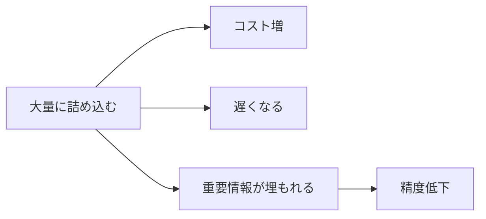

**コンテキストウィンドウ（context window）** は、LLM が **一度のリクエストで扱える
トークンの上限**です。システムプロンプト・会話履歴・RAG で投入する文書・そして出力まで、
すべてがこの「窓」を共有します。

## 窓の中身

入力（システム＋履歴＋文書＋質問）と出力の **合計**が上限に収まる必要があります。
出力用の余白も残しておく点に注意します。推論（thinking）を行うモデルでは、**推論のトークンも出力側** に含まれます。

## 2026 年時点の目安

| 項目 | 目安（Claude の現行モデル） | 補足 |
| --- | --- | --- |
| コンテキストウィンドウ | **100 万トークン（1M）** | 日本語なら数十万〜100 万字程度。文庫本数冊分に相当 |
| 最大出力 | **12.8 万トークン（128K）** | 長い出力はストリーミングで受け取る |

数年前は数万トークンが一般的だったため、「入りきらない」問題は大きく緩和されました。
一方で、**入れられることと、入れるべきことは別** です（次節以降）。

## 上限を超える・近づくと何が起きるか

| 状況 | 起きること | 対策 |
| --- | --- | --- |
| 上限を超える | エラー、または古い履歴が脱落 | 要約・圧縮、投入量を絞る |
| 詰め込みすぎ | コスト増・レイテンシ悪化・精度低下 | 必要な文書だけに限定 |
| 長文の中盤 | 中央の情報が軽視されやすい（lost in the middle） | 重要情報を前後に配置、件数を絞る |
| 入力が長くなるほど | 長さに比例して性能がじわじわ落ちる（context rot） | 関連の薄い情報を入れない |

## 「大きい窓」は万能ではない

近年は非常に大きなコンテキストウィンドウを持つモデルもありますが、
**大量に入れれば精度が上がるわけではありません**。むしろノイズが増えると精度は下がりがちです。

研究でも、長い入力の中盤にある情報は参照されにくいこと（lost in the middle）や、
単純なタスクでも入力が長くなるほど性能が下がること（context rot）が報告されています。
このため近年は、**「限られた窓に、何をどの順で入れるか」を設計する** という考え方
（コンテキストエンジニアリング）が重視されています。

- **必要な分だけ**を入れる（RAG で関連文書を厳選 → [検索とリランキング](/ai-tech-notes/rag/retrieval/)）
- 長い会話は **要約・圧縮**して履歴を圧縮する
- 静的・大量の知識は窓に詰めず [RAG](/ai-tech-notes/rag/) に逃がす

## 長い会話・エージェントでの管理手段

エージェントのようにツール呼び出しを繰り返す処理では、ツールの結果が積み上がって窓が急速に埋まります。
主な管理手段は次の 3 つです。

| 手段 | 仕組み | 向くケース |
| --- | --- | --- |
| 要約（コンパクション） | 一定量を超えたら古いやり取りを要約に置き換える。Claude では API 側で自動実行する機能（ベータ）がある | 長時間の対話・長いエージェント処理 |
| 古い結果の削除（コンテキスト編集） | 使い終わったツール結果などを窓から消す | 検索・ファイル読み込みを何度も行うエージェント |
| 外部メモリ | 重要な事実をファイルや DB に書き出し、必要なときだけ読み戻す | 複数セッションにまたがる作業 |

## 全部入れるか、RAG で絞るか

| 状況 | 推奨 |
| --- | --- |
| 対象が 1〜数文書で、全体を読む必要がある（契約書のレビュー等） | 全文を入れる（キャッシュ併用） |
| 対象が大量で、質問ごとに必要な部分が違う（社内 Q&A 等） | [RAG](/ai-tech-notes/rag/) で絞る |
| 同じ大きな資料に繰り返し質問する | 全文 ＋ プロンプトキャッシュも有力。コストを試算して判断 |

:::tip
「コンテキストウィンドウが大きい ＝ 全部入れてよい」ではありません。
**入れる量とコスト・精度はトレードオフ**です（→ [コスト最適化](/ai-tech-notes/cost-roi/optimization/)）。
:::

## 参考・出典

- [Context windows](https://platform.claude.com/docs/en/build-with-claude/context-windows) — Claude Platform Docs
- [Compaction](https://platform.claude.com/docs/en/build-with-claude/compaction) — Claude Platform Docs
- [Context editing](https://platform.claude.com/docs/en/build-with-claude/context-editing) — Claude Platform Docs
- [Effective context engineering for AI agents](https://www.anthropic.com/engineering/effective-context-engineering-for-ai-agents) — Anthropic
- [Lost in the Middle: How Language Models Use Long Contexts](https://arxiv.org/abs/2307.03172) — Liu et al., 2023
- [Context Rot: How Increasing Input Tokens Impacts LLM Performance](https://research.trychroma.com/context-rot) — Chroma Research
