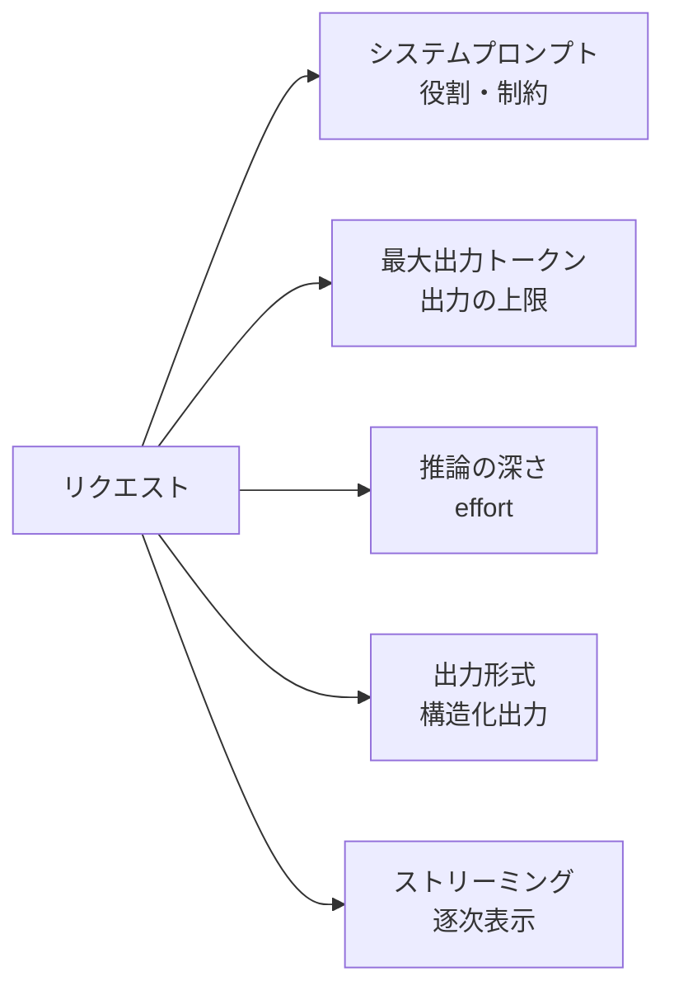
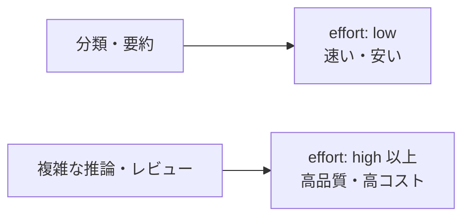

LLM の振る舞いは、いくつかの基本パラメータで調整できます。
ここを理解しておくと、品質・コスト・体感速度のバランスを取りやすくなります。

## 主な制御パラメータ

### 1. システムプロンプト

モデルの **役割・トーン・制約**を最初に固定する指示です。
「出典を必ず示す」「不明なら不明と答える」など、ナレッジ回答の品質を支える要になります。
内容を安定させると [プロンプトキャッシュ](/ai-tech-notes/cost-roi/optimization/) も効きやすくなります。

### 2. 最大出力トークン（出力上限）

1回の応答で生成する**出力の上限**。小さすぎると途中で切れ、大きすぎると暴走時のコスト・遅延が増えます。
分類など短い用途は小さく、長文生成は十分に確保します。

- 上限は「モデルに伝わる目標」ではなく **強制的な打ち切り** です。長さを指定したいときはプロンプトで伝えます
- 推論を行うモデルでは、**推論のトークンもこの上限に含まれる** ため、低すぎると回答に入る前に打ち切られます
- 応答の停止理由（`max_tokens` で止まったか）を必ず確認し、途中で切れた出力をそのまま使わないようにします

### 3. ランダム性（temperature など）— 2026 年に大きく変化

かつては `temperature` や `top_p` で出力のばらつきを調整するのが定番でしたが、
**推論モデルの普及に伴い、これらのパラメータは使えなくなりつつあります**。

- Claude の新しいモデル（Opus 4.7 以降など）では `temperature` / `top_p` / `top_k` が廃止され、指定するとエラーになる
- 2026-10-21 版の API では、**すべてのモデルで** これらを指定するとエラーになる
- 他のプロバイダでも、推論モデルではサンプリング設定が固定されていることが多い

代わりに、ばらつきは次の方法で制御します。

| やりたいこと | 2026 年時点の方法 |
| --- | --- |
| 分類・抽出の結果を安定させたい | **構造化出力**（JSON スキーマ）で選択肢・形式を固定する |
| 定型回答の表現を揃えたい | プロンプトで例（Few-shot）と書式を示す |
| アイデアを多様に出したい | 「観点の異なる案を 5 つ」のように **プロンプトで多様性を指示** する |
| 再現性を検証したい | 同じ入力を複数回実行し、ばらつきを評価する |

:::note
もともと「決定的」設定でも、出力が**完全に同一になる保証はありませんでした**（[LLMは確率的](/ai-tech-notes/llm-basics/)）。
既存コードに `temperature` の指定が残っている場合は、モデル移行時のエラー原因になるため削除を検討してください。
:::

### 4. 推論の深さ（effort / adaptive thinking）

近年のモデルは、回答前に内部で考える **推論（thinking）** を行います。
2026 年時点の Claude では、モデルが問題の難しさに応じて推論量を自動で決め（adaptive thinking）、
開発者は **effort** パラメータで全体の「頑張り度合い」を指定します。

| effort | 向く用途 |
| --- | --- |
| low | チャット・分類・大量処理・サブタスク。速く安い |
| medium | 一般的な回答。品質を保ちつつコストを下げたい場合 |
| high | 知的な判断が要る作業の基準ライン |
| xhigh | コーディング・エージェント作業の多く |
| max | 正確さがコストより重要な、ごく難しい問題 |

- **既定値はモデルで異なる** ため、明示的に指定する（例: Claude Opus 5.5 の既定は medium）
- モデルによっては推論を **無効にできない**。安くしたいときは effort を下げる
- 推論の中身は表示されない設定でも、**推論トークンは課金される**
- effort は用途（ルート）ごとに、実データで品質を測りながら決める

→ コスト観点の使い分けは [モデルの切り替え](/ai-tech-notes/cost-roi/optimization/) を参照。

### 5. 出力形式（構造化出力）

JSON スキーマを指定し、**その形式に必ず従った出力** を得る機能です。
後続のプログラムで処理する用途（抽出・分類・[レビューの指摘](/ai-tech-notes/use-cases/review-assist/)）では、
「JSON で答えて」とプロンプトで頼むより確実です。

- 以前よく使われた「回答の書き出しを指定する（プリフィル）」手法は、新しいモデルでは使えなくなっている
- 引用（Citations）機能とは同時に使えないなど、機能間の制約がある点に注意

### 6. ストリーミング

生成されたトークンを**逐次返す**方式。体感速度が上がり、長い出力でのタイムアウトも避けやすくなります。
チャット UI やドラフト生成のような長文用途で特に有効です。
最大出力を大きく設定する場合や推論を深くする場合は、HTTP のタイムアウトを避けるために **ストリーミングが事実上必須** です。

## まとめ

| パラメータ | 効果 | 主な調整理由 |
| --- | --- | --- |
| システムプロンプト | 役割・制約の固定 | 品質・一貫性 |
| 最大出力トークン | 出力上限 | 途中切れ防止／コスト |
| 推論の深さ（effort） | 品質 ⇔ コスト | 難易度に応じて |
| 構造化出力 | 形式の固定 | 後続処理の安定 |
| ストリーミング | 逐次表示 | 体感速度・長文対応 |

:::tip
迷ったら「**システムプロンプトで制約を固定し、effort は難易度に合わせ、形式は構造化出力で固定し、長文はストリーミング**」を出発点に。
具体的な指定方法は利用プロバイダのドキュメントを確認してください。
:::

## 参考・出典

- [Effort](https://platform.claude.com/docs/en/build-with-claude/effort) — Claude Platform Docs
- [Adaptive thinking](https://platform.claude.com/docs/en/build-with-claude/adaptive-thinking) — Claude Platform Docs
- [Structured outputs](https://platform.claude.com/docs/en/build-with-claude/structured-outputs) — Claude Platform Docs
- [Streaming messages](https://platform.claude.com/docs/en/build-with-claude/streaming) — Claude Platform Docs
- [API versioning](https://platform.claude.com/docs/en/api/versioning) — Claude Platform Docs
