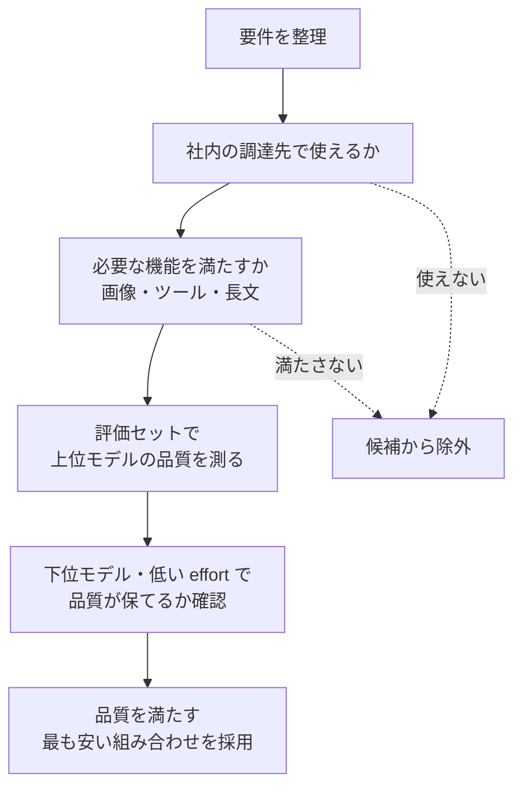

LLM は単一ではなく、**能力・コスト・速度のトレードオフ**で複数のモデルが提供されます。
用途に合ったモデルを選ぶ（そして使い分ける）ことが、品質とコストの両立につながります。

## モデルの「階層」

プロバイダによって名称は異なりますが、概ね次のような階層があります。

| 階層 | 知能 | コスト | 速度 | 主な用途 |
| --- | --- | --- | --- | --- |
| 軽量 | 低〜中 | 低 | 速い | 分類・要約・FAQ・一次処理 |
| 標準 | 中〜高 | 中 | 中 | 一般的な回答（本命になりやすい） |
| 高性能 | 高 | 高 | 遅め | 複雑な推論・重要なレビュー/ドラフト |
| 最上位 | 最高 | 最高 | 遅い | 最難関の推論・長時間の自律的なエージェント作業 |

### 2026 年 11 月時点の例（Claude）

| 階層 | モデル | 入力 / 出力（$/1M トークン） | コンテキスト | 位置づけ |
| --- | --- | --- | --- | --- |
| 最上位 | Claude Fable 5.2 | $8 / $40 | 1M | 最も高性能。長時間の自律作業向け |
| 高性能 | Claude Opus 5.5 | $4 / $20 | 1M | 高度な推論・コーディング・エージェント |
| 標準 | Claude Sonnet 5.5 | $2 / $10 | 1M | 日常業務・RAG 回答の本命 |
| 軽量 | Claude Haiku 5.5 | $0.10 / $0.50 | 1M | 分類・抽出・前処理・大量処理 |

他のプロバイダ（OpenAI の GPT、Google の Gemini など）も同様に、価格と性能の異なる複数の階層を提供しています。
社内の調達先（Azure / AWS / Google Cloud など）で **どのモデルが使えるか** も選定条件になります。
例えば Claude は Anthropic の API のほか、Amazon Bedrock、Google Cloud の Vertex AI、Microsoft Foundry からも利用できます。

## 機能面の違いも確認する

知能やコストだけでなく、**何ができるか**もモデルによって異なります。

| 機能 | 説明 |
| --- | --- |
| マルチモーダル | テキストに加え画像などを入力できるか |
| 推論（thinking） | じっくり考えるモードに対応するか（→ [生成の制御](/ai-tech-notes/llm-basics/generation-controls/)） |
| ツール利用 | 関数呼び出し・[MCP](/ai-tech-notes/mcp/) 連携の安定性 |
| 構造化出力 | JSON 等のスキーマに沿った出力ができるか |
| コンテキスト長 | [コンテキストウィンドウ](/ai-tech-notes/llm-basics/context-window/)の上限 |
| 推論の深さの調整 | effort などで、同じモデルのまま推論量を調整できるか |
| 提供クラウド・リージョン | 社内で契約しているクラウドで使えるか、データの処理リージョンを指定できるか |

## 選定フロー

ポイントは、**まず上位モデルで「出せる品質」を確認し、そこから下げていく** 順番です。
最初から安いモデルで始めると、品質不足がモデルの限界なのか、プロンプトや検索の問題なのかを切り分けられません。

選定軸の整理:

- **精度要求** — 難所だけ高性能、定型は軽量
- **レイテンシ** — 体感速度が重要なら軽量・事前計算
- **コスト** — 高頻度ほど軽量モデル併用の効果大
- **コンテキスト長 / モダリティ** — 必要な機能を満たすか

:::tip[複数モデルを組み合わせる前に]
軽量モデルと高性能モデルを振り分ける構成（カスケード）は効果的ですが、実装と運用が複雑になります。
最新世代では、**高性能モデルの推論の深さ（effort）を下げるだけで、旧世代の上位設定に並ぶ** ことも多いため、
まず「1 つのモデルで effort を調整する」構成と比べてから判断してください。
単一モデルにはプロンプトキャッシュを共有しやすい利点もあります。
:::

より詳しい判断は [システム選定（コスト視点）](/ai-tech-notes/cost-roi/system-selection/)、
使い分けの実装は [モデルの切り替え](/ai-tech-notes/cost-roi/optimization/) を参照してください。

:::caution[モデルは更新が速い]
モデルのラインナップ・性能・価格は頻繁に更新されます。
具体的なモデル名や上限値は、**利用するプロバイダの最新ドキュメントで必ず確認**してください。
本ページは「選び方の枠組み」を示すものです。
:::

## 参考・出典

- [Models overview](https://platform.claude.com/docs/en/about-claude/models/overview) — Claude Platform Docs
- [Pricing](https://platform.claude.com/docs/en/about-claude/pricing) — Claude Platform Docs
- [Effort](https://platform.claude.com/docs/en/build-with-claude/effort) — Claude Platform Docs
