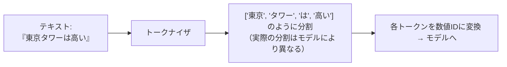
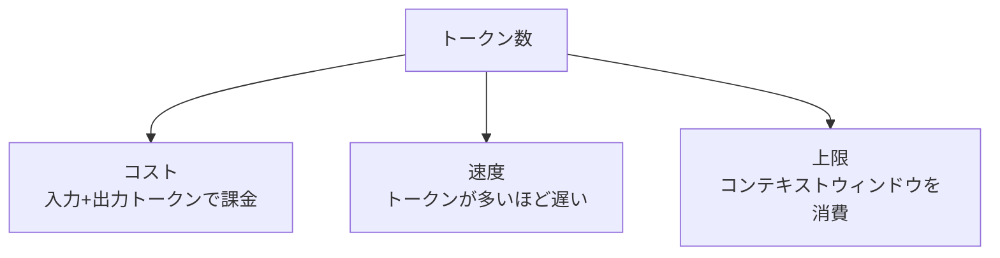

**トークン（token）** は、LLM がテキストを処理するときの最小単位です。
コスト・速度・入出力の上限はすべてトークン数で決まるため、最初に理解しておくべき概念です。

## トークンとは何か

トークンは「単語」より細かいことが多く、単語・部分語・記号・空白などに分割されます。

- ざっくりの目安: 英語は **1単語 ≒ 1〜2トークン**、日本語は文字あたりのトークンが多めになりがち
- **コードや記号、日本語**はトークン効率が悪く、同じ「見た目の長さ」でもトークン数が増えやすい

## なぜ重要か

| 観点 | 関係 |
| --- | --- |
| コスト | 入力トークン × 入力単価 + 出力トークン × 出力単価（出力の方が数倍高いのが一般的） |
| 速度 | 生成トークンが増えるほどレイテンシ増 |
| 上限 | [コンテキストウィンドウ](/ai-tech-notes/llm-basics/context-window/)の消費量 |

## コストの具体例（2026 年 11 月時点）

単価は「100 万トークン（1M tokens）あたり」で示されるのが一般的です。Claude の現行モデルを例にすると、次のとおりです。

| モデル（階層） | 入力 $/1M | 出力 $/1M |
| --- | --- | --- |
| Claude Fable 5.2（最上位） | $8 | $40 |
| Claude Opus 5.5（高性能） | $4 | $20 |
| Claude Sonnet 5.5（標準） | $2 | $10 |
| Claude Haiku 5.5（軽量） | $0.10 | $0.50 |

※ Haiku 5.5 は 10 万トークン以下のプロンプトの価格です。最新の価格は出典の Pricing ページで確認してください。

**試算例:** 入力 8,000 トークン（RAG 文書込み）＋ 出力 800 トークンの質問を、Sonnet 5.5 で 1 日 1,000 件処理すると

- 入力: 8,000 × 1,000 × $2 / 1M = **$16 / 日**
- 出力: 800 × 1,000 × $10 / 1M = **$8 / 日**

入力の量が多いため、**入力を絞る（RAG で厳選する）・キャッシュする** ことの効果が大きいと分かります。

### トークン単価を下げる仕組み

| 仕組み | 効果の目安 | 向くケース |
| --- | --- | --- |
| プロンプトキャッシュ | キャッシュから読んだ入力は通常の約 1/10 の単価（書き込み時は割増） | 同じシステムプロンプト・テンプレートを繰り返し送る |
| バッチ処理 | 非同期処理で約 50% 割引 | 夜間の一括要約・分類など、即時応答が不要な処理 |
| 軽量モデルの併用 | 単価が 1 桁以上安い | 分類・抽出・クエリ書き換えなどの前処理 |

→ 詳しくは [コスト最適化テクニック](/ai-tech-notes/cost-roi/optimization/) を参照。

## 実務での勘所

- **トークン数は推測せず実測する** — 言語・コードで大きく変わるため、代表的な入力で計測する。
  Claude には送信前にトークン数を数える API（Token counting）があり、課金されずに計測できる
- **推論（thinking）のトークンも出力として課金される** — 表示されない推論部分も含めて見積もる
- **モデルを変えたら測り直す** — トークナイザはモデル世代で変わることがある
- 入力を絞るほどコスト・速度が改善 → [検索とリランキング](/ai-tech-notes/rag/retrieval/) で投入量を最小化
- コスト見積もりは [コスト試算テンプレート](/ai-tech-notes/cost-roi/) を参照

:::note[英語向けトークナイザでの概算に注意]
他社（英語圏）のトークナイザで日本語のトークン数を概算すると、実際より**少なく**見積もりがちです。
使用するモデルのトークンカウント手段で測るのが確実です。
:::

:::caution[同じ文章でもモデル世代でトークン数が変わる]
例えば Claude では、Opus 4.7 以降の新しいトークナイザで、同じテキストのトークン数が
旧世代（Opus 4.6 / Sonnet 4.6 / Haiku 4.5 など）の **約 1.0〜1.35 倍** になります。
単価が下がっていても、トークン数の増加で相殺される場合があるため、移行時は実データで再計測してください。
:::

## 参考・出典

- [Pricing](https://platform.claude.com/docs/en/about-claude/pricing) — Claude Platform Docs
- [Token counting](https://platform.claude.com/docs/en/build-with-claude/token-counting) — Claude Platform Docs
- [Batch processing](https://platform.claude.com/docs/en/build-with-claude/batch-processing) — Claude Platform Docs
- [Models overview](https://platform.claude.com/docs/en/about-claude/models/overview) — Claude Platform Docs
