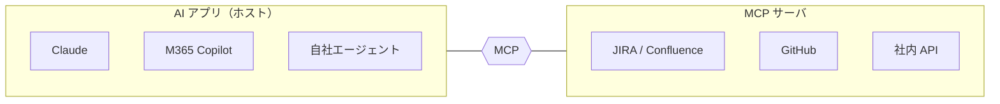
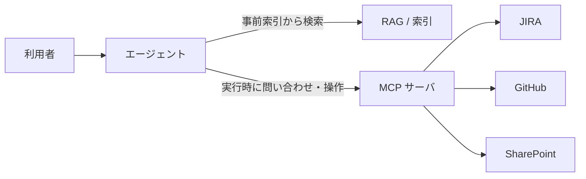

**MCP（Model Context Protocol）** は、LLM アプリケーションやエージェントが外部のツール・データソースへ
**標準化された方法で接続する** ためのオープンなプロトコルです。
「AI 版の USB-C」とたとえられるように、一度 MCP サーバを作れば、対応するさまざまな AI クライアントから同じ方法で使えます。
ナレッジシステムでは、主に **実行時に外部システムへ問い合わせる・操作する** 役割を担います。

## なぜ MCP が必要か

MCP 以前は、AI アプリごと・データソースごとに個別の連携コードを書く必要がありました（M 個のアプリ × N 個のデータソース）。
MCP を介すと、データソース側は MCP サーバを 1 つ用意すれば、どの対応クライアントからも使えます（M ＋ N）。

## 構成要素

| 要素 | 役割 | 例 |
| --- | --- | --- |
| ホスト | ユーザーが使う AI アプリ。LLM を呼び出す | Claude、Copilot Studio、自社エージェント |
| クライアント | ホスト内で MCP サーバとの接続を担う部品 | ホストに組み込まれた MCP クライアント |
| サーバ | ツールやデータを MCP の形式で公開する | GitHub MCP サーバ、Atlassian の MCP サーバ |

サーバが公開できるものは主に次の 3 種類です。

| 種類 | 内容 | ナレッジシステムでの例 |
| --- | --- | --- |
| **Tools（ツール）** | AI が呼び出せる操作・検索 | チケット検索、PR 取得、コメント投稿 |
| **Resources（リソース）** | 読み取り用のデータ | ファイル内容、設定、スキーマ |
| **Prompts（プロンプト）** | 定型のプロンプトテンプレート | 「この PR をレビューする」手順 |

接続方式（トランスポート）は、同じマシン上で動かす **stdio** と、ネットワーク越しに使う **Streamable HTTP** が基本です。
社内システムで複数ユーザーに提供する場合は、HTTP で動く **リモート MCP サーバ** として構成するのが一般的です。

## 2026 年時点の状況

| トピック | 状況 |
| --- | --- |
| 普及 | Claude、ChatGPT、Gemini、Microsoft Copilot、VS Code、Cursor など主要な AI 製品が対応。公開サーバは 1 万を超える |
| ガバナンス | 2025 年 12 月、Anthropic が MCP を Linux Foundation 傘下の **Agentic AI Foundation** に寄贈。特定ベンダーに依存しない標準として運営 |
| 仕様 | 最新版は **2026-07-28 版**。プロトコルのセッションを廃止して **ステートレス** にし、ロードバランサ配下でのスケールが容易に。サーバの機能を問い合わせる `server/discover` の追加、認可の改善（動的クライアント登録の非推奨化）なども含む |
| 公式サーバ | GitHub、Atlassian（Jira / Confluence）、Microsoft など、主要 SaaS が **公式のリモート MCP サーバ** を提供 |
| 発見 | 公開 MCP サーバのメタデータを集める **MCP Registry** が公式に運営されている（プレビュー） |

:::tip[まず公式サーバを探す]
JIRA・Confluence・GitHub などの主要 SaaS には、ベンダー公式のリモート MCP サーバがあります。
自作する前に公式サーバで要件を満たせないかを確認し、自作は社内独自のシステムに絞るのが効率的です。
→ [MCP サーバ構成](/ai-tech-notes/mcp/server-design/)
:::

## ナレッジシステムでの位置づけ

- **RAG:** 大量の文書を事前にインデックス化し、意味検索する
- **MCP:** 最新の状態・構造化データ・操作（チケット検索、PR 取得など）を都度取得する

どちらを使うかの判断と併用の設計は [RAG と MCP の使い分け](/ai-tech-notes/mcp/rag-vs-mcp/) を参照してください。

## 注意点

- **トークン消費:** ツール定義や大きなレスポンスがコンテキストを圧迫しやすい → [トークン消費問題と対策](/ai-tech-notes/mcp/token-cost/)
- **セキュリティ:** MCP サーバの応答は外部からの入力であり、プロンプトインジェクションの入口になりうる。
  書き込み系ツールは最小権限と人の承認を前提にする → [MCP サーバ構成](/ai-tech-notes/mcp/server-design/)

:::tip[具体的な構成例]
Microsoft 365 環境で Claude を使い、RAG と MCP を接続する具体的な事例は
[参考アーキテクチャ — M365 Copilot × Claude](/ai-tech-notes/mcp/m365-copilot-claude-reference/) を参照してください。
:::

## 参考・出典

- [Model Context Protocol — Architecture overview](https://modelcontextprotocol.io/docs/learn/architecture) — modelcontextprotocol.io
- [Specification 2026-07-28](https://modelcontextprotocol.io/specification/2026-07-28) / [Changelog](https://modelcontextprotocol.io/specification/2026-07-28/changelog) — modelcontextprotocol.io
- [Donating the Model Context Protocol and establishing the Agentic AI Foundation](https://www.anthropic.com/news/donating-the-model-context-protocol-and-establishing-of-the-agentic-ai-foundation) — Anthropic
- [The MCP Registry](https://modelcontextprotocol.io/registry/about) — modelcontextprotocol.io
