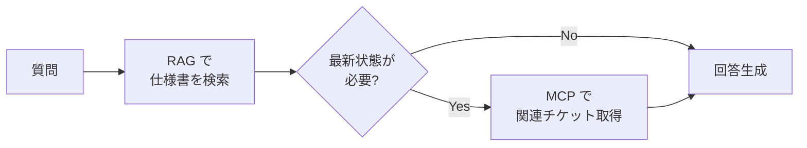

RAG と MCP は競合ではなく **補完関係** です。データの性質と、必要な「新しさ」「操作」で使い分けます。

## 判断フロー

上から順に確認し、最初に「はい」になった行の方式を選びます。

| 順 | 確認すること | はい → | いいえ → |
| --- | --- | --- | --- |
| 1 | 起票・更新などの **操作** が必要か | **MCP** | 2 へ |
| 2 | 数分〜数時間の **更新遅れが許されない** 情報か | **MCP**（都度取得） | 3 へ |
| 3 | **大量の文書を意味で探す** 必要があるか | **RAG**（索引検索） | 4 へ |
| 4 | **ID・条件で引ける構造化データ** か | **MCP**（条件検索） | **RAG** |

判断の鍵は **「索引の更新遅れを許容できるか」** です。
RAG の索引は増分同期でも数分〜数時間遅れます。チケットの現在のステータスのように「今」が重要な情報は MCP で取得します。

## 比較表

| 観点 | RAG | MCP |
| --- | --- | --- |
| データの性質 | 静的・大量・非構造（文書） | 動的・最新・構造化（チケット・PR） |
| 取得タイミング | 事前にインデックス | 実行時 |
| 得意なこと | 意味検索・出典提示・横断検索 | 状態参照・条件検索・操作 |
| 鮮度 | 同期間隔ぶん遅れる | 常に最新 |
| 権限 | 索引に ACL を反映する必要がある | 元システムの権限がそのまま効く（本人として認可した場合） |
| コスト注意点 | 索引の構築・維持 | トークン消費・API 呼び出し回数 |
| 代表ソース | 規程・仕様書・Wiki・過去の議事録 | JIRA・GitHub・SharePoint の最新状態 |

## 併用パターン（オーケストレーション）

多くの実システムは **RAG をベースに、MCP を必要箇所で併用** します。呼び出し順の設計は主に 3 つです。

### パターン A: RAG → MCP で補完（最も一般的）

まず RAG で文書を検索し、回答に「最新の状態」が必要な場合だけ MCP で補います。

例: 「この機能の仕様と、関連する不具合の対応状況は？」→ 仕様は RAG、不具合チケットの状態は MCP。

### パターン B: MCP で特定 → RAG で深掘り

ID や条件で対象を特定してから、関連文書を RAG で探します。

例: 「PROJ-123 の背景を教えて」→ MCP でチケットを取得 → チケットに書かれた機能名で RAG 検索。

### パターン C: エージェントに選ばせる

RAG の検索も MCP のツールも「ツール」としてエージェントに渡し、どれをどの順で使うかを AI に判断させます。
柔軟ですが、呼び出し回数が増えやすく、挙動の予測とテストが難しくなります。

| パターン | 予測しやすさ | 柔軟さ | コスト | 向くケース |
| --- | --- | --- | --- | --- |
| A: RAG → MCP | 高 | 中 | 低〜中 | 社内 Q&A の大半 |
| B: MCP → RAG | 高 | 中 | 低〜中 | ID・チケット起点の調査 |
| C: エージェント任せ | 低 | 高 | 中〜高 | 定型化しにくい調査・複数システム横断 |

:::tip[固定フローから始める]
まず **A や B の固定フロー** で作り、評価で「固定フローでは答えられない質問」が多いと分かってから C に広げるのが安全です。
C を採用する場合も、検索ツールの説明文を丁寧に書き、ツール数を絞ってください（→ [トークン対策](/ai-tech-notes/mcp/token-cost/)）。
:::

## プラットフォーム側の対応

Microsoft 365 Copilot のコネクタも、この使い分けに対応した 2 つの方式を提供しています。

- **Synced コネクタ:** 外部データを事前に索引化（＝ RAG）
- **Federated コネクタ:** MCP で実行時に取得し、索引化しない（＝ MCP）

→ 具体的な構成は [参考アーキテクチャ — M365 Copilot × Claude](/ai-tech-notes/use-cases/m365-copilot-claude-reference/) を参照。

## 参考・出典

- [Microsoft 365 Copilot connectors overview](https://learn.microsoft.com/microsoftsearch/connectors-overview) — Microsoft Learn
- [Building effective agents](https://www.anthropic.com/engineering/building-effective-agents) — Anthropic
- [Model Context Protocol — Architecture overview](https://modelcontextprotocol.io/docs/learn/architecture) — modelcontextprotocol.io
