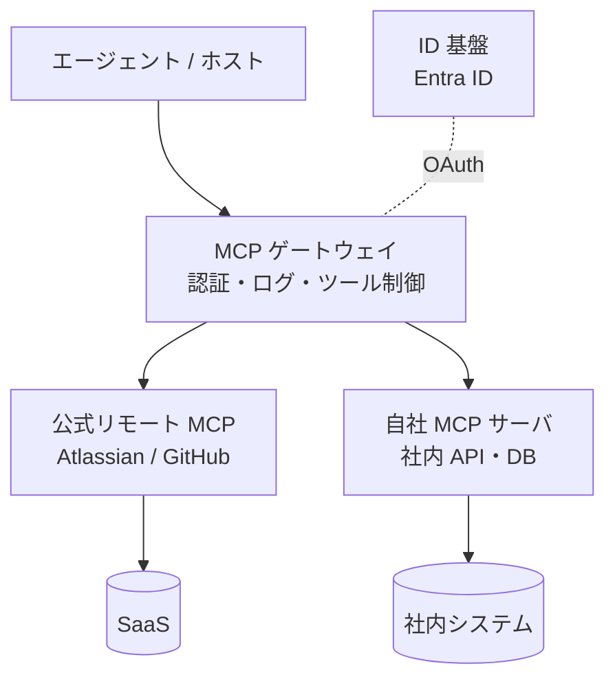

ナレッジシステムで MCP サーバをどう構成し、どこに置き、どう守るかを整理します。

## 典型構成

利用者やエージェントが増えてきたら、個々のサーバに直接つなぐのではなく、
**ゲートウェイ（中継層）で認証・監査ログ・ツールの有効化を一元管理** する構成が運用しやすくなります。

## 公式サーバを使うか、自作するか

| 選択肢 | 向くケース | 注意点 |
| --- | --- | --- |
| **ベンダー公式のリモート MCP**（GitHub、Atlassian など） | 主要 SaaS への接続。まず検討する | 提供ツールは選べない場合がある。レート制限・プランによる制約を確認 |
| **OSS の MCP サーバをセルフホスト** | 公式が無い／社内ネットワーク内で動かしたい | 保守主体とセキュリティ品質を確認。依存パッケージの供給網リスク |
| **自社で MCP サーバを開発** | 社内独自システム・業務 API | 開発・運用の負担。公式 SDK（各言語）を使う |

- **リモート（HTTP）とローカル（stdio）:** 複数人で使う社内システムは、認証・監査を一元化できる **リモート MCP サーバ** が基本。
  stdio は開発者個人の PC 上のツール連携向け
- 2026-07-28 版の仕様で通信がステートレスになり、**一般的な Web API と同じようにロードバランサ配下で水平スケール** しやすくなった

## 認証・認可

| 方式 | 内容 | 向くケース |
| --- | --- | --- |
| OAuth 2.1（仕様の標準） | 利用者本人として認可し、**本人の権限の範囲で** 元システムにアクセス | 社員ごとに見える範囲が違うデータ（推奨） |
| API キー・サービスアカウント | サーバ共通の資格情報でアクセス | 全員が同じ範囲を見てよい公開情報・社内共通データ |

- **本人の権限で動かす** のが原則です。共通のサービスアカウントで強い権限を持たせると、
  閲覧権限の無い社員にも AI 経由で情報が見えてしまいます
- 最新仕様では、クライアント登録方式として **Client ID Metadata Documents** が推奨され、従来の動的クライアント登録は非推奨になりました

## セキュリティの勘所

MCP 仕様のセキュリティベストプラクティスと、LLM 特有のリスクを踏まえた要点です。

| リスク | 内容 | 対策 |
| --- | --- | --- |
| プロンプトインジェクション | チケット本文や文書に埋め込まれた指示に AI が従ってしまう | 取得内容は「データ」として扱う。書き込み系は人の承認を挟む |
| 過剰な権限 | 不要な書き込み・削除ツールまで有効になっている | 読み取りと書き込みを分離。使うツールだけ有効化 |
| トークンの使い回し | クライアントから受け取ったトークンをそのまま下流 API に渡す | **禁止（仕様で MUST NOT）**。下流には別途発行したトークンを使う |
| 混乱した代理人（confused deputy） | 中継サーバの同意画面が省略され、別クライアントに権限が渡る | クライアントごとに同意を取り直す（仕様の要件） |
| 悪意のあるサーバ | 第三者製サーバが情報を外部に送る・ツール説明に罠を仕込む | 採用前の審査。許可したサーバ以外は使えないようにする |

:::caution[書き込み系ツールは最小権限 ＋ 人の承認]
コメント投稿・チケット起票・文書更新などの書き込み系ツールは、エージェントが誤って（あるいは誘導されて）実行すると
取り消しが難しい影響を与えます。**読み取り専用で始め、書き込みは必要なものだけを承認付きで追加** してください。
:::

## 設計の勘所

- **最小権限:** サーバごとにスコープを絞り、書き込み系は明示的に分離
- **ツール数を絞る:** ツール定義もトークンを食う → [トークン対策](/ai-tech-notes/mcp/token-cost/)
- **結果の整形:** 巨大なレスポンスはサーバ側で要約・フィルタしてから返す
- **ツールの説明を丁寧に書く:** AI はツールの説明文を読んで使い分ける。用途・入力例・返す内容を明確に
- **監査ログ:** 誰が（どのユーザーの権限で）何を取得・操作したかを記録

## 提供する操作の例

| ソース | 読み取り | 操作（要注意） |
| --- | --- | --- |
| JIRA | チケット検索・取得 | コメント追加・起票 |
| Confluence | ページ検索・取得 | ページ作成・更新 |
| GitHub | PR/Issue/コード取得 | コメント・ラベル付与 |
| SharePoint | 文書検索・取得 | 文書作成・更新 |

## 参考・出典

- [Security Best Practices](https://modelcontextprotocol.io/specification/latest/basic/security_best_practices) — modelcontextprotocol.io
- [Specification 2026-07-28 — Changelog](https://modelcontextprotocol.io/specification/2026-07-28/changelog) — modelcontextprotocol.io
- [GitHub MCP Server](https://github.com/github/github-mcp-server) — GitHub
- [Getting started with the Atlassian Rovo MCP Server](https://support.atlassian.com/rovo/docs/atlassian-remote-mcp-server/) — Atlassian
- [OWASP Top 10 for LLM Applications 2025](https://genai.owasp.org/resource/owasp-top-10-for-llm-applications-2025/) — OWASP GenAI Security Project
