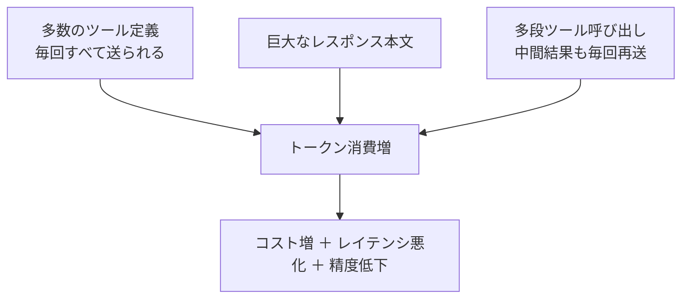
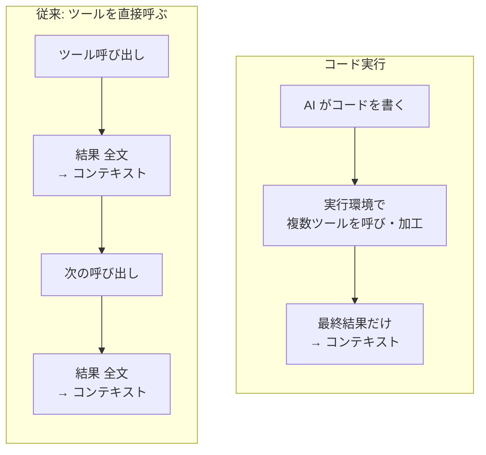

MCP は強力ですが、**ツール定義・大きなレスポンス・多段の呼び出し** によって
コンテキストとトークンを急速に消費し、コスト・レイテンシ・精度を悪化させます。
ここは設計段階で必ず対策しておくべき重要ポイントです。

## トークンが膨らむ主因

| 主因 | なぜ膨らむか | 規模感の例 |
| --- | --- | --- |
| ツール定義 | 接続した MCP サーバのツール説明・スキーマが **毎リクエスト** コンテキストに入る | 数十のツールで数万トークンに達することもある |
| レスポンス | API の生 JSON をそのまま返すと、不要なフィールドまで入る | チケット 1 件で数千トークン |
| 多段呼び出し | ツール結果はすべて会話履歴に残り、以後のリクエストで再送される | 呼び出し回数に比例して増え続ける |

ツールが多すぎると、コストだけでなく **AI がツールを選び間違える** 原因にもなります。

## 対策

### 1. 基本: 送る量を絞る

| 対策 | 効果 |
| --- | --- |
| ツールを必要最小限に絞る（ユースケースごとに有効化） | 定義トークンの削減・選択ミスの減少 |
| サーバ側で要約・フィールド選択 | レスポンスの肥大化を防ぐ |
| ページング・上限件数 | 一度に返す量を制御 |
| 結果のキャッシュ | 同一問い合わせの重複を回避 |
| RAG で代替できる部分は RAG へ | 静的知識は MCP で都度取得しない |
| 使い終わったツール結果を消す（コンテキスト編集） | 多段呼び出しでの履歴の肥大化を防ぐ |

### 2. ツール検索（必要なツールだけ読み込む）

ツールが多い場合、すべての定義を最初から渡さず、**AI が必要に応じてツールを検索して読み込む** 方式が使えます。
Claude の API では、ツールに「遅延読み込み」の印を付けておくと、最初は検索用のツールだけが渡され、
必要になったツールの定義だけが追加されます。Anthropic の報告では、ツール定義のトークンを大幅に削減しつつ、
ツール選択の精度も向上しています（検索ぶんの往復が増える点はトレードオフ）。

### 3. コード実行（MCP をコードから呼ぶ）

AI にツールを 1 つずつ呼ばせる代わりに、**MCP サーバを関数ライブラリとして見せ、AI に処理コードを書かせて実行する** 方式です。
中間データはコード実行環境の中で処理され、最終結果だけがコンテキストに戻るため、大量データを扱う処理で特に効きます。

Anthropic の例では、ある業務フローのトークン消費が **約 15 万 → 約 2,000（約 98.7% 削減）** になったと報告されています。
ただし、AI が書いたコードを動かすための **サンドボックス・リソース制限・監視** が必要になります。

## 判断の指針

- **静的・大量** のナレッジ → [RAG](/ai-tech-notes/rag/) に寄せる
- **動的・少量・最新性重視** → MCP で都度取得（レスポンスは絞る）
- **ツールが 10 個を超える・定義が数万トークン** → ツール検索を検討
- **大量データの集計・変換を伴う処理** → コード実行方式を検討
- コスト試算は [コスト・ROI](/ai-tech-notes/cost-roi/) を参照

## よくあるアンチパターン（症状と回避策）

MCP は強力なため「**何でも MCP で取得**」しがちですが、これはトークン浪費の典型パターンです。

| 症状 | 原因 | 回避策 |
| --- | --- | --- |
| 静的な規程・仕様まで毎回 MCP で取得している | RAG との役割分担が無い | 静的知識は RAG に寄せる（[使い分け](/ai-tech-notes/mcp/rag-vs-mcp/)） |
| 1 回の応答で数万トークンを消費している | API の生レスポンスをそのまま返している | サーバ側で要約・フィールド選択・件数制限 |
| AI が関係ないツールを呼ぶ・選び間違える | ツールが多すぎる | 必要なツールだけ有効化、またはツール検索 |
| 同じ取得を何度も繰り返す | 結果を再利用していない | 結果をキャッシュ、取得済みの情報をプロンプトで明示 |
| 会話の後半ほど遅く高くなる | ツール結果が履歴に積み上がっている | 使い終わった結果を消す（コンテキスト編集）・要約 |

:::tip
MCP のコストは「**ツール定義 ＋ レスポンス ＋ 呼び出し回数**」で決まります。3 つすべてを絞るのが基本です。
:::

## 参考・出典

- [Code execution with MCP: Building more efficient agents](https://www.anthropic.com/engineering/code-execution-with-mcp) — Anthropic
- [Introducing advanced tool use on the Claude Developer Platform](https://www.anthropic.com/engineering/advanced-tool-use) — Anthropic
- [Tool search tool](https://platform.claude.com/docs/en/agents-and-tools/tool-use/tool-search-tool) — Claude Platform Docs
- [Context editing](https://platform.claude.com/docs/en/build-with-claude/context-editing) — Claude Platform Docs
