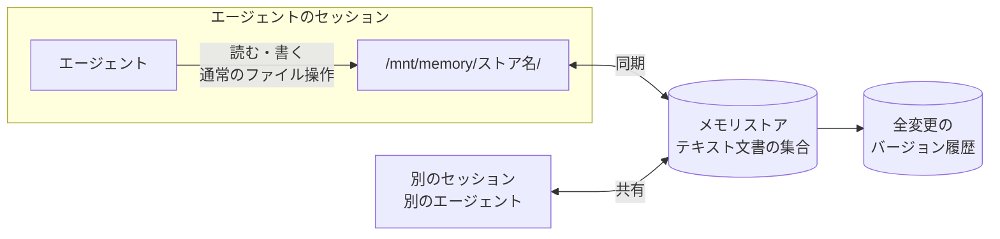
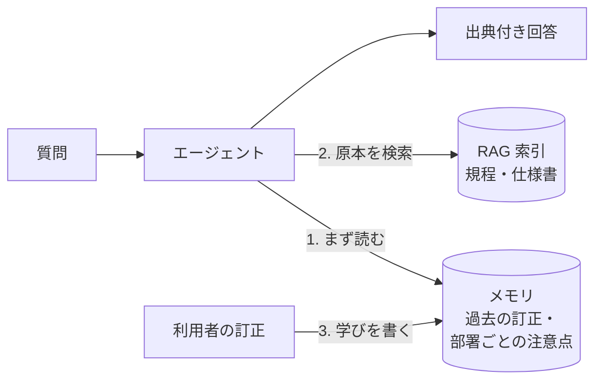

RAG は「**人が用意した文書を、AI が読む**」仕組みです。
これに対して 2026 年に広がったのが、**AI エージェント自身が書き込み、次回以降に読み返す** メモリです。
Anthropic の Claude Managed Agents では、メモリが **ファイルシステムとしてマウント** され、
エージェントは普段のファイル操作（読む・書く・検索する）でそれを扱います。

「ベクトル DB・埋め込みパイプライン・検索 API を作らなくても、ファイルに書いて読めばよい」という発想で、
一部では「RAG の代わり」とも語られます。ただし **何でも置き換えられるわけではありません**。
このページでは仕組みと限界を整理し、RAG との使い分けを決めます。

## RAG とメモリの違い

| 観点 | RAG（索引検索） | エージェントメモリ（ファイル型） |
| --- | --- | --- |
| 書き手 | 人・同期処理（エージェントは読むだけ） | **エージェント自身**（人や API も書ける） |
| 中身 | 規程・仕様書・Wiki など大量の原本 | 学んだこと・訂正・好み・作業の進捗など少量の知見 |
| 探し方 | 埋め込み＋キーワードの意味検索 | ファイル一覧・grep・ファイルを開いて読む |
| 規模の目安 | 数万〜数百万チャンク | 数十〜数千ファイル（後述の上限あり） |
| 更新 | 同期バッチで反映（遅れあり） | 会話中に即時反映 |
| 主なリスク | 古い版の混入・取りこぼし | 誤った知見の定着・プロンプトインジェクションによる汚染 |

一言でいうと、RAG は **組織の「蔵書」を引く** 仕組み、メモリは **エージェントの「業務ノート」** です。

## 仕組み（Claude Managed Agents の例）

Managed Agents のメモリは 2026 年 4 月に公開ベータとして提供が始まりました（2026 年 11 月時点でもベータ）。

| 要素 | 内容 |
| --- | --- |
| メモリストア | ワークスペース単位の「Claude 向けに最適化されたテキスト文書の集合」。名前と説明を付けて作成し、説明はエージェントに渡される |
| マウント | セッション作成時に指定すると `/mnt/memory/<ストア名>/` に見える。実行中のセッションに後から付け外しはできない |
| 操作 | 専用ツールではなく、エージェントの標準のファイル操作ツールで読み書きする |
| アクセス権 | ストアごとに `read_write`（既定）か `read_only` を指定。ファイルシステムの層で強制される |
| 共有 | 1 つのストアを複数のエージェント・セッションで同時に使える。例: 全社共通は読み取り専用、利用者ごとは読み書き |
| 履歴 | 変更のたびに不変のバージョンが残る。どのエージェント・セッションが書いたかを追跡できる |
| 取り消し | 専用の「復元」API はなく、古いバージョンを取得して内容を書き戻す |
| 秘匿化 | 漏れた秘密情報や個人情報は、監査の記録を残したまま過去のバージョンから消せる（redact） |

### 上限（2026 年 11 月時点のドキュメント）

| 項目 | 上限 |
| --- | --- |
| 1 メモリ（1 ファイル） | 100 kB（約 2.5 万トークン） |
| 1 ストアあたりのメモリ数 | 10,000 |
| 1 セッションに付けられるストア数 | 8 |
| バージョン履歴の保持 | 30 日（稼働中のメモリの直近版は常に保持） |

公式ドキュメントも「**大きなファイルを少数より、小さなファイルを多数**」を推奨しています。
1 ストア 10,000 ファイルという上限からも、**数十万件の社内文書をそのまま置く用途は想定されていない** ことが分かります。

### 報告されている効果

Anthropic の発表では、導入企業が次の数値を報告しています（いずれも**企業側の自己申告**で、条件は公開されていません）。

- **Rakuten:** 独自の検索基盤をメモリで置き換え、一次回答の誤りが 97% 減少、コスト 27% 減、レイテンシ 34% 減
- **Wisedocs:** 文書の検証作業が 30% 高速化

また、Anthropic のハーネス設計に関する記事では、Sonnet 4.5 に **メモリフォルダを持たせただけで** ブラウジング調査のベンチマーク（BrowseComp-Plus）の正答率が 60.4% → 67.2% に上がったと報告されています。

## 使い分けの判断

上から順に確認し、最初に当てはまった行の方式を選びます。

| 順 | 確認すること | はい → | いいえ → |
| --- | --- | --- | --- |
| 1 | 対象は **原本が別にある大量の文書** か（規程・仕様書・Wiki） | **RAG** | 2 へ |
| 2 | 対象は **エージェントが作業中に得た知見** か（訂正・好み・判断の経緯） | **メモリ（読み書き）** | 3 へ |
| 3 | 対象は **少量で、毎回ほぼ全部を見せたい参照情報** か（用語集・手順・判断基準） | **メモリ（読み取り専用）** または CLAUDE.md / Skill | 4 へ |
| 4 | 対象は **最新の状態** か（チケット・在庫・承認状況） | **MCP**（→ [RAG と MCP の使い分け](/ai-tech-notes/mcp/rag-vs-mcp/)） | RAG |

### よくある併用パターン

実務では「どちらか」ではなく、**RAG で原本を引き、メモリで学びを残す** 併用が基本です。

例: 社内 Q&A エージェントで、利用者から「その規程は 2025 年版で廃止。今は〇〇規程を見て」と訂正された場合です。

- **原本の修正**（規程の改廃）は、原本の管理者が行い、RAG の索引に反映します。
- **エージェントの学び**（「この質問では〇〇規程を優先する」）は、メモリに書き、次の利用者への回答から反映します。

訂正を利用者ごとに覚えるか、全員で共有するかは、ストアの分け方とアクセス権で設計します。

## 注意点

:::caution[メモリに原本をコピーしない]
規程や仕様書の本文をメモリにコピーすると、原本とメモリの **二重管理** になり、
原本が改訂されても古い内容が残ります（→ [重複バージョン問題](/ai-tech-notes/anti-patterns/data-duplication/)）。
メモリには **「どの原本を見るべきか」「何に注意すべきか」** を書き、本文は RAG で引きます。
:::

- **汚染への備え:** 外部の文書やメールなど信頼できない入力を扱う場合、プロンプトインジェクションでメモリに悪意ある内容が書き込まれる可能性があると、公式ドキュメント自体が警告しています。参照用の共有ストアは `read_only` にし、書き込み可能なストアは利用者・用途ごとに分けます。
- **劣化への備え:** 誤った知見や古い知見も残り続けます。定期的に棚卸しして、統合・削除します。変更履歴（バージョン）を監査に使えるようにしておきます。
- **規制・契約の確認:** 2026 年 11 月時点のドキュメントでは、Managed Agents のメモリは ZDR（データを保持しない契約）と HIPAA の対象外とされています（ZDR はセルフホスト構成を除く）。機密データを扱う前に、最新の対象範囲を確認してください。
- **評価に組み込む:** メモリがあると、同じ質問でも回答が時間とともに変わります。[RAG の評価](/ai-tech-notes/rag/evaluation/) の評価セットは、**メモリが空の状態と、蓄積後の状態の両方** で測ります。

## 参考・出典

- [Built-in memory for Claude Managed Agents](https://claude.com/blog/claude-managed-agents-memory) — Anthropic（2026-04-23）
- [Managed Agents — Memory](https://platform.claude.com/docs/en/managed-agents/memory) — Claude Platform Docs
- [Agent Harness Design: 3 Patterns for Harnessing Claude's Intelligence](https://claude.com/resources/articles/harnessing-claudes-intelligence) — Anthropic（2026-04-02）
- [Knowledge and Memory Beyond RAG](https://medium.com/@Micheal-Lanham/knowledge-and-memory-beyond-rag-why-2026-agents-need-a-write-path-not-just-a-retriever-ae2547b7ffe9) — Micheal Lanham（Medium）
