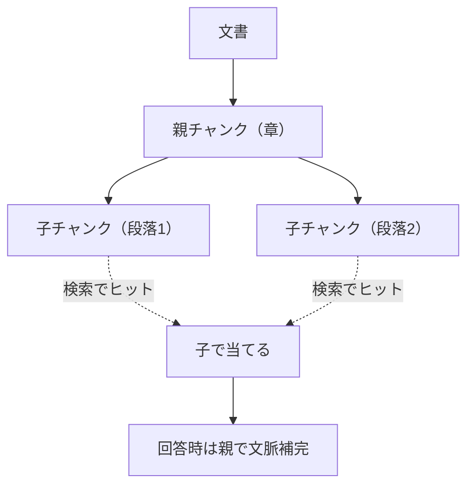
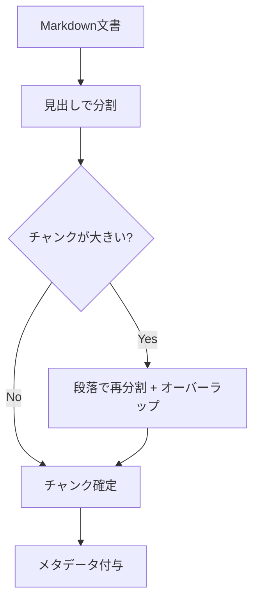
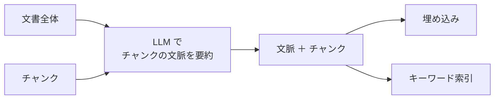

チャンク（分割単位）の設計は、RAG 精度に最も影響する要素のひとつです。
大きすぎるとノイズが増え、小さすぎると文脈が失われます。
「検索で当たるか」と「当たった塊が回答に十分な文脈を持つか」の両立がゴールです。

## なぜチャンクが効くのか

検索は基本的に **チャンク単位**でヒットします。つまりチャンクの切り方が、

- **検索のヒット率**（小さすぎると文脈不足で当たらない／大きすぎると無関係語が混ざる）
- **回答の質**（当たったチャンクに答えが収まっているか）
- **コスト**（大きいチャンクを多数渡すと投入トークンが膨らむ）

のすべてを左右します。

## 前提: まず文書を正しく読み取る

チャンク以前に、**PDF や Office 文書から見出し・表の構造を保ったままテキスト化できているか** が精度の土台です。
PDF をプレーンテキストに変換すると、見出しが本文に埋もれ、表の行と列が崩れます。

- **レイアウト解析で Markdown に変換する:** Azure AI Document Intelligence の Layout モデルは、
  見出し・表・段落を保った Markdown を出力でき、見出し単位のチャンク分割と相性が良い
- **検索基盤の取り込み機能を使う:** Azure AI Search の Document Layout スキルを使うと、
  取り込み時に見出し単位のセクションへ分割できる（解析は別料金。巨大な文書は処理時間の制約に注意）
- **変換結果を目で確認する:** 代表的な文書を数件変換し、見出し・表が崩れていないかを最初に確認する

→ 形式の方針は [データ形式の方針](/ai-tech-notes/data-modeling/) を参照。

## 主なチャンク方式

| 方式 | 特徴 | 向くケース |
| --- | --- | --- |
| 固定長 | 実装が簡単、文脈が切れやすい | 均質なテキスト |
| 意味単位 | 見出し・段落で分割 | 構造化された文書（MD推奨） |
| 階層（親子） | 親(章)-子(段落)を保持 | 長文・仕様書 |
| スライディングウィンドウ | 重複を持たせ文脈を維持 | 連続性が重要な文書 |

### 固定長分割

トークン数で機械的に区切る方式。実装は簡単ですが、文の途中や論理の切れ目を無視して切るため、
文脈が分断されやすいのが弱点です。オーバーラップ（後述）と組み合わせて緩和します。

### 意味単位分割（推奨の出発点）

見出し・段落など**文書構造**に沿って分割します。Markdown の見出し構造を活かせるため、
[Markdown 推奨](/ai-tech-notes/data-modeling/) のデータと相性が良く、出典提示も精密になります。

### 階層（親子）チャンク

検索は小さな子チャンクで精度よく当て、回答時には親（章・節）を渡して文脈を補う方式です。
「ヒット精度」と「文脈の十分さ」を両立しやすく、長い仕様書で有効です。

## チャンクサイズとオーバーラップ

| パラメータ | 小さくすると | 大きくすると |
| --- | --- | --- |
| チャンクサイズ | ヒット精度↑・文脈不足になりやすい | 文脈豊富・ノイズ↑・コスト↑ |
| オーバーラップ | 境界での文脈欠落リスク↑ | 文脈維持↑・重複でコスト/冗長↑ |

実務的な出発点:

- まずは **意味単位（見出し）** で分割し、大きすぎる塊だけ段落で再分割
- **オーバーラップは 10〜15% 程度**から始める
- 1つの正解が1チャンクに収まる粒度を狙う（またがると検索精度が落ちる）

## 構造を活かす・特殊要素の扱い

- **見出しパスを保持**: 「章 > 節 > 小節」をメタデータに持たせると、出典提示と絞り込みが効く
- **表**: 行で機械分割すると壊れる。表は1つの塊として保持するか、Markdown 表のまま渡す
- **コードブロック**: 途中で切らない。関数・ブロック単位を意識
- **画像/図**: キャプションや代替テキストをテキスト化して索引に含める

## 文脈付きチャンク（Contextual Retrieval）

チャンクは切り出した時点で文脈を失います。例えば「前年同期比 3% 増加した」というチャンクだけでは、
どの会社の、どの期間の話か分かりません。

**文脈付きチャンク** は、取り込み時に LLM で「このチャンクは文書全体の中で何について書かれた部分か」という
短い説明（50〜100 トークン程度）を生成し、チャンクの先頭に付けてから埋め込み・キーワード索引に登録する手法です。

Anthropic の報告では、検索の失敗率（上位 20 件に正解が無い割合）が

| 構成 | 失敗率の削減 |
| --- | --- |
| 文脈付き埋め込みのみ | 約 35% 減 |
| 文脈付き埋め込み ＋ 文脈付き BM25 | 約 49% 減 |
| 上記 ＋ リランク | 約 67% 減 |

- 取り込み時の LLM 呼び出しが **チャンク数ぶん** 増えるが、同じ文書全体を毎回渡すため **プロンプトキャッシュで大幅に安くできる**
- 簡易版として、**文書タイトルと見出しパスをチャンク先頭に付ける** だけでも効果がある（LLM 不要）

## メタデータの付与

各チャンクには文書メタデータを継承し、出典情報を必ず添えます。

- `doc_id` / `source`（原文への導線）
- 見出しパス（章・節）
- `updated_at` / `team` / `doc_type`（検索フィルタ用）

詳細は [メタデータ付与](/ai-tech-notes/data-modeling/metadata/) を参照。

## アンチパターン

- **PDF をプレーンテキスト化しただけ** で投入 → 見出し・表が崩れて検索も出典も不正確
- **巨大チャンク**で「とりあえず全部入れる」→ ノイズ増・コスト増・精度低下
- **改行や固定長で機械的に分割**して表・コードを破壊
- メタデータ無しで投入 → 絞り込めず出典も出せない
- 1つの正解が複数チャンクにまたがる粒度 → どちらも中途半端でヒットしない

## テックリードが訊いてくる質問

> **Q. 「チャンクサイズは結局いくつが正解？」**
> A. 唯一解はありません。意味単位を基準に、評価データで複数サイズを比較して決めます（[評価](/ai-tech-notes/rag/evaluation/)）。

> **Q. 「文書を更新したらチャンクはどうなる？」**
> A. 変更分だけ再チャンク・再埋め込みする増分更新にします。旧チャンクが残ると古い情報が混ざります（[重複対策](/ai-tech-notes/anti-patterns/data-duplication/)）。

> **Q. 「表や仕様書がうまく拾えない」**
> A. 機械的な固定長分割が原因のことが多いです。表・コードを壊さない意味単位分割や親子チャンクを検討します。

> **Q. 「チャンクを変えたら精度が変わった。再現できる？」**
> A. チャンク設定はバージョン管理し、評価スコアと紐づけて記録します。変更＝再評価をルール化します。

## 参考・出典

- [Introducing Contextual Retrieval](https://www.anthropic.com/engineering/contextual-retrieval) — Anthropic
- [Retrieval-Augmented Generation with Azure AI Document Intelligence](https://learn.microsoft.com/azure/ai-services/document-intelligence/concept/retrieval-augmented-generation) — Microsoft Learn
- [Document Layout skill](https://learn.microsoft.com/azure/search/cognitive-search-skill-document-intelligence-layout) — Microsoft Learn
- [Chunk and vectorize by document layout（semantic chunking）](https://learn.microsoft.com/azure/search/search-how-to-semantic-chunking) — Microsoft Learn
