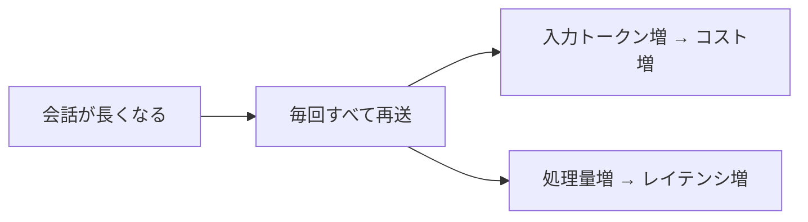
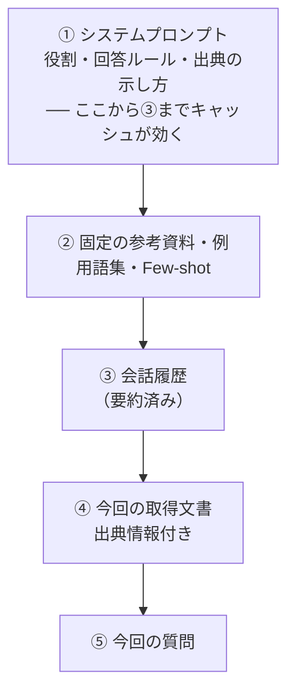
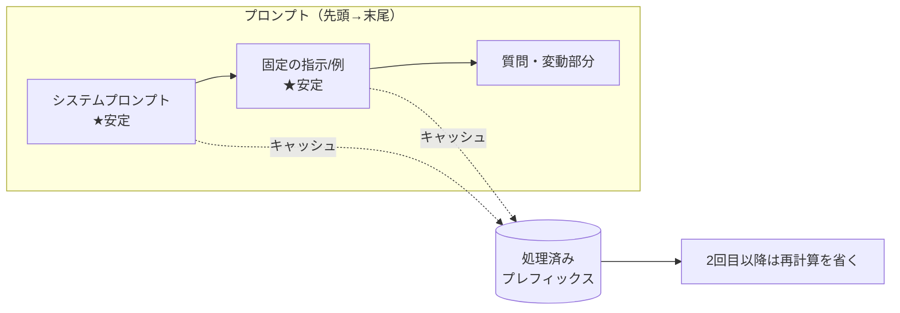
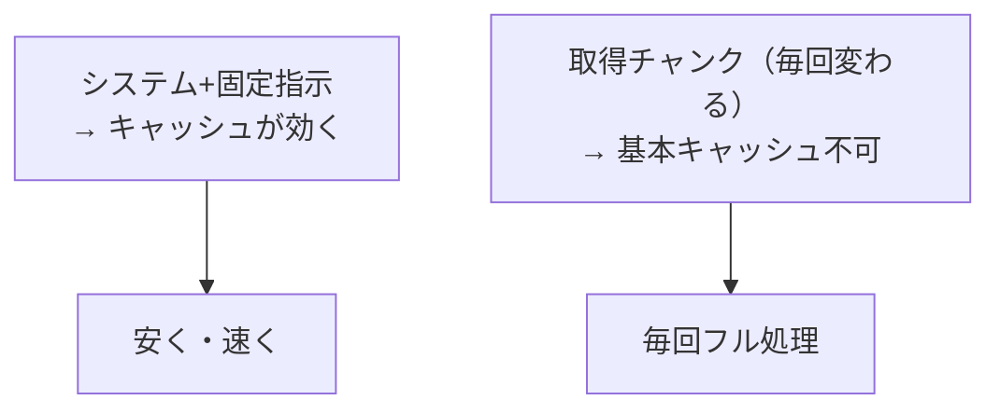

RAG のコストと挙動は、「**LLM は記憶を持たない（ステートレス）**」という前提から決まります。
回答に必要な情報（システムプロンプト・会話履歴・取得文書・質問）は、**毎回すべてコンテキストに載せて送る** 必要があります。
この前提そのものの説明は [LLM の基礎 — LLM は記憶を持たない](/ai-tech-notes/llm-basics/#llm-は記憶を持たないステートレス) を参照してください。
このページでは、その前提のうえで **コンテキストをどう組み立て、キャッシュでどうコストを下げるか** を扱います。

## ステートレスが RAG のコストに効く

ステートレスゆえに、マルチターン会話では **履歴と取得文書が毎ターン再送 → 毎ターン再課金・再計算**されます。
会話が長くなるほど、1ターンあたりのコストとレイテンシが膨らみます。

対策の方向性:

- 履歴を**要約・圧縮**して再送量を抑える
- RAG で投入する文書は**必要な分だけ**に絞る（[検索とリランキング](/ai-tech-notes/rag/retrieval/)）
- そして次の **プロンプトキャッシュ**で、再送する固定部分の再計算を省く

## コンテキストの組み立て順序

RAG のプロンプトは、**変わりにくいものを先頭に、変わりやすいものを末尾に** 並べるのが基本です。
キャッシュが効きやすくなるうえ、モデルにとっても「前提 → 根拠 → 質問」の順で読みやすくなります。

- **取得文書には出典情報を付けて渡す:** タイトル・URL・更新日・見出しパスを各文書の先頭に付けると、出典付きで回答させやすい
- **文書ごとに区切る:** XML タグ（例: `<document>`）などで文書の境界を明示すると、どの文書に基づく回答かが明確になる
- **長い文書は質問より前に置く:** 大量の文書を扱うときは、文書を先、質問を最後に置く方が回答品質が上がりやすい
- API の引用機能（Claude の search result ブロックなど）を使う場合は、所定の形式で渡す
  （→ [ナレッジ回答 — 出典の示し方](/ai-tech-notes/use-cases/knowledge-qa/#出典の示し方)）

## プロンプトキャッシュで何が変わるか

ここが重要な誤解ポイントです。

:::caution[キャッシュは「記憶」ではない]
プロンプトキャッシュを使っても、**LLM がステートレスである事実は変わりません**。
依然として毎回すべてを送ります。変わるのは、**同じ前置き部分の「再計算」をプロバイダ側が省く**点だけです。
結果として **安く・速く**なりますが、モデルが内容を覚えているわけではありません。
:::

### 仕組み: プレフィックス（先頭一致）キャッシュ

多くのプロバイダのキャッシュは **プレフィックス一致**で動きます。
プロンプトの**先頭から変わっていない部分**を処理済みとしてキャッシュし、2回目以降は再計算を省きます。

鉄則は **「安定した内容を先頭に、変動する内容を末尾に」**。
先頭に時刻・UUID・ユーザー名など毎回変わる値を入れると、**そこから後ろのキャッシュが全部無効**になります。

### 経済性（一般的な傾向）

| 区分 | コスト感 | 補足 |
| --- | --- | --- |
| キャッシュ**読み取り** | 通常入力の **約 1/10**（最新モデルでは 1/20 以下のものもある） | 同じ前置きを再利用するほど得 |
| キャッシュ**書き込み** | 通常入力の **約 1.25 倍**（短期）／**約 2 倍**（長期TTL） | 数回読まれれば元が取れる |
| 有効期限（TTL） | **既定は数分（約5分）**、延長すると**1時間**程度 | アクセス間隔に合わせる |

**損益分岐の目安:** TTL 5 分なら、同じ前置きが **2 回** 使われれば元が取れます（1.25 + 0.1 = 1.35 < 2）。
TTL 1 時間は書き込みが高いため **3 回以上** の利用が目安です。

### RAG 特有の注意（ここが盲点）

RAG で取得するチャンクは **クエリごとに変わる**ため、そのままでは「安定したプレフィックス」になりません。
つまり **取得文書はキャッシュが効きにくい**のが普通です。

キャッシュが効くのは主に:

- **システムプロンプト**や**固定の指示・few-shot 例**（毎回同じ先頭部分）
- **同じ会話の継続**（前ターンまでの履歴は変わらないのでプレフィックスとして再利用）
- 全クエリ共通の**大きな前置き文書**（あれば）

## AIモデルごとの挙動（具体例）

キャッシュやコンテキストの挙動は **モデルによって異なります**。代表的な差は次の通りです。

### 1. キャッシュが効く「最小トークン数」が違う

プレフィックスが一定の長さに満たないと、**キャッシュは静かに効きません**（エラーは出ない）。
この最小長はモデルで異なります。

| モデル（Claude の例） | キャッシュ可能な最小プレフィックス |
| --- | --- |
| Opus 5.5 / Sonnet 5.5 / Haiku 5.5 / Fable 5.2 など最新世代 | 512 トークン |
| Opus 4.8 / Sonnet 4.6 など | 1,024 トークン |
| Opus 4.7 | 2,048 トークン |
| Opus 4.6 / Opus 4.5 / Haiku 4.5 | 4,096 トークン |

世代が新しいほど小さくなるとは限らない点に注意してください（例: Opus 4.6 は 4,096、Opus 4.8 は 1,024）。

→ 短いシステムプロンプトだけだと、最小長に届かずキャッシュされないことがあります。

### 2. TTL（有効期限）と料金体系が違う

- 既定 TTL は**数分**、延長オプションで**1時間**程度（プロバイダ・モデルで差）
- キャッシュ書き込み/読み取りの単価もモデルで異なる（例: Claude Opus 5.5 の読み取りは通常入力の約 1/20）
- キャッシュは **ワークスペースやアカウント単位で分離** されている。同じプロンプトでも、送信元が分かれていると共有されない

### 3. コンテキストウィンドウ上限が違う

載せられる履歴・文書の量はモデル次第です（例: 数十万〜**100万トークン**級まで幅がある）。
上限が大きいモデルほど長い履歴を再送できますが、**大きい＝全部入れてよい、ではありません**
（[コンテキストウィンドウ](/ai-tech-notes/llm-basics/context-window/)）。

### 4. サーバ側のコンテキスト管理機能

長い会話向けに、プロバイダによっては **自動要約（コンパクション）** や
**古いツール結果の自動削除** といった機能を提供します。
これらは「ステートレスな再送」を楽にする補助で、基盤がステートレスである事実は変わりません。

:::caution[数値・モデル名は必ず最新ドキュメントで確認]
上記の最小トークン数・TTL・上限・料金は **モデルの更新で変わります**。本ページは挙動の「枠組み」を示すものです。
実装時は利用プロバイダの最新ドキュメントで確認してください。
:::

## キャッシュが効いているかを必ず計測する

レスポンスの **キャッシュ読み取りトークン**（例: `cache_read` 系の指標）が
**0 のまま**なら、キャッシュが効いていません。よくある原因:

- 先頭に時刻・ランダム値・ユーザー固有情報を入れている
- JSON のキー順が毎回変わる（シリアライズが非決定的）
- ツール定義やモデルを途中で変えた（プレフィックスが崩れる／キャッシュはモデル単位）
- 推論の深さ（effort）などの設定を会話の途中で変えた（設定変更でキャッシュが無効になる場合がある）
- プレフィックスが最小長に届いていない（エラーにならず、黙ってキャッシュされない）

## テックリードが訊いてくる質問

> **Q. 「会話の続きだから、前の文脈は送らなくていいよね？」**
> A. 送る必要があります。LLM はステートレスで前回を覚えていません。続きに見せるには履歴の再送が必須です。

> **Q. 「コンテキストが大きいモデルなら、全文書を毎回入れればRAGは不要では？」**
> A. 非推奨です。コストとレイテンシが膨らみ、ノイズで精度も落ちます（lost in the middle）。RAG で絞る方が安く正確です。

> **Q. 「プロンプトキャッシュを入れたのに安くならない。なぜ？」**
> A. プレフィックスが毎回変わっている可能性大。先頭に動的値が無いか、取得チャンクを先頭に置いていないかを確認し、`cache_read` 指標で検証します。

> **Q. 「キャッシュすればモデルが内容を覚えてくれる？」**
> A. いいえ。キャッシュは再計算の省略（コスト/速度の最適化）であって記憶ではありません。

関連: [コスト最適化（キャッシュ・モデル切り替え）](/ai-tech-notes/cost-roi/optimization/) /
[コンテキストウィンドウ](/ai-tech-notes/llm-basics/context-window/)

## 参考・出典

- [Prompt caching](https://platform.claude.com/docs/en/build-with-claude/prompt-caching) — Claude Platform Docs
- [Pricing](https://platform.claude.com/docs/en/about-claude/pricing) — Claude Platform Docs
- [Search results](https://platform.claude.com/docs/en/build-with-claude/search-results) — Claude Platform Docs
- [Long context prompting tips](https://platform.claude.com/docs/en/build-with-claude/prompt-engineering/long-context-tips) — Claude Platform Docs
