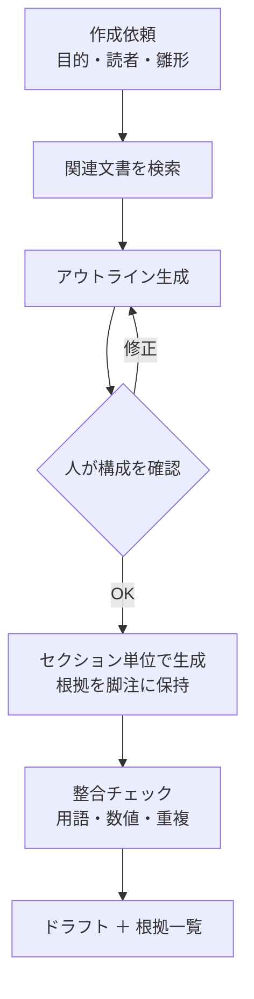

既存ナレッジやテンプレートを下敷きに、**文書の草案を生成**するユースケースです。
Q&A と違い、より多くの文脈を投入し、**体裁・構成・トーンを整える力** が求められます。
目標は「完成品」ではなく、**人が手直しして仕上げられる質の高い下書き** です。

## 要件

- 社内テンプレート・用語・トーンに沿わせる
- 参照した根拠を脚注やコメントで残せる（事実と推測を区別できる）
- 長文生成のためコンテキスト量とコストの設計が重要
- 最終責任は人が持つ（レビューと承認の工程を前提にする）

## 典型フロー（アウトライン → セクション生成）

長い文書を一度に生成すると、後半ほど品質が落ち、修正もしにくくなります。
**まず構成案を作り、人が確認してから、セクション単位で生成する** のが安定します。

この形は、処理を固定の工程に分けて順に渡す **プロンプトチェイニング** にあたります。
工程の間でプログラム的なチェック（見出し構成がテンプレートどおりか等）を挟めるのが利点です。

## テンプレート管理

テンプレートは「体裁の雛形」であると同時に、**AI への指示書** でもあります。

| 管理対象 | 内容 | 置き場所の例 |
| --- | --- | --- |
| 構成テンプレート | 見出し構成・必須セクション・各セクションの目的 | Markdown（見出し＋各節の説明コメント） |
| スタイルガイド | 文体（です・ます）、用語の統一表、禁止表現 | 共通のガイド文書を 1 つ |
| 良い例（Few-shot） | 過去の優良ドキュメントの抜粋 | テンプレートと同じ場所でバージョン管理 |

- テンプレートは **Markdown ＋ YAML フロントマター** で管理すると、AI にも人にも扱いやすい → [YAML タグ設計](/ai-tech-notes/data-modeling/yaml-tags/)
- テンプレートとスタイルガイドは毎回同じ内容を渡すため、**プロンプトキャッシュ** の効果が大きい → [コンテキストとキャッシュ](/ai-tech-notes/rag/context-and-caching/)
- テンプレート自体を Git などでバージョン管理し、**どの版で生成したか** を記録する

## 長文生成の勘所

- **セクションごとに必要な文脈だけ渡す:** 全関連文書を毎回渡さず、セクションの目的に合う根拠だけを検索し直す
- **前のセクションの要約を渡す:** 本文全体ではなく要約を渡すことで、一貫性を保ちつつトークンを節約する
- **数値・固有名詞は根拠から転記:** 生成させず、根拠文書からの引用であることを脚注で示す
- **推測には印を付ける:** 根拠のない記述は「要確認」と明示させ、レビュー時に見落とさないようにする

## 品質を上げる「書いて → 評価して → 直す」ループ

明確な評価基準（テンプレート準拠・用語統一・根拠の有無）がある場合は、
生成役とは別の呼び出しで **評価役** に点検させ、指摘を反映して書き直させる構成が有効です（evaluator-optimizer）。
ただし反復回数に比例してコストが増えるため、**ループは 1〜2 回に制限** し、残りは人のレビューに任せます。
→ 評価の観点は [レビュー支援](/ai-tech-notes/use-cases/review-assist/) と共通化できます。

## 勘所まとめ

- **テンプレート駆動** にすると体裁が安定する
- セクション分割生成でコンテキスト超過とコストを抑える → [最適化](/ai-tech-notes/cost-roi/optimization/)
- 参照元を保持し、後段の [レビュー](/ai-tech-notes/use-cases/review-assist/) へ引き継ぐ
- 効果は「作成時間」だけでなく **修正量（採用率）** でも測る

## 参考・出典

- [Building effective agents（Prompt chaining / Evaluator-optimizer）](https://www.anthropic.com/engineering/building-effective-agents) — Anthropic
- [Prompt caching](https://platform.claude.com/docs/en/build-with-claude/prompt-caching) — Claude Platform Docs
