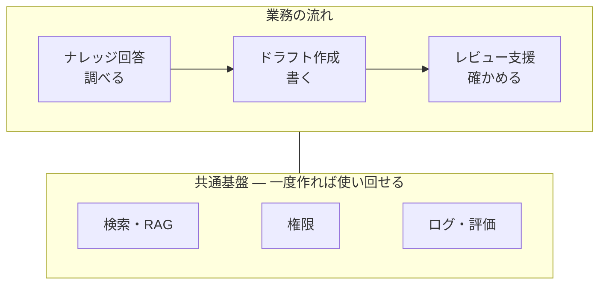

ナレッジ AI システムの代表的なユースケースを整理します。
ユースケースごとに「求められる精度」「許容レイテンシ」「コスト感」「失敗したときの影響」が異なり、
適したアーキテクチャも変わります。

## 代表的な3ユースケース

| ユースケース | 概要 | 重視する点 | 主な難所 | 詳細 |
| --- | --- | --- | --- | --- |
| ナレッジ回答 | 社内文書に基づく Q&A | 出典の正確さ・幻覚抑制・権限 | 検索の取りこぼし、古い版の混入 | [回答](/ai-tech-notes/use-cases/knowledge-qa/) |
| ドラフト作成 | 仕様書・議事録・提案書などの草案生成 | 文脈の網羅・体裁・トーン | 長文の一貫性、根拠の追跡 | [ドラフト](/ai-tech-notes/use-cases/draft-generation/) |
| レビュー支援 | 文書・コードの観点別レビュー | 基準の明文化・一貫性 | 過剰指摘（ノイズ）と見逃しのバランス | [レビュー](/ai-tech-notes/use-cases/review-assist/) |

3つは独立ではなく、**回答で調べ → ドラフトで書き → レビューで確かめる** という一連の業務の各工程に対応します。
共通基盤（検索・権限・ログ）を一度作れば、ユースケースを追加するコストは小さくなります。

## ユースケース選定の視点

| 観点 | 問い | 設計への影響 |
| --- | --- | --- |
| 読み取り中心か、生成中心か | 答えは既存文書の中にあるか | 回答は **検索精度**、生成は **文脈量と構成力** が効く |
| 正解が一意か | 「正しい答え」を定義できるか | 回答は出典必須、ドラフト/レビューは **基準の提示** が鍵 |
| 失敗時の影響 | 誤りが外部に出るか、人が必ず確認するか | 影響が大きいほど人の確認（Human-in-the-loop）を必須に |
| 頻度とコスト | 1日に何回使われるか | 高頻度ほどトークン最適化・キャッシュの効果が大きい |
| データの所在 | M365 内で完結するか | 完結するなら M365 Copilot が第一候補、外部が多いなら自前構成 |

## 何で効果を測るか（KPI の例）

導入前に「何が改善したら成功か」を決めておかないと、PoC の評価が印象論になります。

| ユースケース | 品質の指標 | 業務効果の指標 |
| --- | --- | --- |
| ナレッジ回答 | 正答率・出典の正確さ・「分からない」の適切さ | 問い合わせ削減数、自己解決率、調査時間 |
| ドラフト作成 | 修正量（採用率・編集距離）、事実誤りの件数 | 作成時間の短縮、テンプレート準拠率 |
| レビュー支援 | 指摘の適合率（採用された指摘の割合）・見逃し率 | レビュー待ち時間、手戻り件数 |

:::tip[小さく始める順番]
最初は **ナレッジ回答** から始めるのが定石です。検索・権限・評価という共通基盤を作る過程そのものが、
ドラフト作成やレビュー支援の土台になります。
:::

## まず「既製品」で足りるかを確認する

2026 年時点では、汎用的な社内 Q&A やドラフト作成は **Microsoft 365 Copilot**（Word / Teams など）や
各 AI アシスタントの標準機能でかなりの部分を満たせます。
自前で構築する価値が出るのは、次のような場合です。

- 業務固有の **テンプレート・基準・ワークフロー** に沿わせたい
- M365 以外（Confluence / JIRA / GitHub / ファイルサーバ）の知識を **横断** したい
- 回答品質を **評価・改善し続ける** 仕組みを自社で持ちたい

各ユースケースに対する推奨構成は
[推奨アーキテクチャ](/ai-tech-notes/use-cases/reference-architectures/) にまとめます。
Microsoft 365 の製品機能に当てはめた具体例は
[参考アーキテクチャ — M365 Copilot × Claude](/ai-tech-notes/use-cases/m365-copilot-claude-reference/) を参照してください。

## 参考・出典

- [Building effective agents](https://www.anthropic.com/engineering/building-effective-agents) — Anthropic
- [Microsoft 365 Copilot connectors overview](https://learn.microsoft.com/microsoftsearch/connectors-overview) — Microsoft Learn
