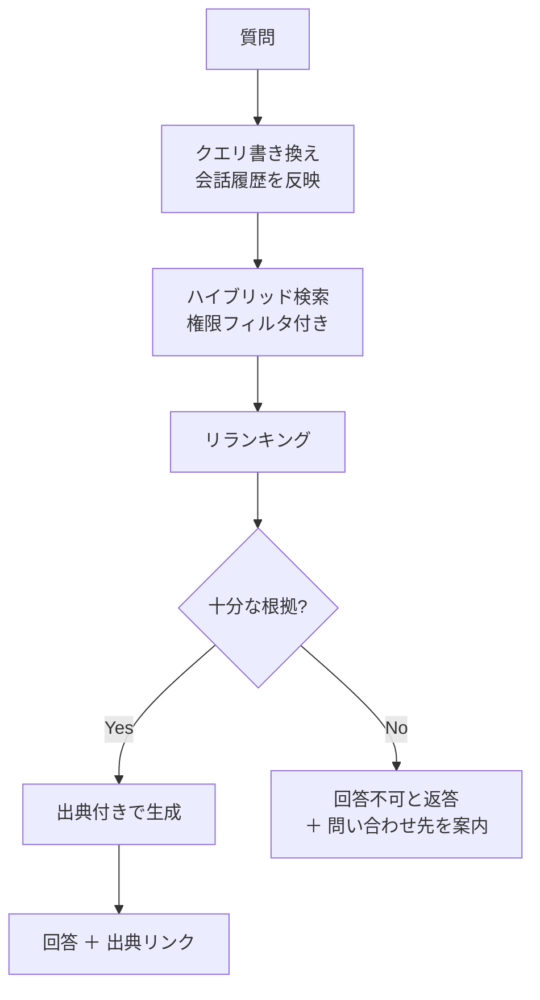

社内に分散したナレッジを横断し、**出典付きで正確に回答**するユースケースです。
幻覚（hallucination）の抑制と根拠の提示、そして **見てはいけない文書を回答に混ぜない** ことが最優先になります。

## 要件

- 回答には必ず **出典（ソース文書・該当箇所）** を添える
- 情報が無い場合は「分からない」と返す（捏造しない）
- アクセス権限を尊重する（権限のない文書を回答に混ぜない）
- 複数の版がある場合は **最新・正本** を優先する

## 典型フロー

ポイントは、**権限フィルタが検索の段階にある** ことと、**生成の前に「根拠が十分か」を判定する** ことです。

## 出典の示し方

出典は「付いている」だけでなく、**利用者がすぐ確かめられる** 形で示すことが重要です。

| パターン | 例 | 向くケース |
| --- | --- | --- |
| 文末の参照番号 | 「申請は 5 営業日前まで [1]」＋ 末尾に文書リンク | チャット UI の標準。実装が容易 |
| 該当箇所の引用 | 根拠となる一文を引用ブロックで表示 | 規程・契約など、文言そのものが重要な場合 |
| 文書カード | タイトル・更新日・所有部署をカード表示 | 版の新しさや正本かどうかを利用者が判断する場合 |

- **更新日を必ず表示** すると、利用者自身が古い情報に気付けます。
- 出典リンクは **元システム（SharePoint / Confluence など）の URL** を指し、AI 用の複製を指さないようにします。
  → [データ複製と重複バージョン問題](/ai-tech-notes/anti-patterns/data-duplication/)

:::tip[API の引用機能を使う]
Claude の API には、渡した文書や検索結果に対して **どの文がどの出典に基づくか** を構造化して返す
引用（Citations）機能があります。検索結果を「search result」ブロックとして渡すと、
出典のタイトル・URL 付きで引用が返るため、番号付けや該当箇所のハイライトを自前で実装する手間が減ります。
なお、引用機能と構造化出力（JSON スキーマ指定）は同時に使えない制約がある点に注意してください。
:::

## 「分からない」と言わせる設計

「分からない」を返せることは、回答の信頼性そのものです。プロンプトでお願いするだけでなく、仕組みで支えます。

1. **検索スコアのしきい値:** リランク後のスコアが一定以下なら、生成に進まず回答不可とする
2. **プロンプトでの明示:** 「与えられた文書に根拠がない場合は、推測せず『見つかりませんでした』と答える」
3. **出典の必須化:** 出典を 1 つも付けられない回答は表示しない（引用機能の出力で判定できる）
4. **次の行動を案内:** 回答不可のときは、問い合わせ先や関連しそうな文書を示して行き止まりにしない

## 権限フィルタの実装

権限は **検索段** で効かせます。生成後にフィルタする方式は、要約の中に情報が混ざるため防げません。

| 方式 | 仕組み | 長所 | 短所 |
| --- | --- | --- | --- |
| 索引に ACL を持たせる | 取り込み時に文書の許可ユーザー/グループ ID を索引に格納し、クエリ時にユーザーの所属で絞る | 高速・大量文書に強い | 権限変更の **同期遅延** がある |
| 検索基盤のネイティブ機能 | Azure AI Search の文書レベルアクセス制御のように、Entra ID トークンや SharePoint ACL を基盤側で評価 | 実装が少ない | 一部プレビュー。対応ソース・上限値に制約 |
| 実行時に元システムへ確認 | 候補文書ごとに元システムの API で閲覧可否を確認 | 常に最新の権限 | 遅い・API 制限に当たりやすい |

- 多くの場合は **「索引に ACL」＋「定期的な権限同期」** が現実解です。権限の変更頻度が高い文書群だけ実行時確認を併用します。
- グループの入れ子や「全員」共有など、**元システムの権限モデルを正しく展開できるか** を最初に検証してください。

:::caution[権限同期の遅延を許容できるか]
索引に ACL を持たせる方式では、元システムで権限を外しても、次の同期までは検索に出てしまいます。
人事・機密文書など遅延が許されない領域は、索引の対象から外すか、実行時確認を併用します。
:::

## 会話（マルチターン）への対応

「それの申請期限は？」のような指示語を含む質問は、そのままでは検索できません。
**会話履歴を踏まえて検索用のクエリを書き換える** 工程を、検索の前に入れます。
→ [検索とリランキング（クエリ変換）](/ai-tech-notes/rag/retrieval/)

## 精度を上げる勘所

- **チャンク設計** が回答精度を大きく左右する → [チャンク戦略](/ai-tech-notes/rag/chunking/)
- **メタデータ**（部署・更新日・文書種別）で検索を絞る → [メタデータ](/ai-tech-notes/data-modeling/metadata/)
- 古い版が混ざると精度低下 → [重複バージョン対策](/ai-tech-notes/anti-patterns/data-duplication/)
- 評価用の質問セットを作り、変更のたびに **正答率・出典の正確さ・回答不可の適切さ** を測る → [RAG の評価](/ai-tech-notes/rag/evaluation/)

## 参考・出典

- [Citations](https://platform.claude.com/docs/en/build-with-claude/citations) — Claude Platform Docs
- [Search results](https://platform.claude.com/docs/en/build-with-claude/search-results) — Claude Platform Docs
- [Document-level access control in Azure AI Search](https://learn.microsoft.com/azure/search/search-document-level-access-overview) — Microsoft Learn
- [Relevance in Azure AI Search](https://learn.microsoft.com/azure/search/search-relevance-overview) — Microsoft Learn
