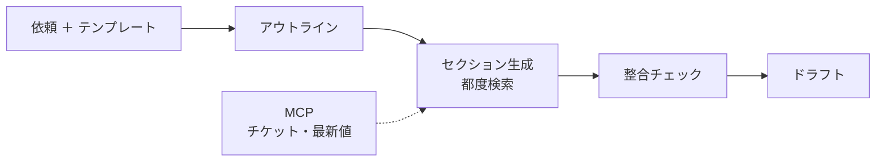

ユースケースごとに推奨する構成パターンを示します。
いずれも [システム全体像](/ai-tech-notes/overview/architecture/) の部分集合で、**どこを厚くするか** が違います。

## 回答 Q&A 向け（精度・出典重視）

- **厚くする所:** 検索（ハイブリッド ＋ リランク）と権限フィルタ
- **薄くてよい所:** 生成モデル。根拠が絞れていれば中位モデルでも十分なことが多い
- **補足:** コンテキストは上位数件に絞り、コストと幻覚を抑える

## ドラフト作成向け（文脈量・構成重視）

- **厚くする所:** テンプレート管理と、セクション単位の文脈構築
- **MCP の出番:** JIRA のチケット状態や最新の数値など、**索引にない最新情報** をセクション生成時に取得
- **補足:** テンプレート・スタイルガイドはプロンプトキャッシュで固定費を下げる

## レビュー支援向け（基準駆動）

- **厚くする所:** 基準ドキュメントの整備と、観点別プロンプト・構造化出力
- **連携:** 対象データの所在に応じて [GitHub](/ai-tech-notes/data-sources/github/) / [Confluence](/ai-tech-notes/data-sources/confluence/) と連携
- **補足:** 観点数 × 対象数でコストが増えるため、差分（変更箇所）に限定して評価する

## 選定早見表

| 観点 | 回答 | ドラフト | レビュー |
| --- | --- | --- | --- |
| 検索精度 | ◎ | ○ | ○ |
| コンテキスト量 | 小 | 大 | 中 |
| 推奨モデル帯 | 中位（＋軽量で書き換え） | 上位（構成・長文） | 中〜上位（観点の難しさ次第） |
| MCP の出番 | 小 | 中 | 中〜大 |
| 構造化出力 | 任意（引用機能を優先） | 任意 | ◎（指摘の集計に必須） |
| 人の確認 | 任意（出典で自己確認） | 必須 | 必須（最終判断） |
| コスト感 | 低〜中 | 中〜高 | 中 |

## 既製品と自前構成の使い分け

| ユースケース | まず検討する既製品 | 自前構成が向くケース |
| --- | --- | --- |
| 回答 | Microsoft 365 Copilot（＋ Copilot コネクタ） | M365 外の知識の横断、回答品質を評価・改善し続けたい |
| ドラフト | Copilot in Word などのアシスタント機能 | 社内テンプレート・承認フローに組み込みたい |
| レビュー（コード） | GitHub Copilot code review / Claude Code | 社内独自の基準・複数リポジトリ横断の観点 |
| レビュー（文書） | — （既製品は少ない） | 規程・設計書など、基準が社内固有の文書全般 |

## 規模による違い

PoC → 部門展開 → 全社展開での作り込みの深さは、ユースケースによらず共通です。
詳細は [システム全体像 — 規模別の構成バリエーション](/ai-tech-notes/overview/architecture/#規模別の構成バリエーション) を参照してください。
ユースケース特有の注意点だけを挙げます。

- **回答:** 全社展開では権限モデルの検証が最大の山場。PoC の段階から本番相当の権限で試す
- **ドラフト:** 部門ごとにテンプレートが異なるため、テンプレートの **所有者と更新ルール** を決めてから広げる
- **レビュー:** 指摘の採用率が低いまま広げると定着しない。1 チームで採用率を上げてから展開する

## 参考・出典

- [Building effective agents](https://www.anthropic.com/engineering/building-effective-agents) — Anthropic
- [Relevance in Azure AI Search](https://learn.microsoft.com/azure/search/search-relevance-overview) — Microsoft Learn
- [Microsoft 365 Copilot connectors overview](https://learn.microsoft.com/microsoftsearch/connectors-overview) — Microsoft Learn
- [Using GitHub Copilot code review](https://docs.github.com/en/copilot/how-tos/use-copilot-agents/request-a-code-review/use-code-review) — GitHub Docs
