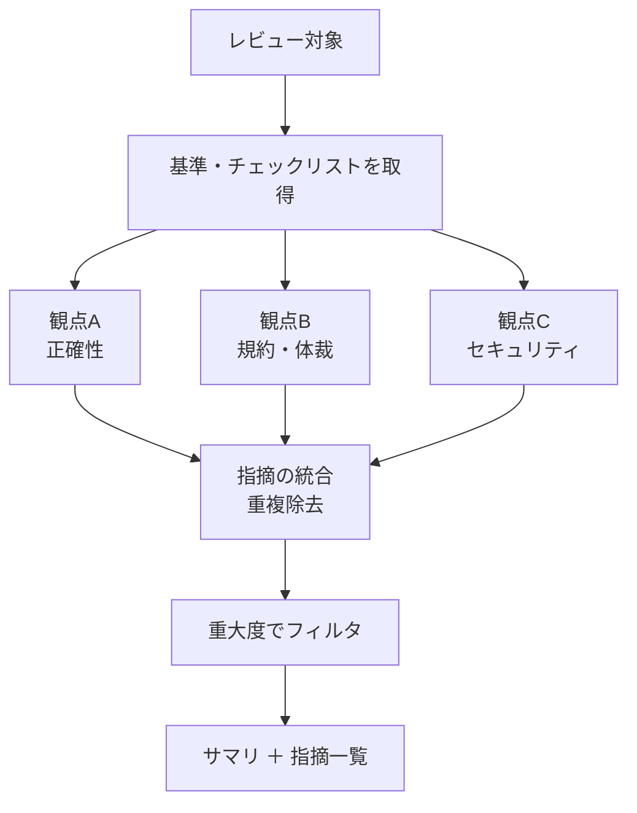

作成物を、**明文化された観点・基準に沿ってレビュー**するユースケースです。
基準（チェックリスト・ガイドライン）をどう与えるかが品質を決めます。
AI レビューの価値は「人の代わり」ではなく、**人がレビューする前に機械的な指摘を片付けておく** ことにあります。

## 要件

- レビュー観点を **基準ドキュメント** として明示的に渡す
- 指摘には根拠（基準のどの項目に違反するか）を添える
- 誤検知（過剰指摘）と見逃しのバランスを取る
- 指摘は **構造化データ** で出し、集計・フィルタできるようにする

## 典型フロー（観点ごとに並列評価）



全観点を 1 回のプロンプトで見させると、目立つ問題に注意が偏り、細かい観点が抜けがちです。
**観点ごとに分けて並列に評価し、最後に統合する** 方が見逃しが減ります（コストは観点数に比例して増えます）。

## 観点別プロンプトの設計

各観点のプロンプトは、次の要素で構成します。

| 要素 | 内容 | 例 |
| --- | --- | --- |
| 役割と範囲 | この観点で **何を見て、何を見ないか** | 「体裁のみを確認。内容の正しさは評価しない」 |
| 基準 | チェックリストの該当項目（ID 付き） | `STY-03: 見出しは体言止め` |
| 判定の基準例 | 指摘すべき例・指摘すべきでない例 | 良い例／悪い例を 1〜2 件ずつ |
| 出力形式 | 構造化された指摘リスト | 下記の JSON スキーマ |

「見ないもの」を明示することが、過剰指摘を減らす最も効果的な方法です。

## 指摘の出力形式と重大度

指摘は自由文ではなく、**スキーマで固定した構造化出力** にします。集計・重複除去・UI 表示がしやすくなります。

```json
{
  "findings": [
    {
      "rule_id": "SEC-02",
      "severity": "high",
      "location": "3.2 節 / src/auth.ts:42",
      "summary": "API キーが平文で記載されている",
      "evidence": "該当箇所の引用",
      "suggestion": "シークレット管理サービスの参照に置き換える"
    }
  ]
}
```

| 重大度 | 定義 | 扱い |
| --- | --- | --- |
| high | 誤り・規約違反・セキュリティ上の問題。そのまま出すと実害がある | 必ず表示。修正を必須に |
| medium | 品質上の問題。読み手の誤解や手戻りを招く | 表示。修正は推奨 |
| low | 好み・軽微な表記ゆれ | 既定では非表示（まとめて件数のみ） |

- 重大度は **定義を基準ドキュメント側に書いておく** と、観点間でぶれにくくなります。
- 低重大度の指摘を既定で隠すだけで、「AI レビューはうるさい」という不満の多くが解消します。

## LLM に評価させるときの注意

LLM を評価者として使う場合、次のような偏りが知られています。

- **位置バイアス:** 比較対象を並べたとき、先（または後）に置いたものを高く評価しやすい
- **冗長性バイアス:** 長い記述を高く評価しやすい
- **自己優遇:** 自分（同系統のモデル）が生成した文章を甘く評価しやすい

対策として、比較順序を入れ替えて 2 回評価する、評価基準を具体的なチェック項目に落とす、
生成と評価で異なるモデルを使う、などが有効です。
また、**人が採用した指摘の割合（適合率）** を継続的に計測し、プロンプトや基準の改善に使います。

## コードレビューの場合

コードレビューは [GitHub](/ai-tech-notes/data-sources/github/) 連携が中心で、既製の選択肢が充実しています。

- **GitHub Copilot code review:** リポジトリの `.github/copilot-instructions.md` やパス別の `*.instructions.md` に
  レビュー基準を書いておくと、それに沿って PR にコメントする
- **Claude Code（GitHub Actions 連携など）:** リポジトリの `CLAUDE.md` 等に規約を置き、PR のレビューや修正提案を自動化できる

自前で作る場合も、**基準をリポジトリ内のファイルとして管理し、コードと一緒にレビュー・更新する** という考え方は共通です。

## 勘所まとめ

- 基準そのものをナレッジ化し、RAG で参照させる
- 観点ごとに分けて評価し、「見ないもの」を明示する
- 構造化出力 ＋ 重大度で、ノイズをフィルタする
- 採用率を計測し、基準とプロンプトを改善し続ける

## 参考・出典

- [Structured outputs](https://platform.claude.com/docs/en/build-with-claude/structured-outputs) — Claude Platform Docs
- [Building effective agents（Parallelization / Evaluator-optimizer）](https://www.anthropic.com/engineering/building-effective-agents) — Anthropic
- [Judging LLM-as-a-Judge with MT-Bench and Chatbot Arena](https://arxiv.org/abs/2306.05685) — Zheng et al., NeurIPS 2023
- [Using GitHub Copilot code review](https://docs.github.com/en/copilot/how-tos/use-copilot-agents/request-a-code-review/use-code-review) — GitHub Docs
- [Customizing Copilot code review](https://docs.github.com/en/copilot/tutorials/customize-code-review) — GitHub Docs
- [Claude Code GitHub Actions](https://code.claude.com/docs/en/github-actions) — Claude Code Docs
